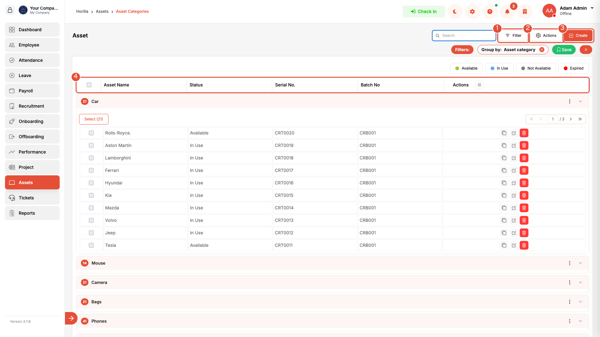
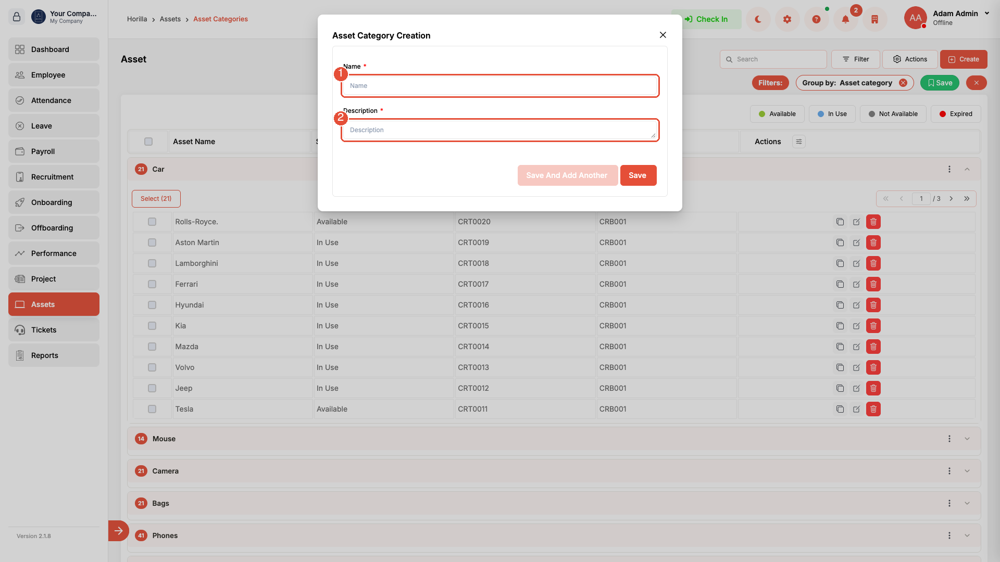

# **Assets**

The asset list shows every asset, grouped by category. Open it from **Assets → Assets**. The page is headed **Asset**.

1. **Filter** opens a panel with **Asset Name, Serial No., Status** (*In Use, Available, Not-Available*), **Category** and **Asset Batch Number**, plus **Advanced** **Purchase Date** and **Purchase Cost** and **Group By**.
2. **Actions** offers **Import** and **Export**.
3. **Create** opens a form for a new **asset category**.
4. The table: **Asset Name, Status, Serial No., Batch No** and **Actions**.

The list opens grouped by asset category, each group showing a count (for example **Car** 21, **Mouse** 14, **Phones** 41, **Headphones** 41). Click a group to open it; a group has its own page controls and a **⋮** menu. The coloured dots (**Available, In Use, Not Available, Expired**) filter by status. The demo holds 200 assets. Each asset row has icons for **Duplicate**, **Update** and **Delete**.

## **Create an asset category**

| Field | Required |
|---|---|
| **Name** | Yes |
| **Description** | Yes |

::: info Not tested
Creating a category, adding an individual asset, importing, duplicating and deleting were not exercised. Where an individual asset is added from was not identified, so it is not described.
:::
