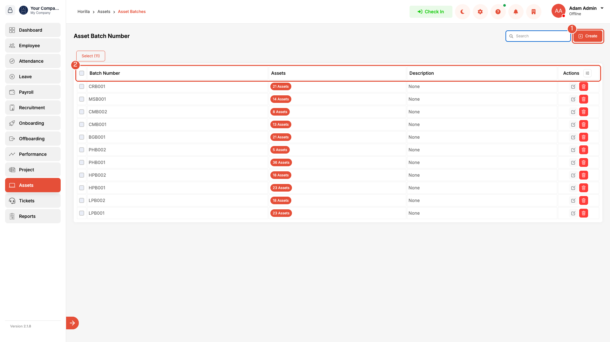

# **Asset Batches**

A batch number groups assets that were bought or received together. Open it from **Assets → Asset Batches**. The page is headed **Asset Batch Number**.

1. **Create** adds a batch.
2. The table: **Batch Number, Assets** (how many assets are in it), **Description** and **Actions** (**Update**, **Delete**). The demo has 11 batches, for example **CRB001** (21 assets) and **PHB001** (36 assets).

| Field | Required |
|---|---|
| **Batch Number** | Yes |
| **Description** | No |

The batch number also appears as **Batch No** on the [asset list](/hr/functional/v2.0/asset/assets).

::: info Not tested
Creating and deleting batches were not exercised.
:::
