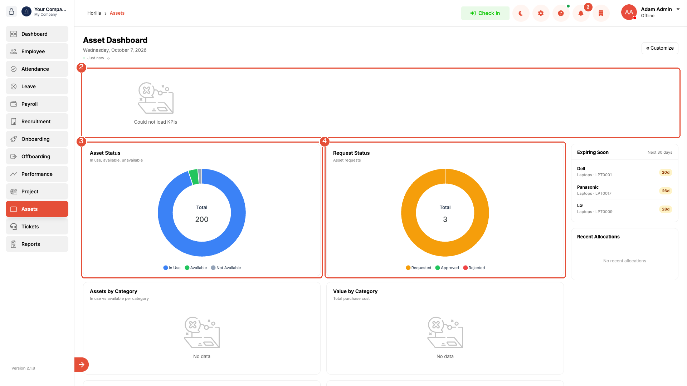
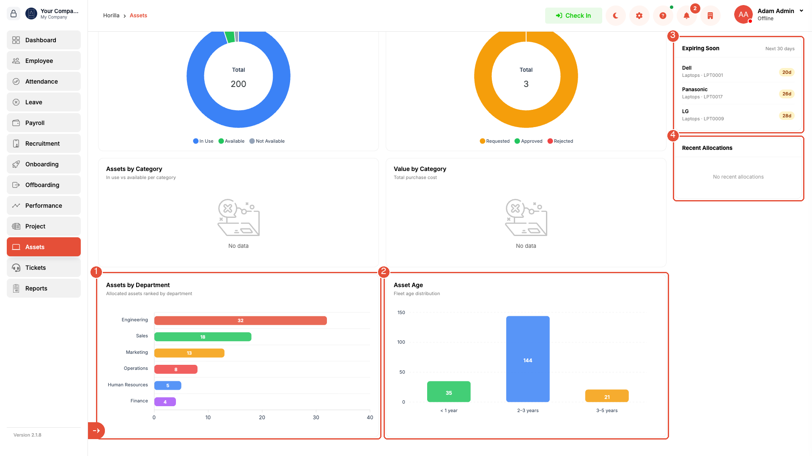

# **Asset Dashboard**

The Asset Dashboard summarises the asset inventory. Open it from **Assets → Dashboard**. **Customize** opens a panel to choose the widgets.

1. **Customize** opens the widget panel.
2. The row of summary cards. In the demo it reads **Could not load KPIs**, so the cards could not be shown.
3. **Asset Status** (*In use, available, unavailable*) splits the 200 assets into **In Use**, **Available** and **Not Available**.
4. **Request Status** (*Asset requests*) splits the 3 requests into **Requested**, **Approved** and **Rejected**.

1. **Assets by Department** (*Allocated assets ranked by department*).
2. **Asset Age** (*Fleet age distribution*) groups assets by age band, for example *< 1 year, 2-3 years, 3-5 years*.
3. **Expiring Soon** (*Next 30 days*) lists assets nearing their expiry with the days left, for example a **Dell** laptop in 20 days.
4. **Recent Allocations**, or **No recent allocations**.

Two further widgets, **Assets by Category** and **Value by Category** (*Total purchase cost*), read **No data** in the demo.

::: info Not tested
Where cards and charts lead was not checked. The summary-card row failed to load, so its contents are not described.
:::
