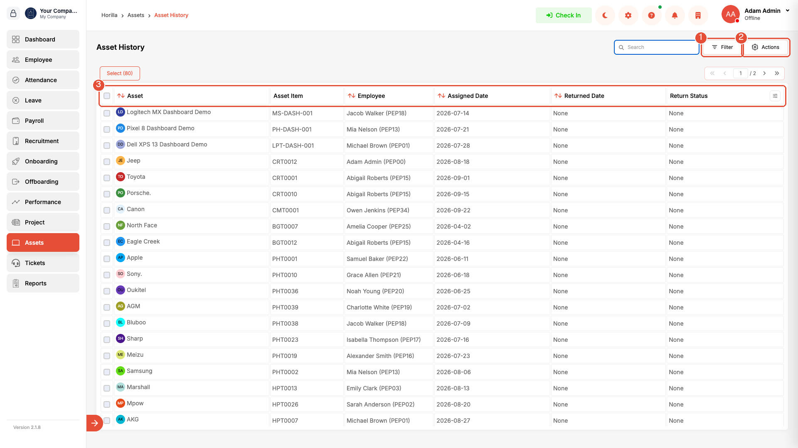

# **Asset History**

Asset History lists every allocation of an asset to an employee. Open it from **Assets → Asset History**.

1. **Filter** opens a panel with **Allocated User, Asset, Allocated By, Asset Allocated Date, Status** (*Minor damage, Major damage, Healthy*) and **Return Date**, plus **+ Add filter** and **Group By**.
2. **Actions** offers **Export**.
3. The table: **Asset, Asset Item, Employee, Assigned Date, Returned Date** and **Return Status**.

The demo holds 80 records over two pages, for example a **Jeep** (asset item *CRT0012*) assigned to *Adam Admin* on 2026-08-18. Records still out show **None** under **Returned Date** and **Return Status**. **Return Status** records the asset's condition on return.

::: info Not tested
Export was not used, and how a return is recorded was not observed because the allocation page did not load.
:::
