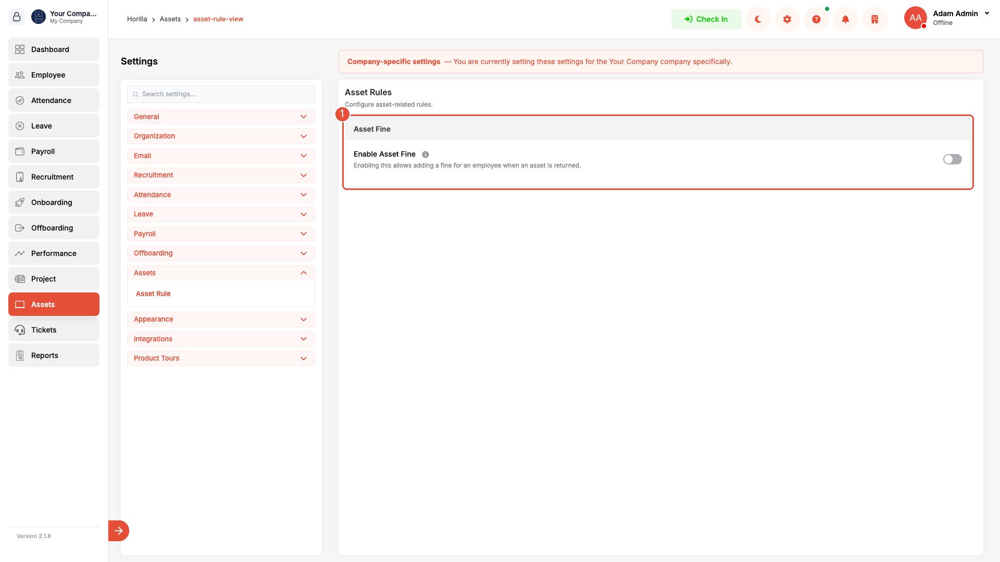

# **Asset Rule**

Open **Settings** with the gear icon, then **Assets → Asset Rule**. The page applies to the company currently selected and says so at the top. It is described as *Configure asset-related rules*.

1. **Asset Fine**, with **Enable Asset Fine**: *Enabling this allows adding a fine for an employee when an asset is returned.* **Off** in the demo.

::: info Not tested
The switch was not changed, so how an asset fine is entered or charged is not described.
:::
