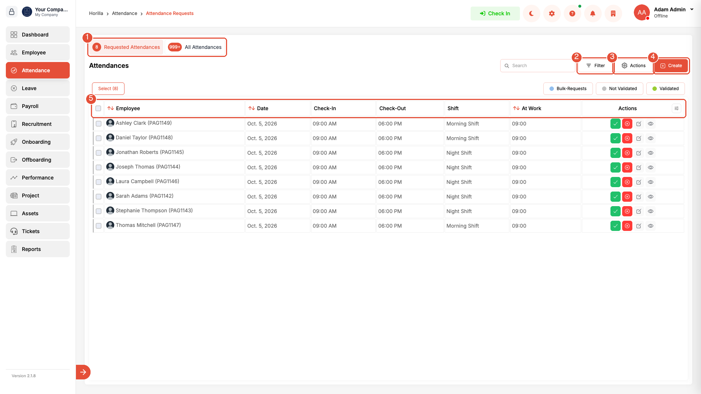
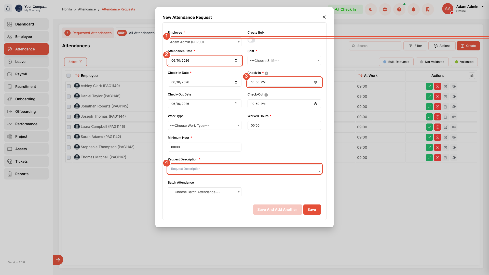

# **Attendance Requests**

An attendance request asks for an attendance record to be added or corrected, for example when someone forgot to check in. An administrator or manager approves or rejects it. Open it from **Attendance → Attendance Requests**.

## **The page**

1. Two tabs: **Requested Attendances** (the requests waiting, 8 in the demo) and **All Attendances**.
2. **Filter**: the same panel as on [Attendances](/hr/functional/v2.0/attendance/attendances).
3. **Actions** offers **Export**, **Bulk Approve** and **Bulk Reject** for the rows you tick.
4. **Create** raises a request.
5. The table: **Employee, Date, Check-In, Check-Out, Shift, At Work** and **Actions**. Each row has icons to **Approve**, **Reject**, **Edit** and **View**.

The coloured dots (**Not Validated**, **Validated**) filter by state. In the demo the eight waiting requests are for 5 October 2026, 09:00 AM to 06:00 PM.

## **Raise a request**

1. Click **Create**.

2. Fill it in:

| Field | Required | Notes |
|---|---|---|
| **Employee** | Yes | Who the request is for. |
| **Attendance Date** | Yes | Defaults to today. |
| **Shift** | Yes | The shift worked. |
| **Check-In Date**, **Check-In** | Yes | When they started. |
| **Check-Out Date**, **Check-Out** | No | When they finished. |
| **Work Type** | No | **Work From Office, Work From Home, Hybrid** or **Remote**. |
| **Worked Hours** | Yes | As *HH:MM*. |
| **Minimum Hour** | Yes | As *HH:MM*. |
| **Request Description** | Yes | Why the record needs adding or correcting. |
| **Batch Attendance** | No | **Dynamic create** is offered in the demo. |

3. Click **Save**.

::: info Not tested
Approving, rejecting and creating requests were not exercised, so the notifications and the resulting attendance record are not described.
:::
