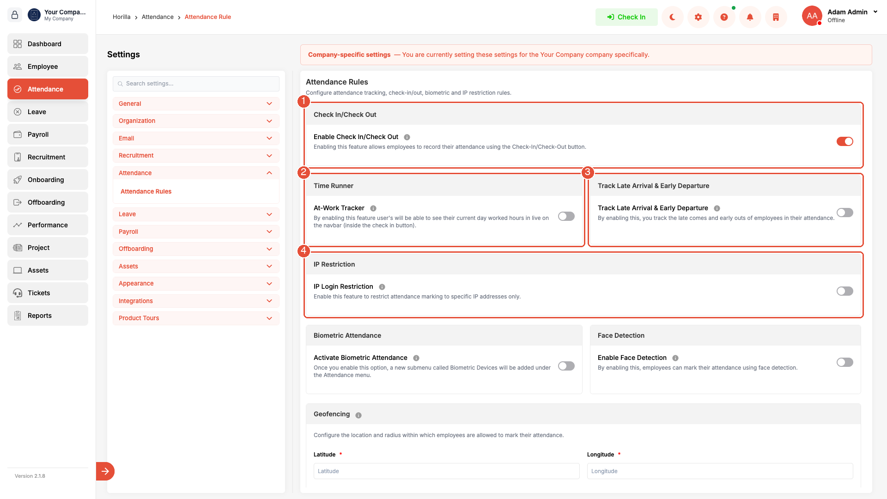
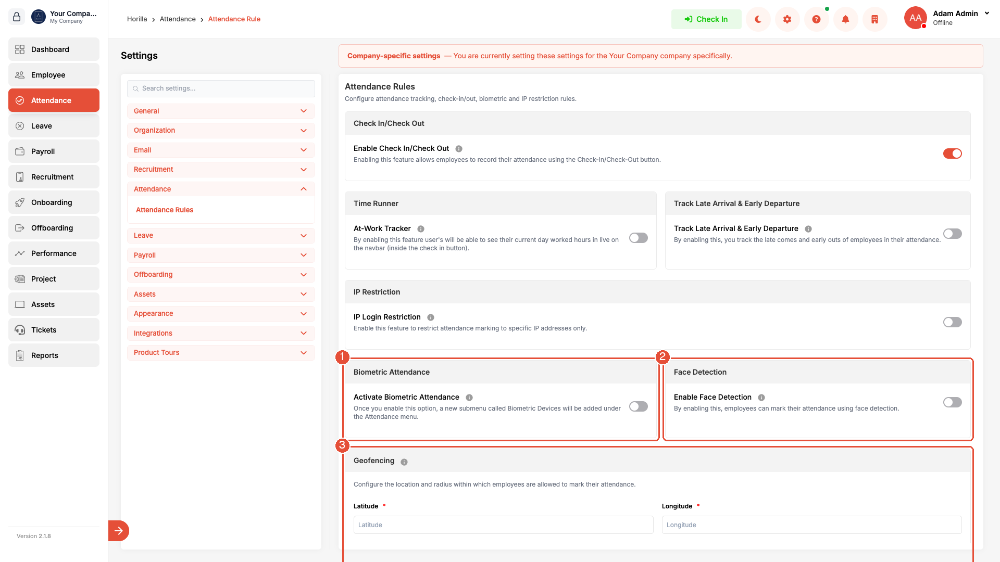

# **Attendance Rules**

Attendance Rules are the switches that decide how attendance is captured. Open **Settings** with the gear icon in the top bar, then **Attendance → Attendance Rules**. The page applies to the company currently selected and says so at the top. It is described as *Configure attendance tracking, check-in/out, biometric and IP restriction rules*.

1. **Check In/Check Out**, with **Enable Check In/Check Out**: *Enabling this feature allows employees to record their attendance using the Check-In/Check-Out button.* **On** in the demo.
2. **Time Runner**, with **At-Work Tracker**: *users will be able to see their current day worked hours in live on the navbar (inside the check in button).* **Off**.
3. **Track Late Arrival & Early Departure**: *you track the late comes and early outs of employees in their attendance.* **Off**. This feeds the [Late Arrival & Early Departure](/hr/functional/v2.0/attendance/late-early) page.
4. **IP Restriction**, with **IP Login Restriction**: *restrict attendance marking to specific IP addresses only.* **Off**.

1. **Biometric Attendance**, with **Activate Biometric Attendance**: *a new submenu called Biometric Devices will be added under the Attendance menu.* **Off**.
2. **Face Detection**, with **Enable Face Detection**: *employees can mark their attendance using face detection.* **Off**.
3. **Geofencing**: *Configure the location and radius within which employees are allowed to mark their attendance.* It has **Latitude**, **Longitude** and **Radius In Meters** fields, a **Start** switch (**off**) and a **Save** button.

::: info Not tested
No switch was changed, because each one changes attendance for the whole demo. Biometric devices, face detection and geofencing need hardware, camera and location set-up and are not walked through here.
:::
