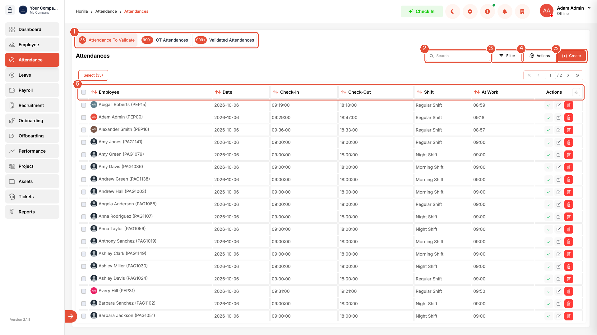
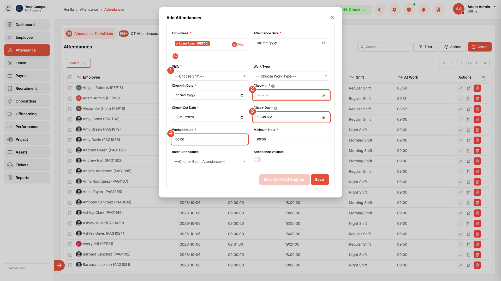

# **Attendances**

**Attendances** is the organisation-wide list of daily attendance records. An administrator uses it to validate records, add or correct them, and review overtime. Open it from **Attendance → Attendances**.

## **The page**

1. Three tabs: **Attendance To Validate** (35 in the demo), **OT Attendances** and **Validated Attendances**. The badge on each tab is a count (shown as **999+** when large).
2. **Search** box.
3. **Filter** opens a panel with **Name or Badge ID**, a **Work Info** section (**Employee, Department, Job Position, Reporting Manager, Company, Shift, Work Type, Work Location**) and an **Attendance** section (**Attendance Date, Min Hour, Validated?, OT Approved?**). **Advanced** adds **Attendance From**, **Attendance Till** and **At Work** limits, and you can **Group By**.
4. **Actions** offers **Validate**, **Import**, **Export** and **Delete** for the rows you tick.
5. **Create** adds an attendance record.
6. The table: **Employee, Date, Check-In, Check-Out, Shift, At Work** and **Actions**. Each row has icons to **Validate**, **Edit** and **Remove**.

## **Add an attendance record**

1. Click **Create**. The **Add Attendances** form opens.

2. Fill it in:

| Field | Required | Notes |
|---|---|---|
| **Employees** | Yes | One or more employees. The picker has a **Filter** to narrow the list. |
| **Attendance Date** | Yes | The working day the record belongs to. |
| **Shift** | Yes | **Regular Shift, Night Shift** or **Morning Shift** in the demo. |
| **Work Type** | No | **Work From Office, Work From Home, Hybrid** or **Remote**. |
| **Check-In Date**, **Check-In** | Yes | When the person started. |
| **Check-Out Date**, **Check-Out** | Yes | When they finished. |
| **Worked Hours** | Yes | Hours worked, as *HH:MM*. |
| **Minimum Hour** | Yes | The minimum hours expected, as *HH:MM*. |
| **Batch Attendance** | No | Attach the record to a batch. |
| **Attendance Validate** | | A switch. |

3. Click **Save**, or **Save And Add Another** to keep the form open for the next record.

## **Validate records**

A record in **Attendance To Validate** has not been confirmed yet. Use the **Validate** icon on a row to confirm one record, or tick several rows and choose **Actions → Validate**.

::: info Not tested
Saving a record, validating, importing and deleting change real attendance data and were not exercised on the demo. The overtime approval steps behind the **OT Attendances** tab are not described here.
:::
