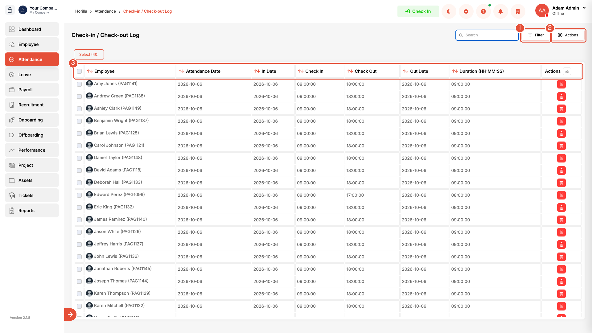

# **Check-in / Check-out Log**

The log lists every individual clock-in and clock-out, one entry per check-in. An employee who leaves and returns the same day has more than one entry in the log for a single attendance record. Open it from **Attendance → Check-in / Check-out Log**.

1. **Filter** opens a panel with **Name or Badge ID**, **Work Info** criteria (**Employee, Department, Shift, Reporting Manager, Company, Job Position, Work Type, Work Location**) and a **Check-in / Check-out Log** section (**Attendance Date, Out Date, In Date, Shift Day**, *Monday* to *Sunday*). **Advanced** adds **Attendance From** and **Attendance Till**, and you can **Group By**.
2. **Actions** offers **Import**, **Export** and **Delete** for the rows you tick.
3. The table: **Employee, Attendance Date, In Date, Check In, Check Out, Out Date, Duration (HH:MM:SS)** and **Actions** (**Remove**).

::: info Not tested
Importing, exporting and deleting entries were not exercised on the demo.
:::
