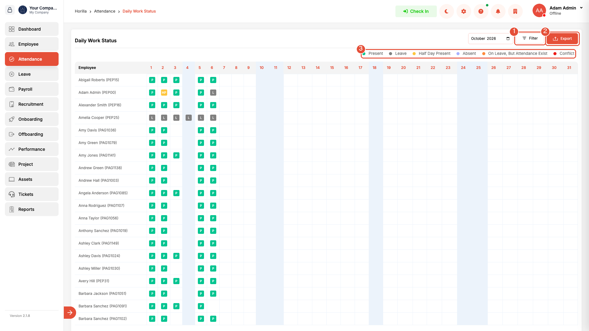

# **Daily Work Status**

**Daily Work Status** is a grid with one row per employee and one column per day of the month, showing each day's status. Open it from **Attendance → Daily Work Status**.

1. **Filter** opens a panel with **Name or Badge ID**, the **Work Info** criteria (**Employee, Company, Department, Shift, Employee Tag, Reporting Manager, Job Position, Work Type, Currently Working**), **Advanced** options (**Groups?, Permissions, Is Active?**) and a **Date Range** (**Start Date**, **End Date**).
2. **Export** downloads the grid.
3. The legend explains the day codes: **Present**, **Leave**, **Half Day Present**, **Absent**, **On Leave, But Attendance Exist** and **Conflict**.

In the demo the grid uses the short codes **P**, **HP** and **L** (matching **Present**, **Half Day Present** and **Leave** in the legend) against each employee for days 1 to 31.
