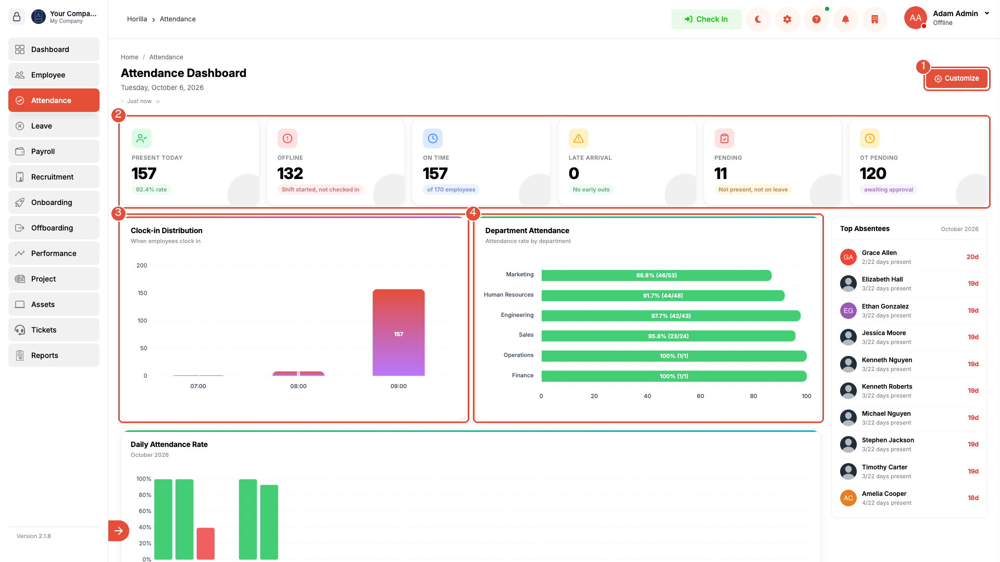
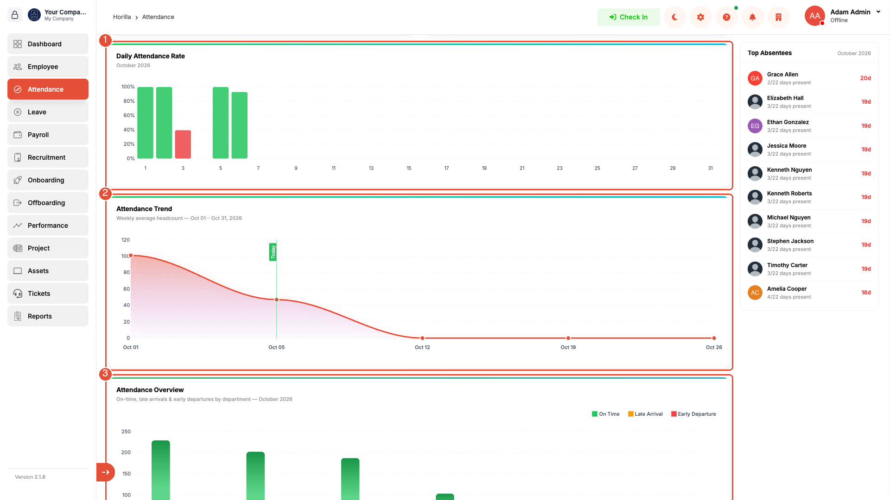
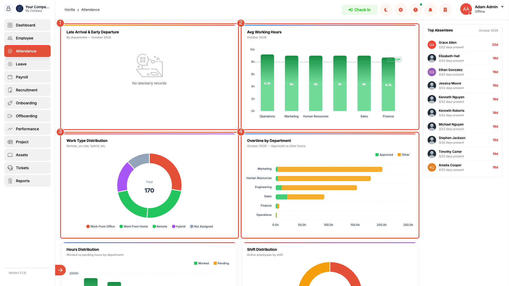
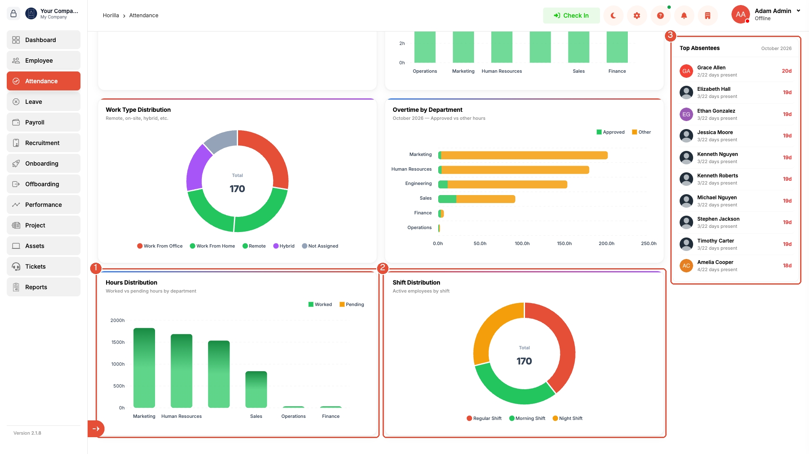

# **Attendance Dashboard**

The Attendance Dashboard shows how attendance is going across the company for the current month. Open it from **Attendance → Dashboard**. **Customize** (top right) opens a panel with **Reset to default** and **Save** for choosing which widgets appear.

## **Summary cards**

1. **Customize** opens the widget panel.
2. Six summary cards:

   | Card | Reads in the demo | Meaning shown on the card |
   |---|---|---|
   | **Present Today** | 157, *92.4% rate* | Employees counted as present today |
   | **Offline** | 132, *Shift started, not checked in* | Employees whose shift has started but who have not checked in |
   | **On Time** | 157, *of 170 employees* | Employees who arrived on time |
   | **Late Arrival** | 0, *No early outs* | Late arrivals today |
   | **Pending** | 11, *Not present, not on leave* | Employees who are neither present nor on leave |
   | **OT Pending** | 120, *awaiting approval* | Overtime waiting for approval |

3. **Clock-in Distribution** (*When employees clock in*) shows how many people clocked in in each hour, for example 157 at 09:00.
4. **Department Attendance** (*Attendance rate by department*) shows each department's rate with the numbers behind it, for example *86.8% (46/53)*.

## **Trends**

1. **Daily Attendance Rate** plots the rate for each day of the month.
2. **Attendance Trend** (*Weekly average headcount*) plots weekly average headcount across the month and marks **Today**.
3. **Attendance Overview** compares on-time arrivals, late arrivals and early departures for each department this month.
4. **Absenteeism Rate** (*Monthly trend, last 6 months*) shows the absenteeism percentage per month.

## **Hours and work patterns**

1. **Late Arrival & Early Departure** (*By department*) charts late and early records, or reads **No late/early records**.
2. **Avg Working Hours** shows each department's average working hours against an **8h target** line.
3. **Work Type Distribution** shows how the 170 employees split across **Work From Office, Work From Home, Remote, Hybrid** and **Not Assigned**.
4. **Overtime by Department** compares **Approved** overtime hours with **Other** hours.

## **Distribution and absentees**

1. **Hours Distribution** compares **Worked** and **Pending** hours by department.
2. **Shift Distribution** shows active employees by shift (**Regular Shift, Morning Shift, Night Shift**).
3. **Top Absentees** ranks employees by days absent this month, showing days present out of the working days so far (for example *2/22 days present*) and the days absent (*20d*).

::: info Not tested
Where clicking a card or chart leads was not checked. The card meanings above are the captions the dashboard shows, not formulas.
:::
