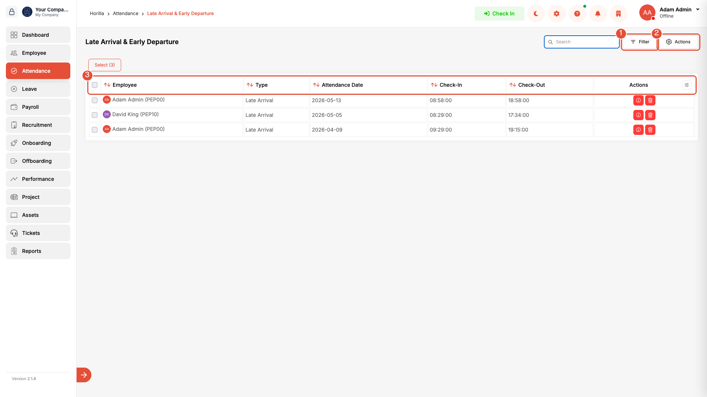

# **Late Arrival & Early Departure**

This page lists attendance records flagged as a late arrival or an early departure. Open it from **Attendance → Late Arrival & Early Departure**.

1. **Filter** opens a panel with **Name or Badge ID**, **Work Info** criteria, and **Type** (**Late Arrival** or **Early Departure**), plus **Attendance Date, Min Hour, Validated?** and **OT Approved?**. **Advanced** adds **Attendance From** and **Attendance Till**.
2. **Actions** offers **Export** and **Delete**.
3. The table: **Employee, Type, Attendance Date, Check-In, Check-Out** and **Actions**.

The demo has three records, all late arrivals dated April and May 2026.

::: warning Switch it on first
Flagging is controlled by **Track Late Arrival & Early Departure** in [Attendance Rules](/hr/functional/v2.0/attendance/attendance-rules). In the demo that switch is off, this page holds only three older records, and the dashboard reads **No late/early records**.
:::

What counts as late or early is also affected by the grace time in [Time Policies](/hr/functional/v2.0/attendance/time-policies).
