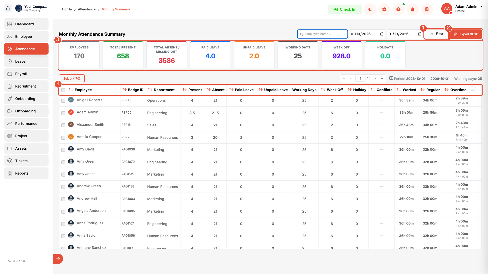

# **Monthly Summary**

The Monthly Summary gives each employee's attendance totals for a month. Open it from **Attendance → Monthly Summary**.

1. **Filter** opens a panel with **Name or Badge ID** and **Work Info** criteria (**Employee, Department, Job Position, Shift, Work Type, Company, Reporting Manager, Employee Tag**).
2. **Export XLSX** downloads the summary as a spreadsheet.
3. The totals strip for everyone shown: **Employees** (170), **Total Present** (658), **Total Absent / Missing Out** (3586), **Paid Leave** (4.0), **Unpaid Leave** (2.0), **Working Days** (25), **Week Off** (928.0) and **Holidays** (0.0).
4. The table, headed with the period (**2026-10-01 to 2026-10-31**, 25 working days): **Employee, Badge ID, Department, Present, Absent, Paid Leave, Unpaid Leave, Working Days, Week Off, Holiday, Conflicts, Worked, Regular** and **Overtime**. The list runs over several pages.

::: tip Reading the current month
In the demo, **Present** and **Absent** add up to the month's working days (for example 4 + 21 = 25), so the days of the month that have not happened yet appear under **Absent**. Read a month in progress with that in mind.
:::
