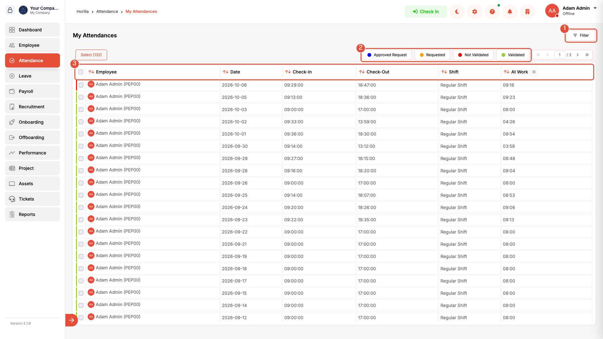

# **My Attendances**

**My Attendances** lists your own attendance records. Open it from **Attendance → My Attendances**.

1. **Filter** opens a panel with **Attendance Date**, **Min Hour**, **Validated?**, **OT Approved?**, **Requested?** and **Approved Request?** (each *Any, Yes* or *No*). **Advanced** adds **Attendance From**, **Attendance Till** and **At Work** greater-or-equal and lesser-or-equal limits, and you can **Group By**.
2. The coloured dots (**Approved Request, Requested, Not Validated, Validated**) filter the list by the state of each record.
3. The table shows **Employee, Date, Check-In, Check-Out, Shift** and **At Work** (the hours worked, for example *09:18*).

The page has a **Select** control for ticking rows but no **Create** button: to correct or add a record, raise an [attendance request](/hr/functional/v2.0/attendance/attendance-requests).

In the demo the administrator has 132 records over three pages, one for each working day.
