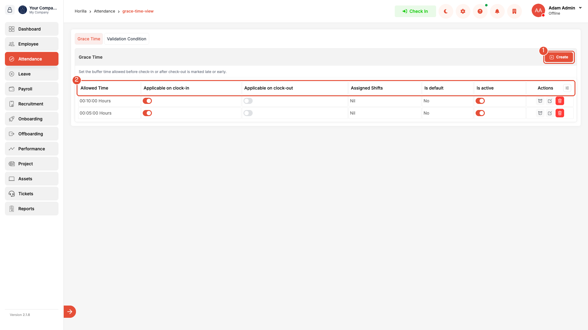
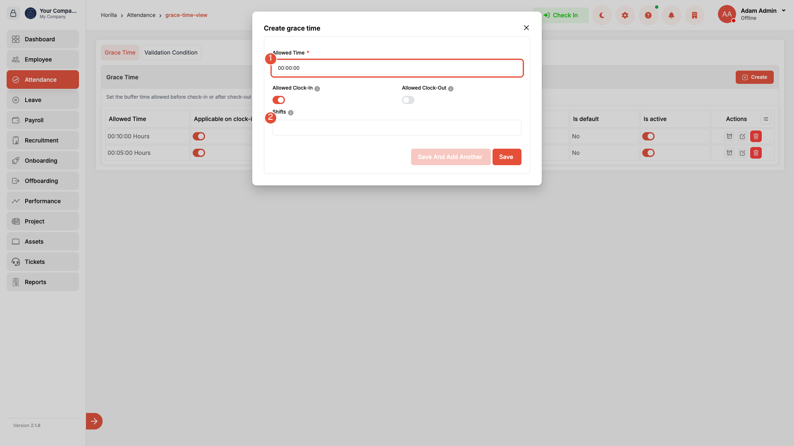
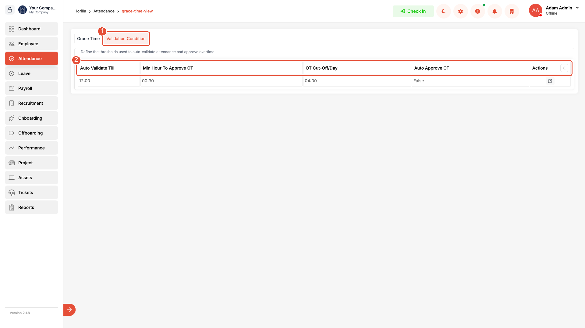

# **Time Policies**

Time Policies holds the two sets of thresholds that shape attendance records. Open it from **Attendance → Time Policies**. It has two tabs: **Grace Time** and **Validation Condition**.

## **Grace Time**

Grace time is the buffer allowed before a check-in, or after a check-out, is marked late or early. The page describes it as *Set the buffer time allowed before check-in or after check-out is marked late or early.*

1. **Create** adds a grace time.
2. The table: **Allowed Time, Applicable on clock-in, Applicable on clock-out, Assigned Shifts, Is default, Is active** and **Actions**. The demo has two grace times, **00:10:00 Hours** and **00:05:00 Hours**, neither assigned to a shift yet (**Nil**) nor marked default.

Each row has **Assign shift**, **Edit** and **Remove**.

To create one:

| Field | Required | Notes |
|---|---|---|
| **Allowed Time** | Yes | The buffer, as *HH:MM:SS*. |
| **Shifts** | No | One or more shifts the grace time applies to. |

The form also has switches for whether it applies on clock-in, on clock-out, whether it is the default, and whether it is active.

## **Validation Condition**

This tab defines *the thresholds used to auto-validate attendance and approve overtime*. The table has **Auto Validate Till, Min Hour To Approve OT, OT Cut-Off/Day, Auto Approve OT** and **Actions**. The demo holds one row: **12:00**, **00:30**, **04:00**, and **Auto Approve OT** set to **False**.

::: info Not tested
Saving or editing a time policy was not exercised, since it changes how every employee's record is judged. The exact effect of each threshold on a record is not described here beyond its name.
:::
