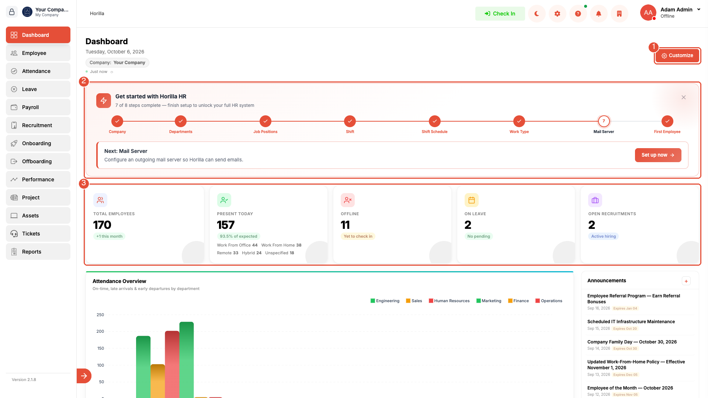
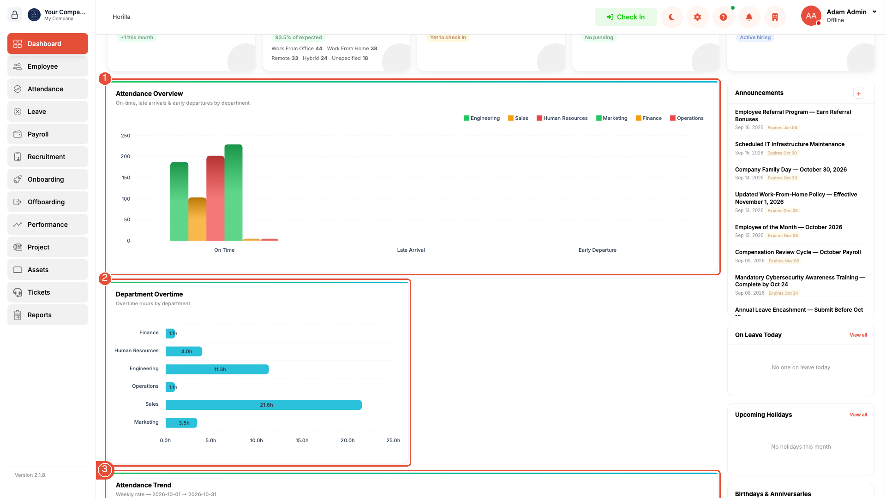
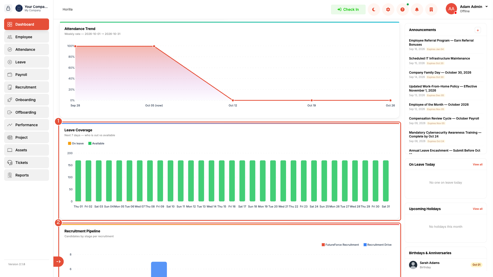
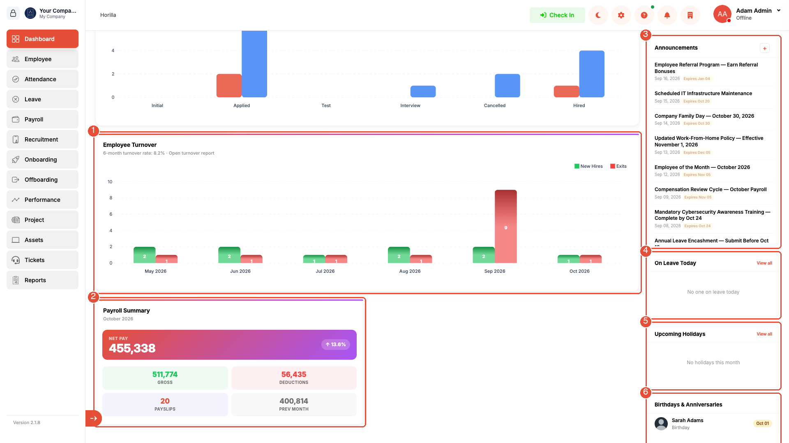
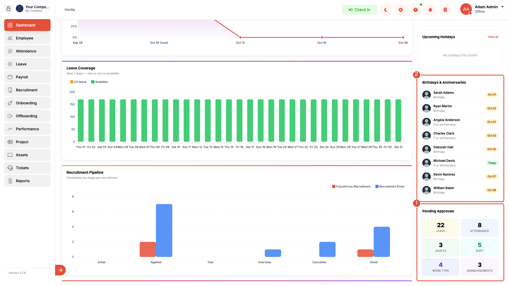
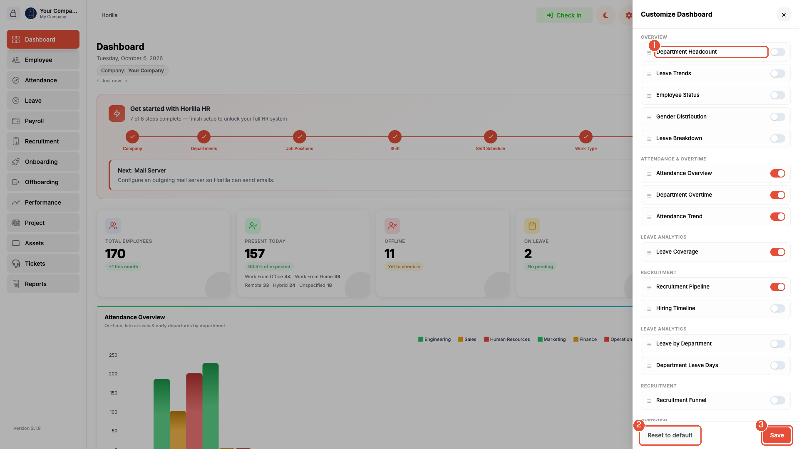

# **Dashboard**

The dashboard is the first page after you sign in. It gives an administrator a company-wide picture in one place: headcount, today's attendance, leave, hiring, payroll, announcements, and the requests waiting for a decision. Open it any time from **Dashboard** at the top of the sidebar.

::: info Scope
This chapter describes the dashboard an administrator sees. The dashboard has a different personal version for employees (**Employee → My Dashboard**); that page is not covered in this edition.
:::

## **The page at a glance**

1. **Customize** opens a panel where you choose which widgets are shown (see [Customizing the dashboard](#customizing-the-dashboard)).
2. **Get started with Horilla HR** is the setup checklist (see [The setup checklist](#the-setup-checklist)).
3. The five **summary cards**: Total Employees, Present Today, Offline, On Leave, Open Recruitments.

Under the title you also see today's date and **Company: Your Company**, which is the company currently selected in the top bar. A small freshness note (**Just now**) sits beside it.

## **The setup checklist**

The **Get started with Horilla HR** banner shows how far the basic setup of a new installation has progressed. In the demo it reads **7 of 8 steps complete**.

The eight steps, in order, and where each one takes you when clicked:

| Step | Opens |
|---|---|
| Company | Settings → **Company** |
| Departments | Settings → **Departments** |
| Job Positions | Settings → **Job Positions** |
| Shift | Settings → **Employee Shift** |
| Shift Schedule | Settings → **Employee Shift Schedule** |
| Work Type | Settings → **Work Type** |
| Mail Server | Settings → **Mail Server** (listed as **Email Servers** in the Settings menu) |
| First Employee | **Add New Employee** |

Completed steps are ticked. The step that is still open is marked and explained underneath. In the demo this reads **Next: Mail Server. Configure an outgoing mail server so Horilla can send emails.** with a **Set up now** button that opens **Mail Server**. The **×** at the right of the banner dismisses the checklist.

Each step's circle is a link, so you can jump straight to the setting from the banner.

## **Summary cards**

Each card is a shortcut: clicking it opens the matching list already filtered.

| Card | Shows | Click opens |
|---|---|---|
| **Total Employees** | Active employees, and how many joined **this month** (170, +1 this month in the demo) | **Employees** list, active employees only |
| **Present Today** | Employees counted as present today (157, **93.5% of expected** in the demo), with a breakdown by work type: Work From Office, Work From Home, Remote, Hybrid, Unspecified | **Employees** list filtered to people present today |
| **Offline** | Employees who have not checked in yet (11, **Yet to check in**) | **Employees** list filtered to people not present today |
| **On Leave** | Employees on approved leave today (2) | **Leave Requests** filtered to approved leave covering today |
| **Open Recruitments** | Recruitments that are still open (2, **Active hiring**) | **Job Openings** with closed recruitments hidden |

## **Charts**

1. **Attendance Overview** (*On-time, late arrivals & early departures by department*) compares, for each department, how many employees were on time, arrived late or left early. Each department has its own colour.
2. **Department Overtime** (*Overtime hours by department*) shows the overtime hours recorded per department.
3. **Attendance Trend** (*Weekly rate*) plots the attendance rate week by week across the current month. The page marks the current week with **now**.

1. **Leave Coverage** shows, for each day, how many employees are on leave and how many are available.
2. **Recruitment Pipeline** (*Candidates by stage per recruitment*) shows, for each recruitment, how many candidates sit in each stage: **Initial, Applied, Test, Interview, Cancelled, Hired**.

1. **Employee Turnover** compares **New Hires** and **Exits** for each of the last six months and states the six-month turnover rate (8.2% in the demo). The **Open turnover report** link opens the standard report **Turnover (All Exits)** under **Reports → Standard Reports**.
2. **Payroll Summary** shows the current month's totals: **Net Pay**, **Gross**, **Deductions**, the number of **Payslips**, and **Prev Month** net pay for comparison, with the percentage change. Amounts appear without a currency symbol on this page.
3. **Announcements**: see below.

## **The right-hand panel**

The right side of the dashboard has its own scroll area:

- **Announcements** lists company announcements with the date posted and the date each one **Expires**. A **+** button sits next to the heading.
- **On Leave Today** names who is out today, or reads **No one on leave today**. **View all** opens **Leave Requests** filtered to approved leave for today.
- **Upcoming Holidays** lists holidays this month, or reads **No holidays this month**. **View all** opens **Public Holidays**.
- **Birthdays & Anniversaries** lists upcoming birthdays and work anniversaries, with the date, or **Today**.

1. **Pending Approvals** counts the requests waiting for a decision, by type. Each tile opens the matching list already filtered to requests still waiting:

   | Tile | Opens |
   |---|---|
   | **Leave** | **Leave Requests**, status *Requested* |
   | **Attendance** | **Attendance Requests**, requests not yet approved |
   | **Assets** | **Assets → Requests & Allocation**, asset requests with status *Requested* |
   | **Shift** | **Shift Requests** (under **Employee → Requests**), status *Requested* |
   | **Work Type** | **Work Type Requests** (under **Employee → Requests**), status *Requested* |
   | **Reimbursements** | **Payroll → Encashments & Reimbursements**, status *Requested* |

2. **Birthdays & Anniversaries** (above it in the panel).

Use **Pending Approvals** as your daily starting point: clear the counts here and the approval queues stay short.

## **Customizing the dashboard**

Click **Customize** to open the **Customize Dashboard** panel.

1. Each widget has an on/off switch, grouped by topic (**Overview, Attendance & Overtime, Leave Analytics, Recruitment** and more). The demo starts with Attendance Overview, Department Overtime, Attendance Trend, Leave Coverage and Recruitment Pipeline switched on, and others, such as **Department Headcount**, **Leave Trends**, **Employee Status**, **Gender Distribution**, **Leave Breakdown**, **Hiring Timeline**, **Leave by Department**, **Department Leave Days** and **Recruitment Funnel**, switched off.
2. **Reset to default** is offered to restore the default selection.
3. **Save** stores your choices.

Each row also has a grip (drag handle) icon at its left.

## **Related**

- [Getting started](/hr/functional/v2.0/getting-started) for the top bar and company switcher
