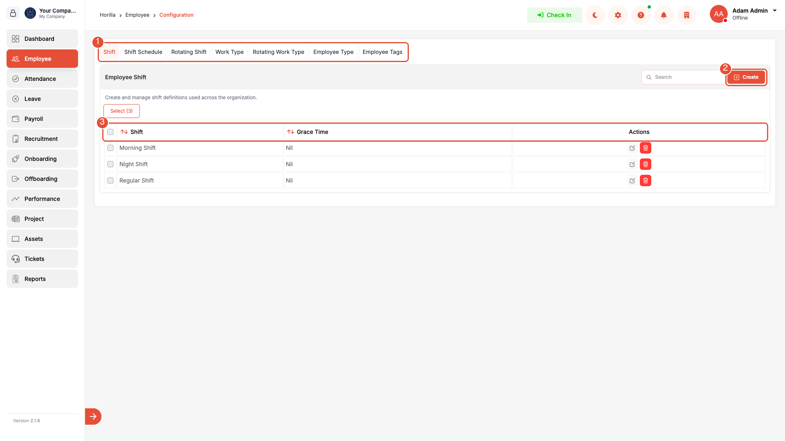
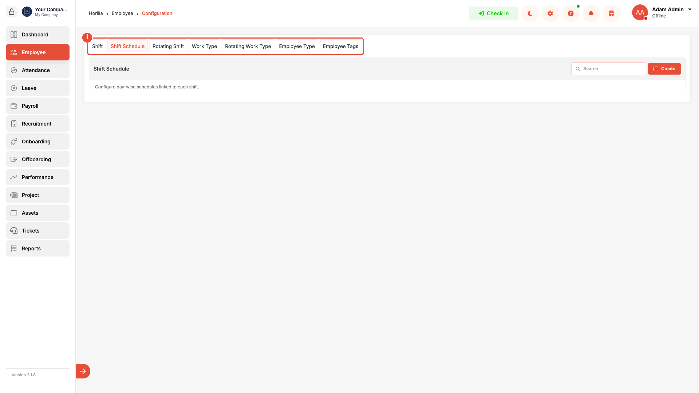

# **Employee Configuration**

**Employee → Configuration** holds the building blocks that employees are assigned to: shifts, shift schedules, rotating patterns, work types, employee types and tags. Open it from **Employee → Configuration**. It has seven tabs.

1. The tabs. The page remembers the one you used last.
2. **Create** adds an item on the current tab.
3. The table for the current tab, with **Edit** and **Delete** on each row.

| Tab | What it is | Columns | In the demo |
|---|---|---|---|
| **Shift** | *Create and manage shift definitions used across the organization* | **Shift, Grace Time** | 3 shifts |
| **Shift Schedule** | *Configure day-wise schedules linked to each shift* | **Day, Start Time, End Time, Minimum Working Hours, Auto Check Out** | 6 schedules |
| **Rotating Shift** | *Set up rotating shift patterns for employees* | **Title, Shift 1, Shift 2, Additional Shifts** | 2 patterns |
| **Work Type** | *Define work modes such as office, remote, or hybrid* | **Work Type, Company** | 4 work types |
| **Rotating Work Type** | *Set up rotating work type patterns for employees* | **Title, Work Type 1, Work Type 2, Additional Work Types** | 2 patterns |
| **Employee Type** | *Manage employee categories such as permanent or contract* | **Employee Type** | 3 types |
| **Employee Tags** | *Create tags used to group and filter employees* | **Title, Color** | 2 tags |

## **Forms**

| Tab | Fields |
|---|---|
| **Shift** | **Employee Shift** (required), **Grace Time** (chosen from the [grace times](/hr/functional/v2.0/attendance/time-policies)) |
| **Shift Schedule** | **Shift** (required), **Day** (required, one or more weekdays), **Start Time**, **End Time** and **Minimum Working Hours** (all required), **Automatic Check Out Time** |
| **Work Type** | **Work Type** (required) |
| **Employee Type** | **Employee Type** (required) |
| **Employee Tags** | **Title** and **Color** (both required) |

A shift is a named working pattern such as **Regular Shift**; its **Shift Schedule** rows give the start time, end time and minimum hours for each weekday. The shifts and work types set up here are the choices offered in [Requests](/hr/functional/v2.0/employee/requests) and [Work Schedules](/hr/functional/v2.0/employee/work-schedules), and are what a person's **Shift Information** and **Work Type** on the profile refer to.

::: info Not tested
Creating, editing or deleting an item was not exercised. Deleting a shift or work type that people already use was not tried, so its effect is not described.
:::
