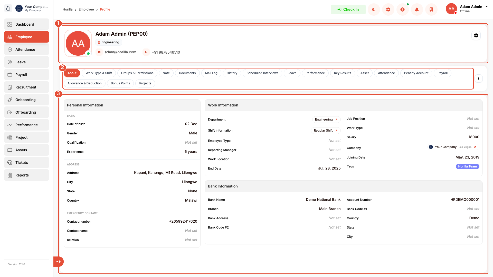
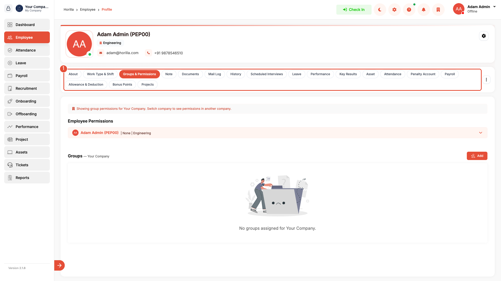
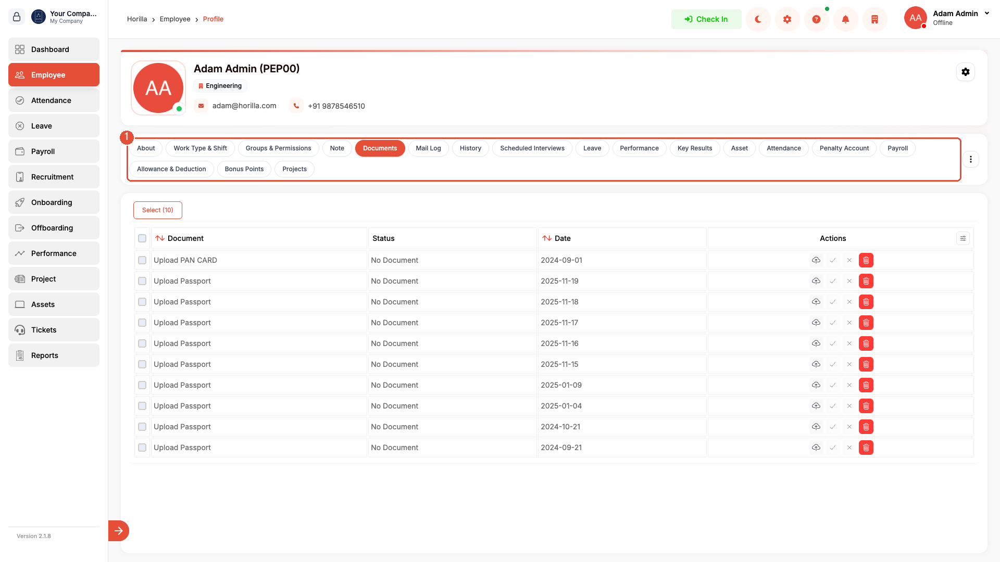

# **Employee Profile**

An employee's profile is their whole record in one place. Open it by clicking a person in [Employees](/hr/functional/v2.0/employee/employees), or open your own with **My Profile** in the profile menu at the top right.

## **Layout**

1. The header shows the photo, name and badge ID, department, email and phone. A gear icon sits at its right.
2. A row of **18 tabs**, listed below. The **⋮** menu beside them is **Manage Tabs**. The profile opens on the tab you used last.
3. The **About** tab, shown here, with **Personal Information**, **Work Information** and **Bank Information**.

### **About**

- **Personal Information**: **Basic** (date of birth, gender, qualification, experience), **Address** (address, city, state, country) and **Emergency Contact** (contact number, name, relation).
- **Work Information**: **Department, Shift Information, Employee Type, Reporting Manager, Work Location, End Date, Job Position, Work Type, Salary, Company, Joining Date** and **Tags**. Values that are empty read **Not set**.
- **Bank Information**: **Bank Name, Branch, Bank Address, Bank Code #1, Bank Code #2, Account Number, Country, State, City**.

## **The tabs**

| Tab | What it shows |
|---|---|
| **About** | Personal, work and bank information (above) |
| **Work Type & Shift** | The person's work type and shift requests, with **Create** |
| **Groups & Permissions** | A table of **Feature** against **Create, View, Edit, Delete, Export**, with the note *Permissions from this employee's groups in the selected company (plus any direct permissions)*. An **Add** button assigns groups. In the demo it reads *No groups assigned for Your Company* |
| **Note** | A free-text note on the employee |
| **Documents** | **Document, Status, Date, Actions**; the actions are **Upload Document, Approve, Reject, Delete** |
| **Mail Log** | **Subject, Date, Status** of emails sent to the person |
| **History** | *All changes made to this record* |
| **Scheduled Interviews** | Interviews scheduled for the person |
| **Leave** | **Leave Type, Start Date, End Date, Requested Days, Status**, with **Approve** and **Reject** |
| **Performance** | Performance records, or *No records available at the moment* |
| **Key Results** | Key results, or *No key results found for this objective* |
| **Asset** | Assets allocated to the person |
| **Attendance** | The person's attendance, with **Create** |
| **Penalty Account** | **Leave Type, Minus Days, Deducted From CFD, Penalty amount, Created Date, Penalty Type**, with **Delete** |
| **Payroll** | **Start date, End Date, Batch, Gross Pay, Deduction, Net Pay, Status**, with **Download** |
| **Allowance & Deduction** | The person's allowances and deductions, or a note that *This employee doesn't have an active contract* |
| **Bonus Points** | *Balance point(s) to redeem* |
| **Projects** | The person's projects, each with task filters (**To Do, In progress, Completed, Expired, Yesterday, Today, Tomorrow, This Week**) |

::: info Not tested
Editing a profile, uploading or approving documents, and changing groups were not exercised. Each tab mirrors a module covered elsewhere in this guide: for example the **Leave** tab corresponds to [Leave](/hr/functional/v2.0/leave) and **Attendance** to [Attendance](/hr/functional/v2.0/attendance).
:::
