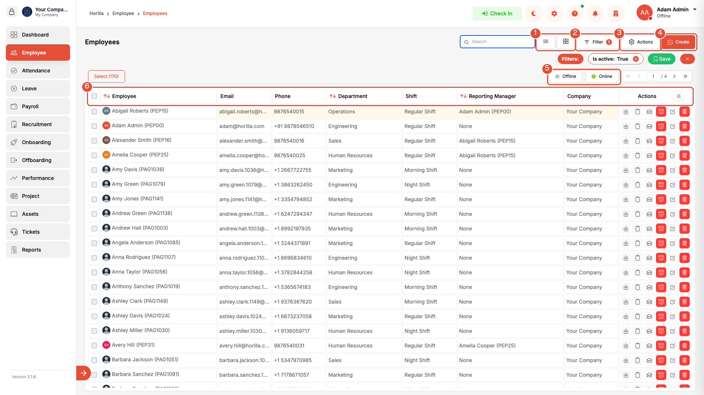
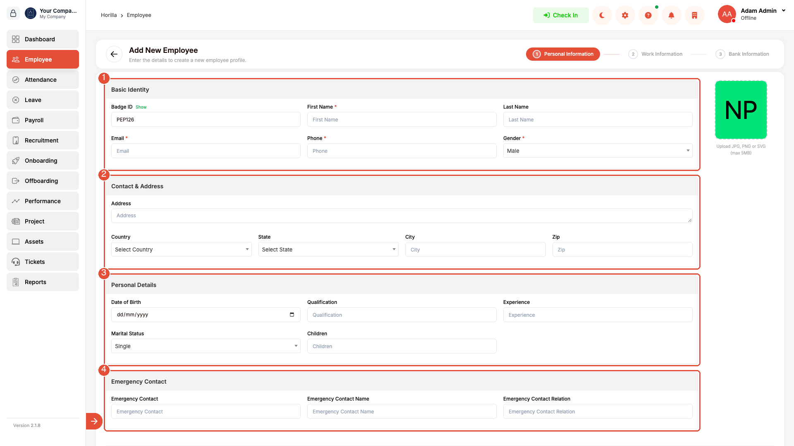

# **Employees**

**Employees** is the list of everyone in the organisation, and where an administrator adds new people. Open it from **Employee → Employees**.

## **The list**

1. The two icons switch between a **list** and a **card** layout.
2. **Filter** opens a panel (the badge shows how many filters are on). It holds **Name or Badge ID**; a **Work Info** section with **Email, Company, Reporting Manager, Department, Job Position, Shift, Employee Tag, Is Active?, Currently Working, Present On** and **Attendance Status** (*On Time, Late Arrival, Early Departure*); a **Groups & Permissions** section with **Groups** and **Permissions**; and **Advanced** with **+ Add filter**. You can also **Group By**.
3. **Actions** offers **Import, Export, Archive, Un-archive, Bulk mail, Reset Password, Send Invitation** and **Delete** for the rows you tick.
4. **Create** opens the **Add New Employee** page.
5. The **Offline** and **Online** dots filter the list by online state.
6. The table: **Employee** (with badge ID), **Email, Phone, Department, Shift, Reporting Manager, Company** and **Actions**.

The list opens with the filter **Is active: True** applied, so archived people are hidden. Click the **×** on that chip to see everyone, or **Save** to keep a filter. The demo has 170 active employees over four pages, and **Select (170)** selects them all for a bulk action.

Each row has icons for **Export Individual Data, Allocations, Send Mail, Archive, Edit** and **Remove**. Click a row to open the [employee profile](/hr/functional/v2.0/employee/employee-profile).

## **Add a new employee**

Click **Create**. The **Add New Employee** page opens with four sections.

| Section | Fields |
|---|---|
| 1. **Basic Identity** | **Badge ID**, **First Name** (required), **Last Name**, **Email** (required), **Phone** (required), **Gender** (required: *Male, Female, Other*), and a profile photo upload |
| 2. **Contact & Address** | **Address**, **Country**, **State**, **City**, **Zip** |
| 3. **Personal Details** | **Date of Birth**, **Qualification**, **Experience**, **Marital Status** (*Single, Married, Divorced*), **Children** |
| 4. **Emergency Contact** | **Emergency Contact**, **Emergency Contact Name**, **Emergency Contact Relation** |

Work details such as department, shift and reporting manager are not asked here; they appear on the profile's **About** tab under **Work Information**.

## **Archive, delete and the active filter**

The **Actions** menu keeps these separate: **Archive** and **Un-archive**, **Delete**, and the sign-in related actions **Reset Password** and **Send Invitation**. Because the list opens with **Is active: True**, archived people are the ones you will not see until you remove that filter.

::: info Not tested
Saving a new employee, archiving, deleting, importing, bulk mail, sending invitations and resetting passwords change real records or send messages, and were not exercised. What each does beyond its name is not described here.
:::
