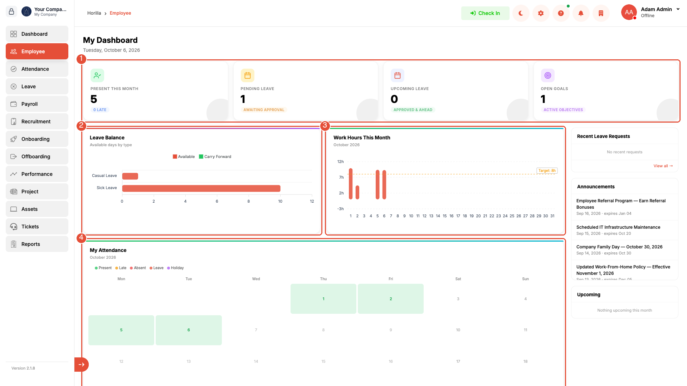

# **My Dashboard**

**My Dashboard** is the personal dashboard of whoever is signed in: their own attendance, leave, payslips and goals. Open it from **Employee → My Dashboard**. It is the screen an employee uses day to day; here it is shown for the demo's administrator.

1. Four summary cards:

   | Card | Reads in the demo | Caption |
   |---|---|---|
   | **Present This Month** | 5 | *0 late* |
   | **Pending Leave** | 1 | *Awaiting approval* |
   | **Upcoming Leave** | 0 | *Approved & ahead* |
   | **Open Goals** | 1 | *Active objectives* |

2. **Leave Balance** (*Available days by type*) charts the available and carried-forward days for each leave type you hold, here **Casual Leave** and **Sick Leave**.
3. **Work Hours This Month** plots your worked hours for each day of the month against a **Target: 8h** line.
4. **My Attendance** is a month calendar with a legend (**Present, Late, Absent, Leave, Holiday**) and a count for each.

Further down the page:

- **Recent Payslips** (*Net pay vs gross pay, click to view*) charts the last six months.
- **My Goals** (*Active objectives and progress*), or **No active goals**.
- **Recent Leave Requests**, or **No recent requests**, with a **View all** link.
- **Announcements** with the date posted and the expiry date.
- **Upcoming**, or **Nothing upcoming this month**.

The company-wide view is the [main dashboard](/hr/functional/v2.0/dashboard).
