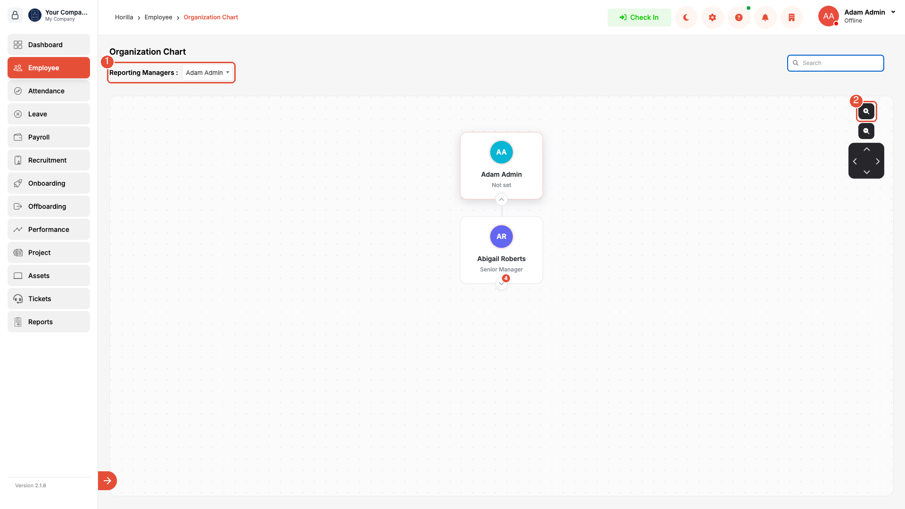

# **Organization Chart**

The Organization Chart draws the reporting structure as a tree. Open it from **Employee → Organization Chart**.

1. **Reporting Managers** is a drop-down that shows whose reporting tree is drawn. In the demo it starts on **Adam Admin**; the other choices are the managers *Abigail Roberts, Alexander Smith, Amelia Cooper, Christopher Miller* and *Henry Lewis*.
2. The **zoom** buttons enlarge or shrink the chart, and the arrow pad pans it up, down, left and right.

The chart shows each person as a card with their photo or initials, their name and their job title (**Not set** when the person has no job position, as for **Adam Admin**). A card with people reporting to it has an arrow with a count, for example **4** under **Abigail Roberts**, which opens the next level down. A **Search** box sits at the top right.

The tree follows each employee's **Reporting Manager**, which is set under **Work Information** on the [profile](/hr/functional/v2.0/employee/employee-profile).

::: info Not tested
Expanding cards, searching and switching the manager were not exercised beyond opening the page.
:::
