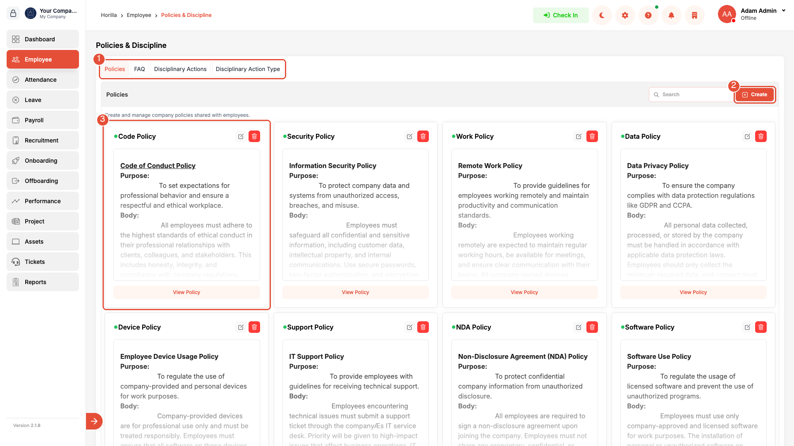
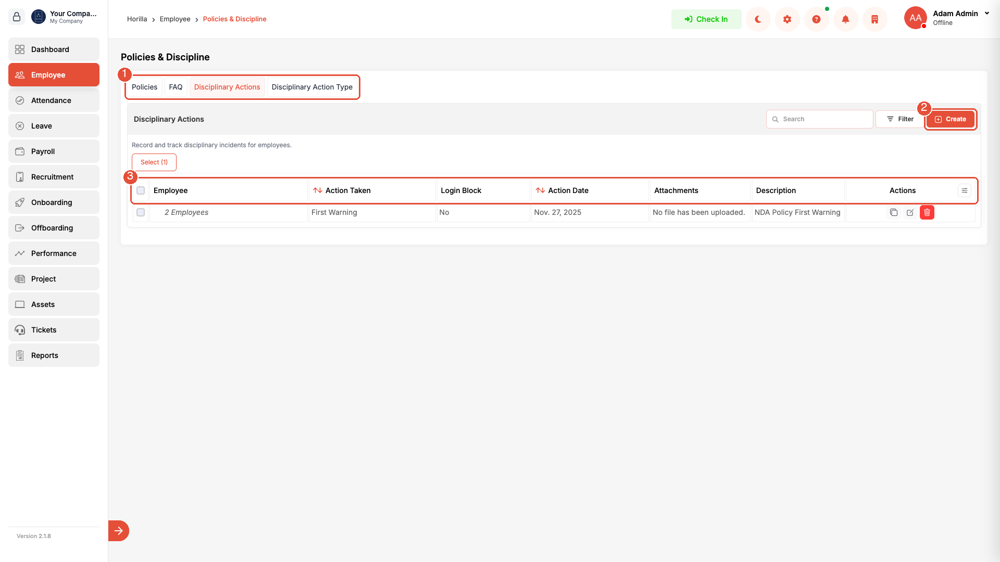
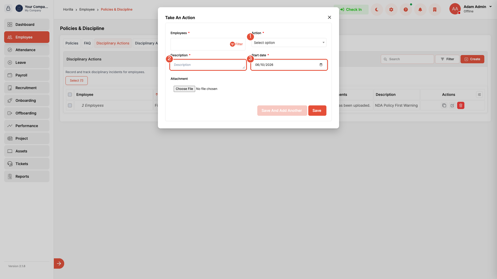

# **Policies & Discipline**

This page holds company policies, FAQs, and the record of disciplinary actions. Open it from **Employee → Policies & Discipline**. It has four tabs: **Policies, FAQ, Disciplinary Actions** and **Disciplinary Action Type**.

## **Policies**

1. The tabs.
2. **Create** adds a policy. The page describes itself as *Create and manage company policies shared with employees.*
3. Each policy is a card with a category, a title, a **Purpose** and a **Body** excerpt, and a **View Policy** link. The demo has policies such as **Code of Conduct Policy** and **Information Security Policy**.

To add a policy, click **Create**. The form has **Title** (required), **Body** (a rich-text editor that accepts links, images and video), **Employees**, **Department** and **Job Position** to say who the policy applies to, and **Attachements** for files.

## **FAQ**

Frequently asked questions grouped by topic, for example *Guidance for access, devices, and technical support* and *Guidance for benefits, payslips, and payroll support*. The tab has **Actions** and **Create**.

## **Disciplinary Actions**

*Record and track disciplinary incidents for employees.* The table lists **Employee, Action Taken, Login Block, Action Date, Attachments, Description** and **Actions** (**Duplicate, Edit, Delete**). The demo holds one record.

| Field | Required | Notes |
|---|---|---|
| **Employees** | | One or more people. |
| **Action** | Yes | *First Warning, Last Warning, One Month Suspension, Dismissal*, or **Dynamic create** for a new type. |
| **Description** | Yes | What happened. |
| **Unit in** | | **Days** or **Hours**, for a suspension period. |
| **Days** / **Hours** | | The length, depending on the unit. |
| **Start date** | Yes | When the action starts. |
| **Attachment** | | A supporting file. |

## **Disciplinary Action Type**

*Define disciplinary action types used when recording employee incidents.* The table lists **Title, Type** and **Login Block**. The demo has four, such as **First Warning** and **Dismissal**. To add one, click **Create** and give a **Title** and an **Action Type** (*Warning, Suspension* or *Dismissal*).

::: info Not tested
Saving a policy or disciplinary action was not exercised. What **Login Block** does to the employee's sign-in was not tested, so it is described here only by its column name.
:::
