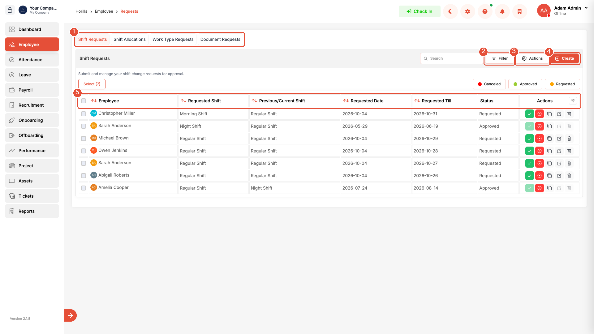
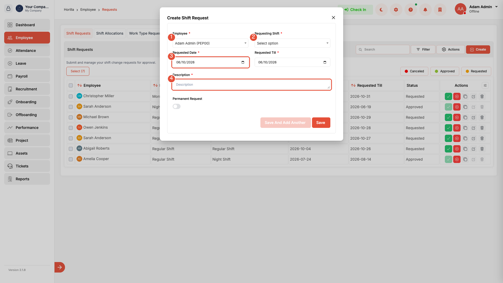
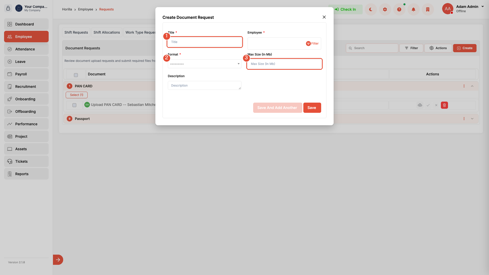

# **Requests**

**Requests** gathers the requests that change an employee's working arrangements. Open it from **Employee → Requests**. It has four tabs.

1. The tabs: **Shift Requests, Shift Allocations, Work Type Requests, Document Requests**.
2. **Filter** narrows the list.
3. **Actions** offers actions for the rows you tick.
4. **Create** raises a request.
5. The table (shown here for **Shift Requests**).

## **Shift Requests**

*Submit and manage your shift change requests for approval.* The table lists **Employee, Requested Shift, Previous/Current Shift, Requested Date, Requested Till, Status** and **Actions**. The status dots filter by *Requested, Approved* or *Canceled*. Each row has icons to **Approve, Reject, Duplicate, Edit** and **Remove**. The demo holds seven requests.

To raise one, click **Create**:

| Field | Required | Notes |
|---|---|---|
| **Employee** | Yes | Who the shift change is for. |
| **Requesting Shift** | Yes | *Regular Shift, Night Shift, Morning Shift*, or **Dynamic create** to add a shift on the spot. |
| **Requested Date** | Yes | The first day of the change. |
| **Requested Till** | No | The last day of the change. |
| **Description** | Yes | The reason. |

## **Shift Allocations**

*Requests from colleagues asking you to cover or take over their shifts.* In the demo the tab is empty (**No records available at the moment**).

## **Work Type Requests**

*Submit and manage requests to change your work type assignment.* The table has the same shape as shift requests: **Employee, Requested Work Type, Previous/current Work Type, Requested Date, Requested Till, Status, Actions**, with five requests in the demo. The form has **Employee**, **Requesting Work Type** (*Work From Office, Work From Home, Hybrid, Remote*, or **Dynamic create**), **Requested Date**, **Requested Till** and **Description**.

## **Document Requests**

*Review document upload requests and submit required files from HR.* The table lists **Document, Status, Date** and **Actions**.

| Field | Required | Notes |
|---|---|---|
| **Title** | Yes | What document is being asked for. |
| **Employee** | Yes | One or more people who must upload it. |
| **Format** | Yes | **Any, PDF, TXT, DOCX, XLSX, JPG, PNG** or **JPEG**. |
| **Max Size (In Mb)** | No | Upload size limit. |
| **Description** | No | Instructions. |

The uploaded files then appear on the person's **Documents** tab on their [profile](/hr/functional/v2.0/employee/employee-profile).

::: info Not tested
Creating, approving and rejecting requests change real assignments and were not exercised, so the effect of an approval on the employee's shift or work type is not shown. The Document Requests tab was empty in the demo.
:::
