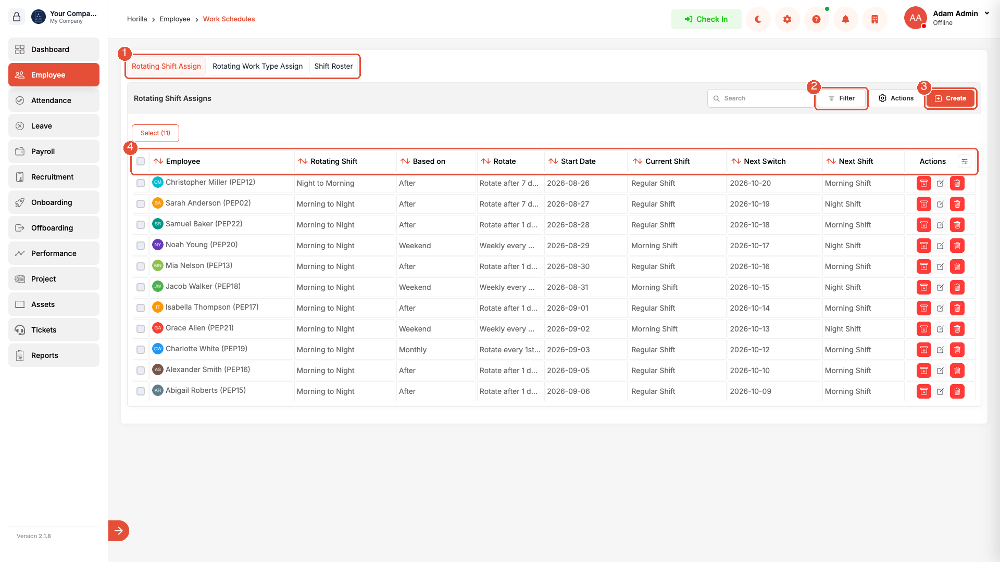
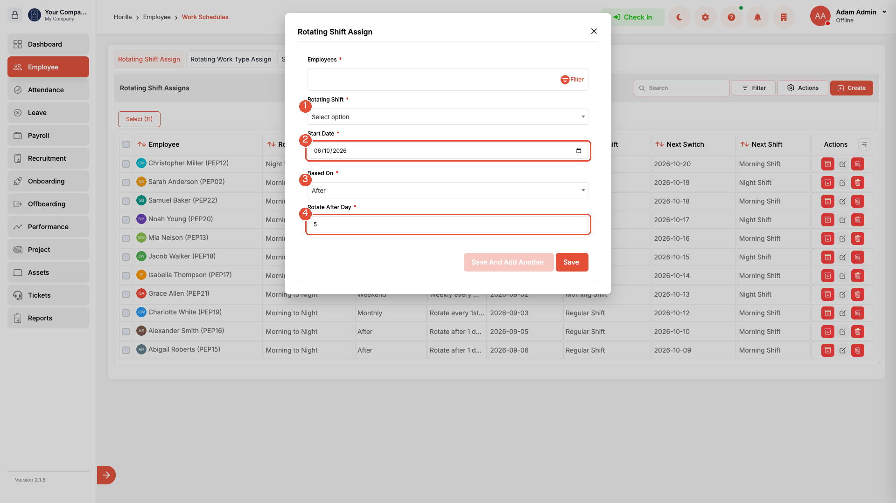
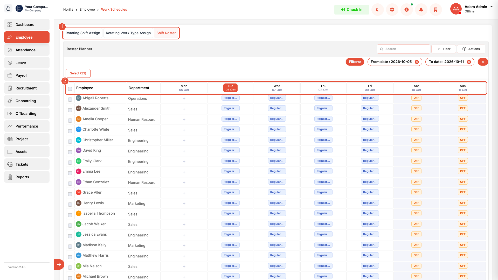

# **Work Schedules**

**Work Schedules** manages shifts and work types that change on a pattern, and shows who works which shift in a week. Open it from **Employee → Work Schedules**. It has three tabs: **Rotating Shift Assign, Rotating Work Type Assign** and **Shift Roster**.

1. The tabs.
2. **Filter** by **Name or Badge ID**, **Rotating Shift**, **Employee**, **Current Shift**, **Next Shift**, **Based On** (*After, Weekend, Monthly*), **Next Switch**, and **Work Info** criteria.
3. **Create** assigns a rotation.
4. The table for **Rotating Shift Assign**: **Employee, Rotating Shift, Based on, Rotate, Start Date, Current Shift, Next Switch, Next Shift, Actions**. Each row has **Archive, Edit** and **Remove**. The demo has 11 assignments, for example *Christopher Miller, Night to Morning, After, Rotate after 7 days, next switch 2026-10-20*.

## **Assign a rotating shift**

| Field | Required | Notes |
|---|---|---|
| **Employees** | | One or more people. |
| **Rotating Shift** | Yes | A pattern defined under [Employee Configuration](/hr/functional/v2.0/employee/configuration): *Morning to Night* or *Night to Morning* in the demo. |
| **Start Date** | Yes | When the pattern starts. |
| **Based On** | | **After**, **Weekend** or **Monthly**: how the switch is timed. |
| **Rotate After Day** | Yes | Number of days between switches. Defaults to 5. |
| **Rotate Every Weekend** | | The weekday to switch on, for weekend-based patterns. |
| **Rotate Every** | | A number, for monthly patterns. |

## **Rotating Work Type Assign**

The same idea for work types. The table is **Employee, Rotating Work Type, Based On, Rotate, Start Date, Current Work Type, Next Switch, Next Work Type, Actions**, with seven assignments in the demo. The form mirrors the one above with **Rotating Work Type** (*WFH to WFO*, *WFO to WFH*).

## **Shift Roster**

1. The tabs.
2. The **Roster Planner**: a grid with one row per employee (with their department) and one column per day, from the **From date** to the **To date** filter (here **Mon 05 Oct** to **Sun 11 Oct**). Today's column is highlighted.

Each cell shows the person's shift as a chip (for example **Regular...**). Weekend days show **OFF**, and a **+** appears in a cell with no shift assigned (here Monday, which has passed). The planner has its own **Search**, **Filter** and **Actions**, and a **Select** control for ticking rows.

::: info Not tested
Saving an assignment and archiving or removing one were not exercised. How the **Next Switch** date is worked out was not checked.
:::
