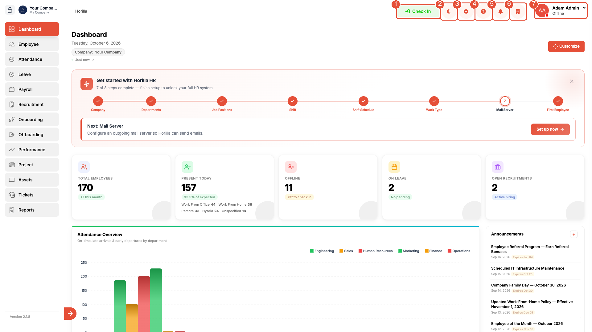
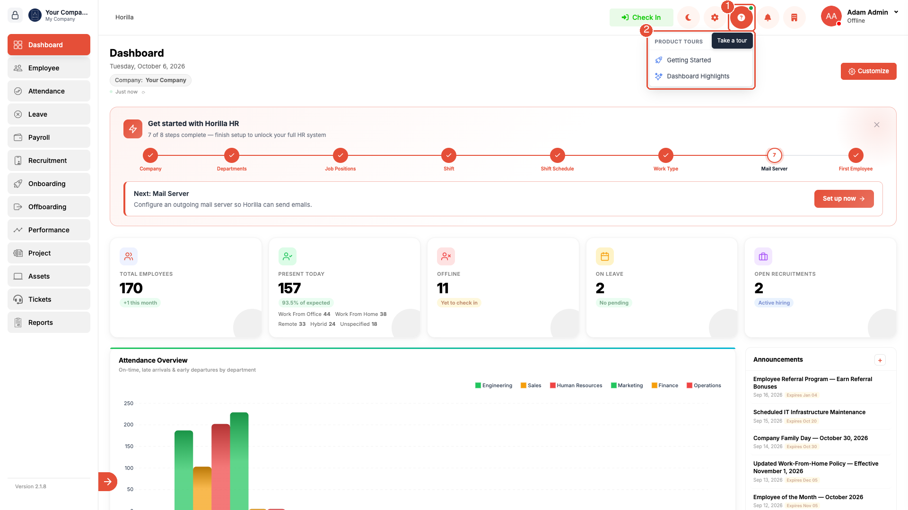
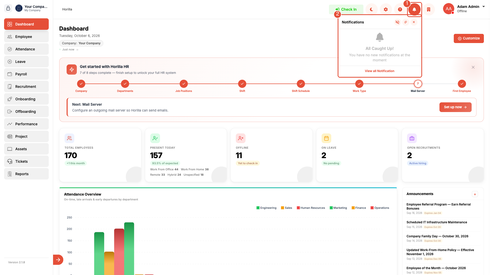
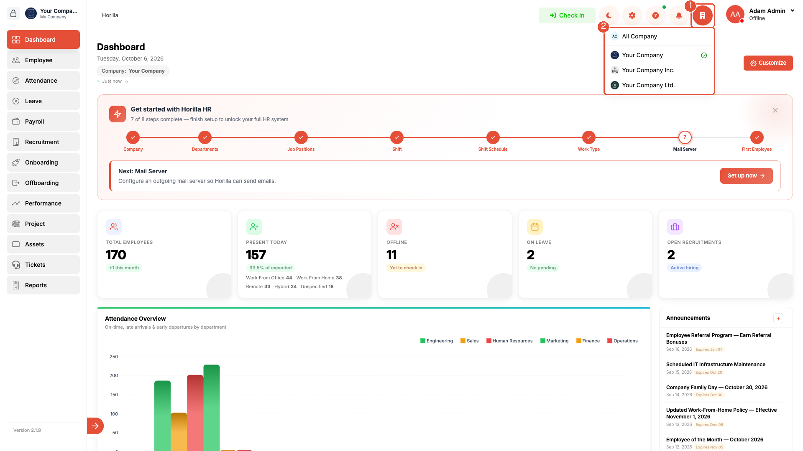
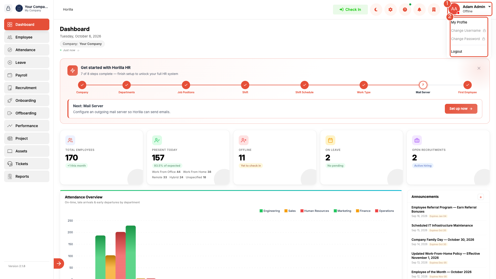

# **Getting Started**

This page covers signing in, finding your way around, and the controls in the top bar. Everything here is the same on every page of Horilla.

## **Signing in**

Open your Horilla address in a browser. The sign-in page asks for a **Username** and a **Password**, then **Sign In**.

- The sign-in page has no "forgot password" link.
- The public demo also shows a banner with demo credentials. That banner belongs to the demo.
- After a successful sign-in you land on the [Dashboard](/hr/functional/v2.0/dashboard).

::: tip First visit
The first time you open the dashboard, Horilla shows a short **Welcome to Horilla** tour. Press **Esc** to close it. You can reopen it any time from the top bar (see **Take a tour** below).
:::

## **The sidebar**

The sidebar on the left is the main way to move around. It lists one entry per module:

**Dashboard, Employee, Attendance, Leave, Payroll, Recruitment, Onboarding, Offboarding, Performance, Project, Assets, Tickets, Reports.**

Click a module to open its pages, for example **Leave** opens **Dashboard, My Leave Requests, Leave Requests** and so on. Which pages appear depends on your permissions.

At the top of the sidebar a lock icon pins it open or lets it collapse when the pointer leaves it. The bottom of the sidebar shows the Horilla version (for example **Version 2.1.8**), which is worth quoting when you contact support.

## **The top bar**

| # | Control | What it does |
|---|---|---|
| 1 | **Check In** | Records your check-in for attendance. Attendance is covered in its own chapter. |
| 2 | Moon / light icon | Switches between the light and dark appearance. Your choice is remembered. |
| 3 | Gear | Opens **Settings**, starting at **System Preferences**. |
| 4 | Help icon (**Take a tour**) | Opens **Product Tours**: **Getting Started** and **Dashboard Highlights**. |
| 5 | Bell | Opens your notifications. |
| 6 | Building icon | Switches company. |
| 7 | Your name | Opens the profile menu. |

### **Take a tour**

The panel lists the guided tours that are available: **Getting Started** and **Dashboard Highlights**. A tour that is open can be closed with **Esc**.

### **Notifications**

The bell opens your notifications. The **All** tab lists them; when there is nothing new it reads **All Caught Up! You have no new notifications at the moment**. The panel also offers **Clear All** and a **View all Notification** link.

### **Switching company**

One Horilla installation can hold several companies. The building icon lists them: in the demo they are **All Company, Your Company, Your Company Inc.** and **Your Company Ltd.** A tick marks the company you are working in, and the dashboard repeats it as **Company: Your Company** under the page title.

### **Your profile menu**

Click your name to open the menu:

- **My Profile** opens your own employee record.
- **Change Username** and **Change Password** are for changing your sign-in details. On the public demo both entries are greyed out with a lock icon.
- **Logout** ends your session.

## **My views and organisation views**

Many modules have two kinds of page. Pages named **My ...** (for example **My Attendances** and **My Leave Requests**) show your own records. The other pages (for example **Attendances** and **Leave Requests**) are for working with other people's records, so they are the ones an administrator or manager uses.
