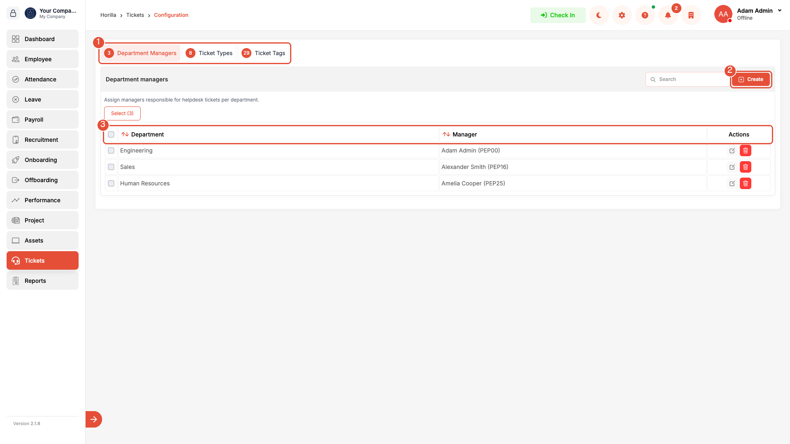
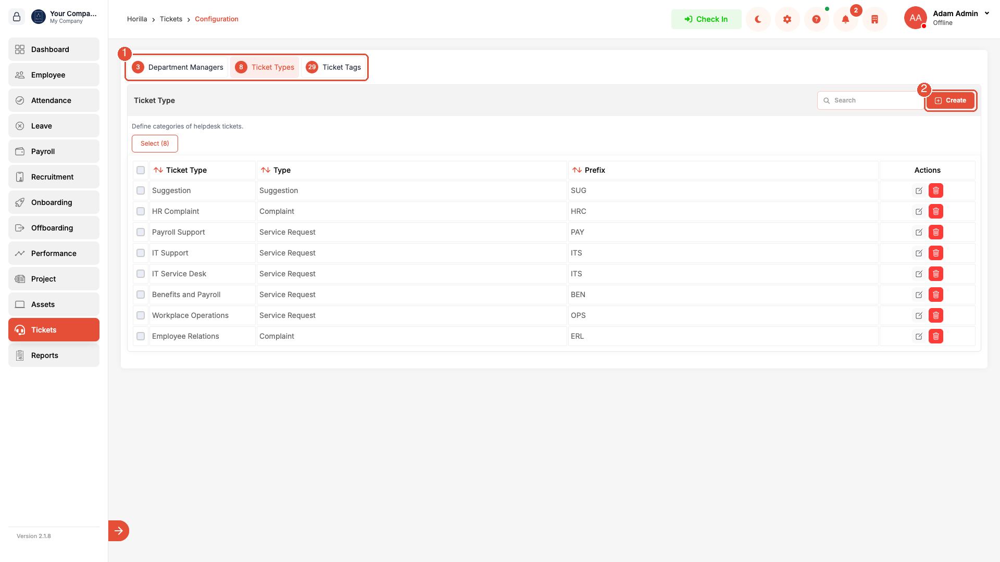

# **Helpdesk Configuration**

**Tickets → Configuration** holds the building blocks for tickets. It has three tabs.

1. The tabs, each with a count (3 department managers, 8 ticket types and 29 tags in the demo).
2. **Create** adds an item on the current tab.
3. The table for the current tab, with **Edit** and **Delete** on each row.

| Tab | What it is | Columns | Form |
|---|---|---|---|
| **Department Managers** | *Assign managers responsible for helpdesk tickets per department* | **Department, Manager** | **Department** and **Manager**, both required |
| **Ticket Types** | *Define categories of helpdesk tickets* | **Ticket Type, Type, Prefix** | **Title**, **Type** (*Suggestion, Complaint, Service Request, Meeting Request, Anonymous Complaint, Others*) and **Prefix**, all required |
| **Ticket Tags** | *Create tags for classifying tickets* | **Title, Color** | **Title** and **Color**, both required |

The **Prefix** of a ticket type becomes the start of its tickets' IDs.

::: info Not tested
Creating, editing and deleting items were not exercised. How a department manager is used when a ticket is forwarded to that department was not tested.
:::
