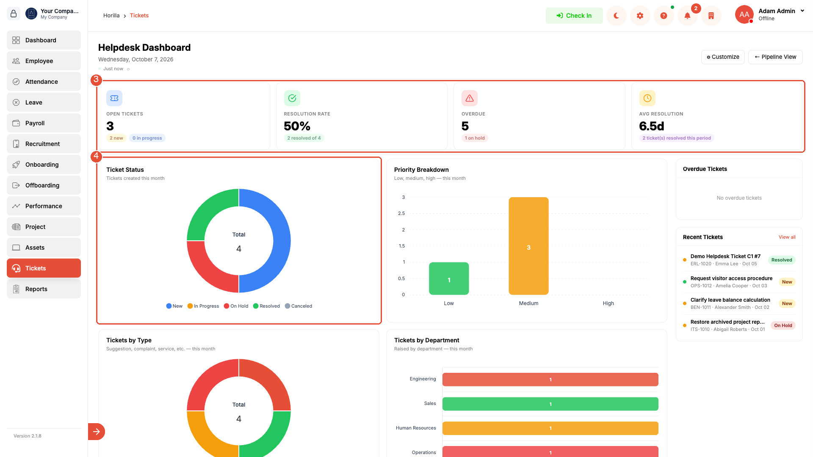
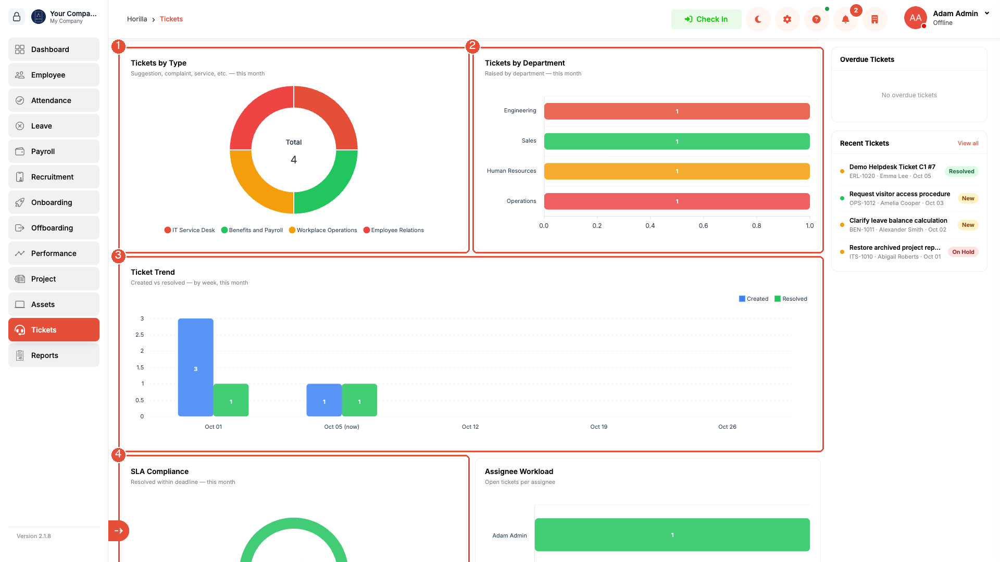
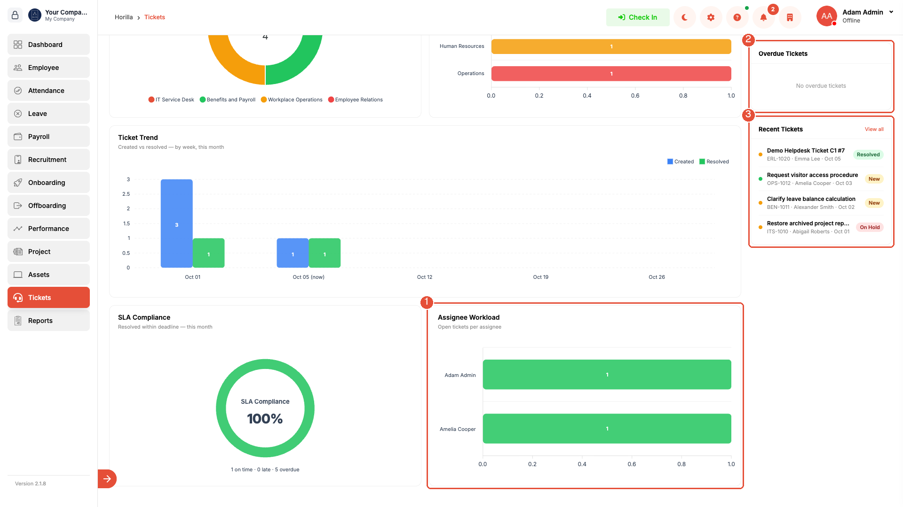

# **Helpdesk Dashboard**

The Helpdesk Dashboard summarises ticket activity. Open it from **Tickets → Dashboard**. **Customize** opens a panel to choose the widgets, and **← Pipeline View** returns to the ticket list.

1. **Customize** opens the widget panel.
2. Four summary cards:

   | Card | Reads in the demo | Caption |
   |---|---|---|
   | **Open Tickets** | 3 | *2 new, 0 in progress* |
   | **Resolution Rate** | 50% | *2 resolved of 4* |
   | **Overdue** | 5 | *1 on hold* |
   | **Avg Resolution** | 6.5d | *2 ticket(s) resolved this period* |

3. **Ticket Status** (*Tickets created this month*) splits tickets into **New, In Progress, On Hold, Resolved** and **Canceled**.

1. **Tickets by Type** (*Suggestion, complaint, service, etc.*), for example **IT Service Desk** and **Benefits and Payroll**.
2. **Tickets by Department** (*Raised by department*).
3. **Ticket Trend** (*Created vs resolved, by week*).
4. **SLA Compliance** (*Resolved within deadline*) gives a percentage with the counts behind it, for example *1 on time, 0 late, 5 overdue*.

The row with **Ticket Status** also holds **Priority Breakdown** (*Low, medium, high*).

1. **Assignee Workload** (*Open tickets per assignee*).
2. **Overdue Tickets**, or **No overdue tickets**.
3. **Recent Tickets** lists the latest tickets with ID, title, owner, date and status, with **View all**.

::: info Not tested
Where cards and charts lead was not checked. In the demo the **Overdue** card reads 5 while the **Overdue Tickets** widget reads *No overdue tickets*, so treat the overdue figures with care.
:::
