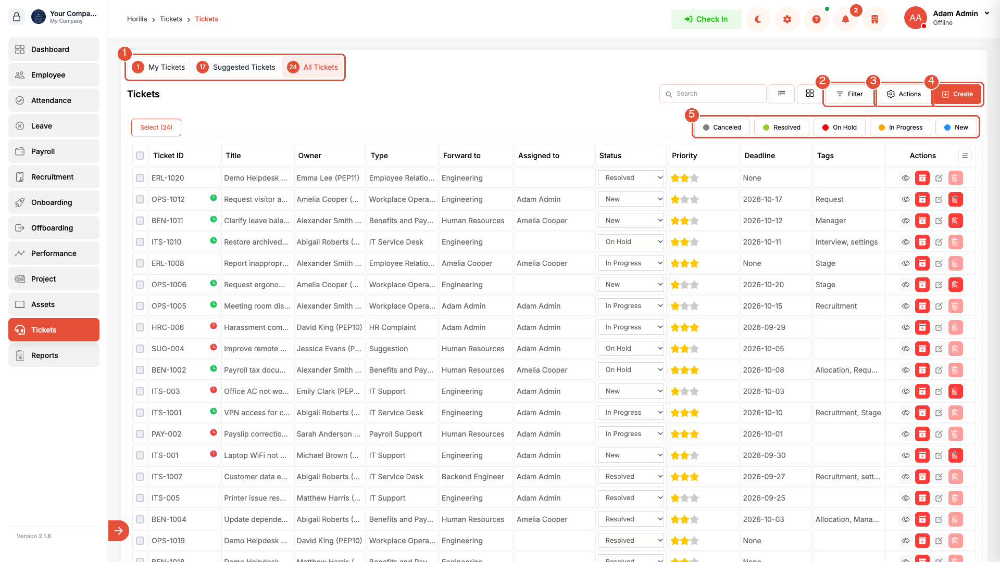
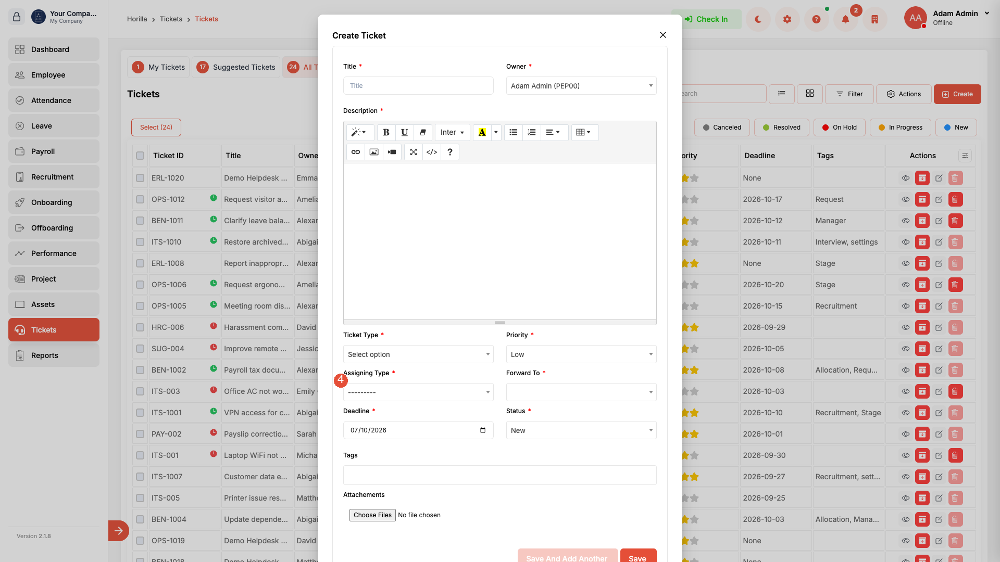

# **Tickets**

**Tickets** is where tickets are raised, assigned and worked. Open it from **Tickets → Tickets**.

## **The page**

1. Three tabs: **My Tickets** (1 in the demo), **Suggested Tickets** (17) and **All Tickets** (24).
2. **Filter** narrows the list.
3. **Actions** offers **Archive**, **Unarchive** and **Delete** for the rows you tick.
4. **Create** raises a ticket.
5. The coloured dots (**Canceled, Resolved, On Hold, In Progress, New**) filter by status.

The page also has a **Search** box and a switch between the **list** and **card** layouts. The table: **Ticket ID, Title, Owner, Type, Forward to, Assigned to, Status, Priority, Deadline, Tags** and **Actions**. **Status** is a drop-down in each row, **Priority** is shown as stars, and each ticket's ID begins with the prefix of its type (for example *ITS-1013*). Row icons include **View**, **Claim Requests**, **Claim** (on *Suggested Tickets*), **Archive**, **Edit** and **Delete**.

## **Create a ticket**

| Field | Required | Notes |
|---|---|---|
| **Title** | Yes | |
| **Owner** | Yes | The employee the ticket is for. Starts as you. |
| **Description** | Yes | Written in a rich-text editor that supports links, images and video. |
| **Ticket Type** | Yes | For example *IT Service Desk, Benefits and Payroll, Workplace Operations, Employee Relations*. |
| **Priority** | Yes | **Low, Medium** or **High**. |
| **Assigning Type** | Yes | **Department, Job Position** or **Individual**. |
| **Forward To** | Yes | The target chosen by the assigning type. |
| **Deadline** | Yes | Defaults to today. |
| **Status** | Yes | Defaults to **New**. |
| **Tags** | No | |
| **Attachements** | No | Files. |

Click **Save**, or **Save And Add Another**.

::: info Not tested
Creating, claiming and changing a ticket's status were not exercised, so the notifications they send, and who may do each, are not described. The effect of **Claim Requests** was not checked.
:::
