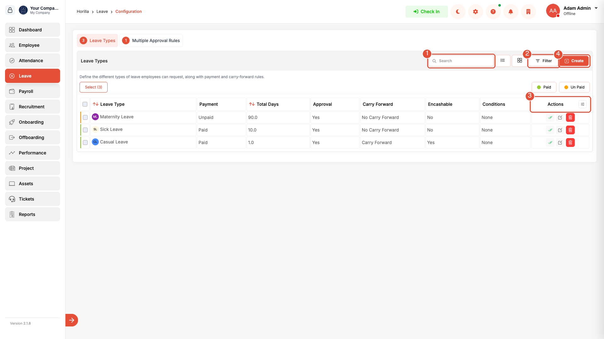
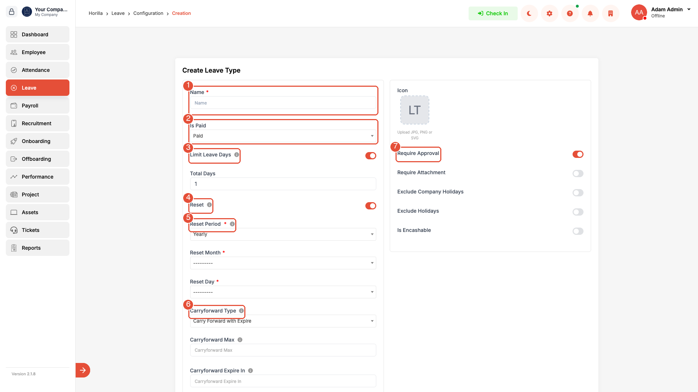
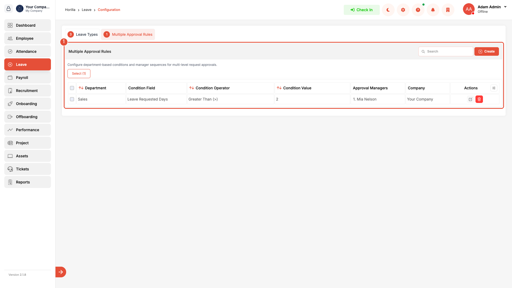
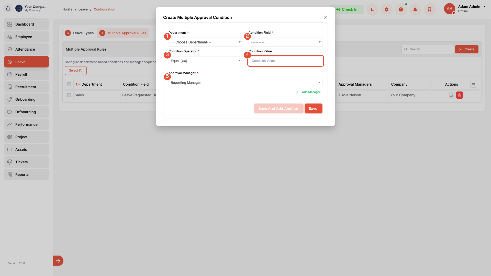

# **Leave Configuration**

**Leave → Configuration** is where leave types and approval rules are defined. It has two tabs: **Leave Types** and **Multiple Approval Rules**. The page remembers the tab you used last.

## **Leave Types**

A leave type is a kind of leave employees can request, such as Sick Leave or Casual Leave, together with its payment, limit, reset and carry-forward rules.

1. **Search** box.
2. **Filter** by **Name**, **Payment Method** (*Paid, Unpaid*), **Reset**, **Carry Forward Type**, **Require Approval**, **Require Attachment** and **Is Encashable**. **Advanced** adds ranges for carry-forward and total days.
3. **Create** opens the new leave type page.

The **Paid** and **Un Paid** buttons above the list filter by payment, and the list can be shown as a **List** or as **Card** tiles. The table lists **Leave Type, Payment, Total Days, Approval, Carry Forward, Encashable, Conditions** and **Actions**. The demo has three: **Maternity Leave** (unpaid, 90 days), **Sick Leave** (paid, 10 days) and **Casual Leave** (paid, 1 day, carry forward, encashable). The **Conditions** column reads **None** for all three.

Each row has **Assign**, **Update** and **Delete**. **Assign** gives that leave type to employees.

### **Create a leave type**

Click **Create**. The form opens as a full page (**Leave → Configuration → Creation**).

| Field | Required | What it does |
|---|---|---|
| **Name** | Yes | The leave type's name, shown in requests and balances. |
| **Is Paid** | | **Paid** or **Unpaid**. |
| **Limit Leave Days** | | On by default. When on, the leave type has a fixed number of days and shows **Total Days**. When off, **Total Days** disappears. |
| **Total Days** | Yes | Days an employee gets. |
| **Reset** | | Turn on to make the balance reset on a schedule. This reveals **Reset Period** and **Carryforward Type**. |
| **Reset Period** | When Reset is on | **Yearly, Monthly, Weekly** or **Custom**. See below. |
| **Carryforward Type** | | **No Carry Forward, Carry Forward** or **Carry Forward with Expire**. See below. |
| **Icon** | No | An image (JPG, PNG or SVG) for the leave type. |
| **Require Approval** | | On by default. |
| **Require Attachment** | | Off by default. |
| **Exclude Company Holidays** | | Off by default. |
| **Exclude Holidays** | | Off by default. |
| **Is Encashable** | | Off by default. |

**What each Reset Period asks for**

| Reset Period | Extra fields shown |
|---|---|
| **Yearly** | **Reset Month** and **Reset Day** |
| **Monthly** | **Reset Day** |
| **Weekly** | **Reset Weekday** |
| **Custom** | **Custom Reset Days** |

**What each Carryforward Type asks for**

| Carryforward Type | Extra fields shown |
|---|---|
| **No Carry Forward** | None |
| **Carry Forward** | **Carryforward Max** |
| **Carry Forward with Expire** | **Carryforward Max**, **Carryforward Expire In**, **Carryforward Expire Period** (*Day, Month, Year*) and **Carryforward Expire Date** |

::: info Not tested
Saving a leave type, **Assign**, **Update** and **Delete** were not exercised on the demo. What each switch does to requests, for example how **Exclude Holidays** changes the day count, is not described here beyond the field names.
:::

## **Multiple Approval Rules**

A multiple-approval rule sets a sequence of approvers for leave requests that meet a condition. The page describes itself as *Configure department-based conditions and manager sequences for multi-level request approvals*.

The table lists **Department, Condition Field, Condition Operator, Condition Value, Approval Managers, Company** and **Actions**. The demo has one rule: **Sales**, **Leave Requested Days**, **Greater Than (>)**, **2**, approved by **1. Mia Nelson**, for **Your Company**.

### **Create a rule**

| Field | Required | Notes |
|---|---|---|
| **Department** | Yes | The department the rule applies to. |
| **Condition Field** | Yes | Only **Leave Requested Days** is offered. |
| **Condition Operator** | | **Equal (==), Not Equal (!=), Range, Less Than (<), Greater Than (>), Less Than or Equal To (<=), Greater Than or Equal To (>=)** or **Contains**. |
| **Condition Value** | | The number to compare the requested days with. |
| **Starting Value**, **Ending Value** | | For the **Range** operator, the lower and upper limit. |
| **Approval Manager** | | **Reporting Manager** (the employee's own manager) or a named employee. |

::: info Not tested
Saving a rule and watching a request pass through its approvers were not exercised. The order in which approvers act, and what happens when one rejects, are not described here.
:::
