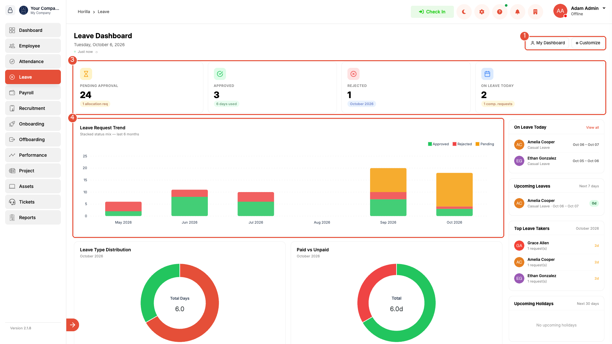
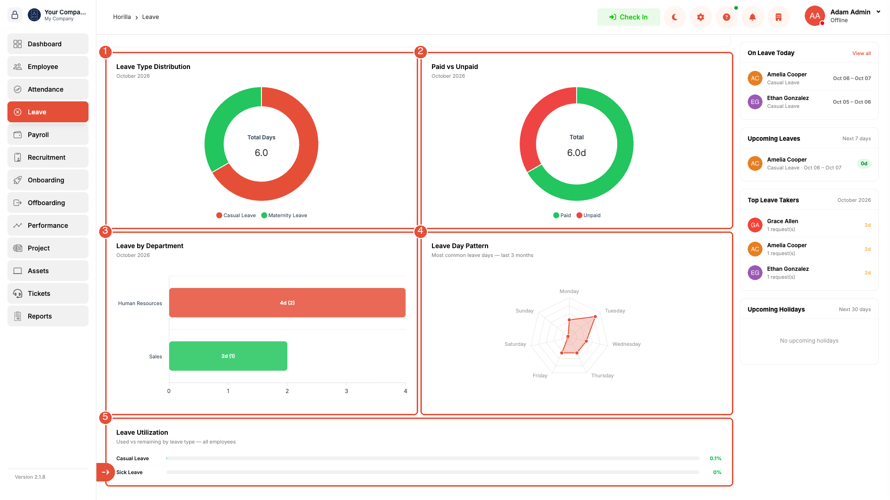
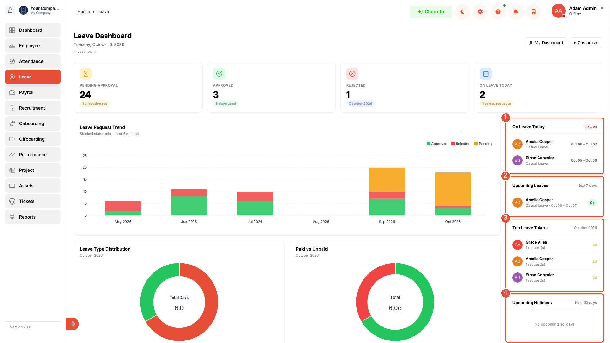

# **Leave Dashboard**

The Leave Dashboard summarises leave activity for the whole organisation. Open it from **Leave → Dashboard**.

## **At a glance**

1. **My Dashboard** opens your personal leave dashboard instead of the company view.
2. **Customize** opens a panel with **Reset** and **Save** buttons for choosing which widgets appear.
3. Four summary cards. Each one opens **Leave Requests** already filtered:

   | Card | Shows | Opens |
   |---|---|---|
   | **Pending Approval** | Requests waiting for a decision (24), plus a note of allocation requests waiting (**1 allocation req**) | Requests with status *Requested* |
   | **Approved** | Requests approved this month (3), with the days used (**6 days used**) | Approved requests dated this month |
   | **Rejected** | Requests rejected this month (1) | Rejected requests dated this month |
   | **On Leave Today** | Employees out today (2), plus a note of compensatory requests (**1 comp. requests**) | Approved requests covering today |

4. **Leave Request Trend** is a stacked bar chart of **Approved**, **Rejected** and **Pending** requests for each of the last six months.

## **Charts**

1. **Leave Type Distribution** splits the month's leave days by leave type (the centre shows the **Total Days**).
2. **Paid vs Unpaid** splits the month's leave days into paid and unpaid.
3. **Leave by Department** shows leave days per department for the month. Each bar is labelled with the days and a count in brackets, for example *4d (2)*.
4. **Leave Day Pattern** (*Most common leave days, last 3 months*) is a radar chart showing which weekdays leave is most often taken on.
5. **Leave Utilization** (*Used vs remaining by leave type, all employees*) shows, for each leave type, how much of the allocation across all employees has been used (for example **Casual Leave 0.1%** in the demo).

## **Side panels**

1. **On Leave Today** lists who is out, with leave type and dates. **View all** opens **Leave Requests**.
2. **Upcoming Leaves** (*Next 7 days*) lists approved leave about to start.
3. **Top Leave Takers** ranks employees by leave days this month, with the number of requests.
4. **Upcoming Holidays** (*Next 30 days*) lists holidays coming up, or reads **No upcoming holidays**.

Clicking a person in these panels opens **Leave Requests** filtered to that employee.
