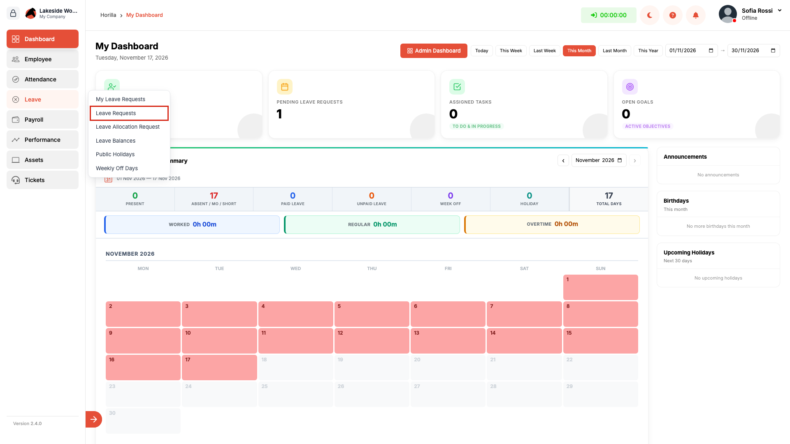
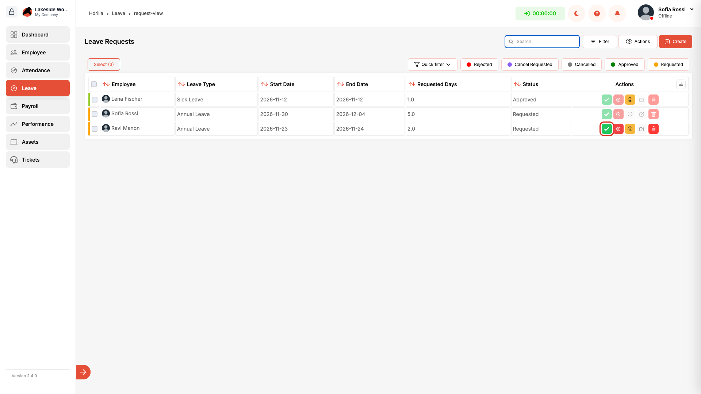
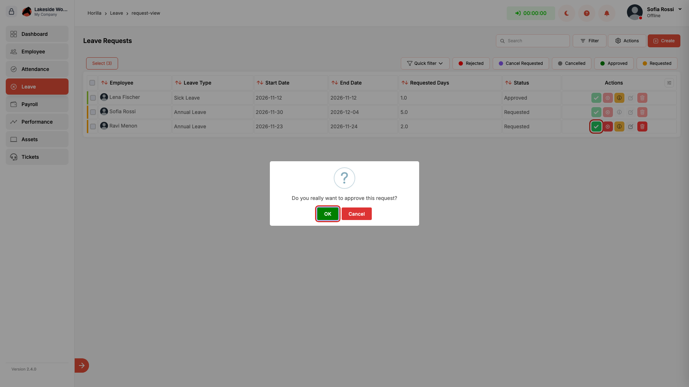
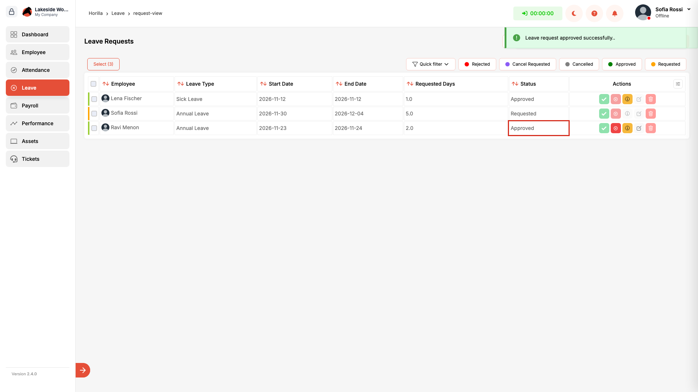
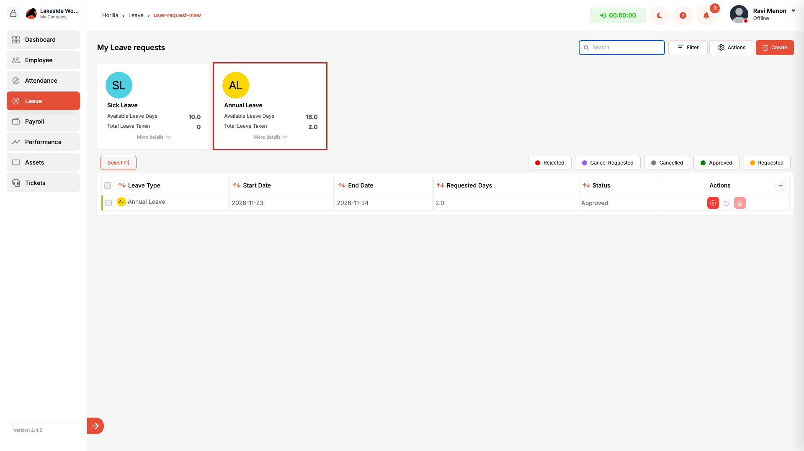

# Approve a leave request

On Monday 16 November 2026, Ravi Menon, a developer, has a request waiting for Annual Leave on 23 and 24 November. Sofia Rossi, his engineering manager, approves it. Verified for Sofia (reporting manager, sees only her team's requests), Daniel Okafor (HR Manager) and Maya Chen (administrator); the last two see everyone's.

## Before you start

- The request is not your own and has the status *Requested*.
- You have `leave.change_leaverequest`, or you are the employee's reporting manager. See [Leave](/hr/functional/v2.0/leave/).

## Steps

1. Point at **Leave** in the sidebar and click **Leave Requests** in the menu that opens.

   
   *The menu opens when you point at Leave. Sample data.*

2. Move the pointer away to close the menu, which hides the **Employee** column. Find the row of Ravi Menon: **Annual Leave**, **2026-11-23** to **2026-11-24**, **2.0** requested days, status *Requested*.
3. In the **Actions** column, click the green check icon, **Approve**. The icons are, from the left, **Approve**, **Reject**, **Penalty**, **Edit** and **Delete**.

   
   *The icons carry no text, but pointing at one shows its name. Sample data.*

4. In the dialog that asks **Do you really want to approve this request?**, click **OK**.

   
   *Cancel closes the dialog. Sample data.*

## Check that it worked

A green message reads `Leave request approved successfully..` (two periods, as the screen shows it), and the status in Ravi's row is *Approved*.

*The message fades after a few seconds. Sample data.*

Sign in as Ravi and open **Leave → My Leave Requests**. The **Annual Leave** card shows **Available Leave Days** 16.0 (it was 18.0) and **Total Leave Taken** 2.0. His bell shows 1.

*Two days left the balance. Sample data.*

## If something goes wrong

- **The Approve icon is gray.** You cannot approve your own request unless you are a superuser. Ask another approver, for example Daniel.
- **Leave Requests is not in the menu.** You are not a reporting manager and lack `leave.view_leaverequest`. Opening `/leave/request-view/` sends you to **My Dashboard**.
- **You want to refuse it.** Click the red **Reject** icon, fill in **Rejection Reason** (required) and click **Save**. The message reads `Leave request rejected successfully..`, the status becomes *Rejected* and the balance does not change.

::: info Not tested
More days than the balance holds, multiple-approval rules, cancellation requests, **Bulk Approve** and the wording of Ravi's notification were not exercised.
:::

## Related pages

- [Leave Requests](/hr/functional/v2.0/leave/leave-requests)
- [My Leave Requests](/hr/functional/v2.0/leave/my-leave-requests)
- [Leave Balances](/hr/functional/v2.0/leave/leave-balances)
- [Why does a leave request count the weekend as leave days?](/hr/functional/v2.0/leave/help/why-does-a-leave-request-count-the-weekend-as-leave-days)
