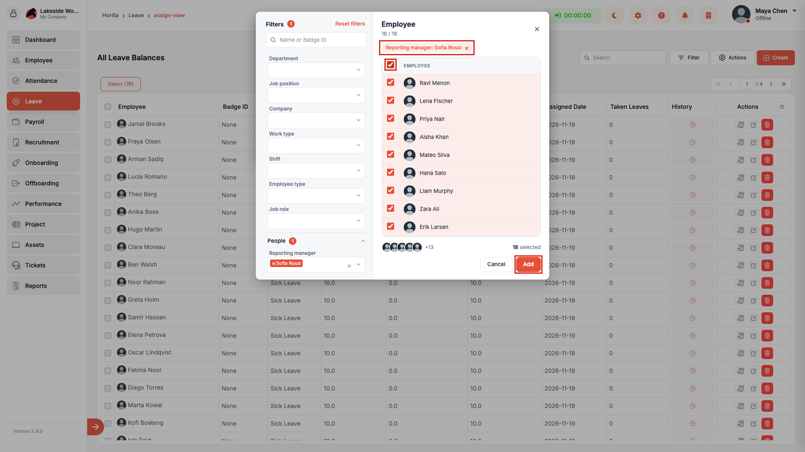
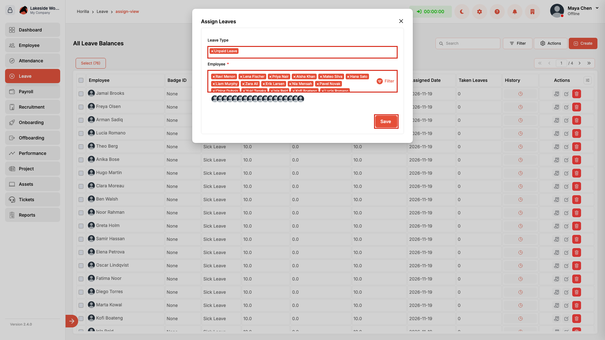
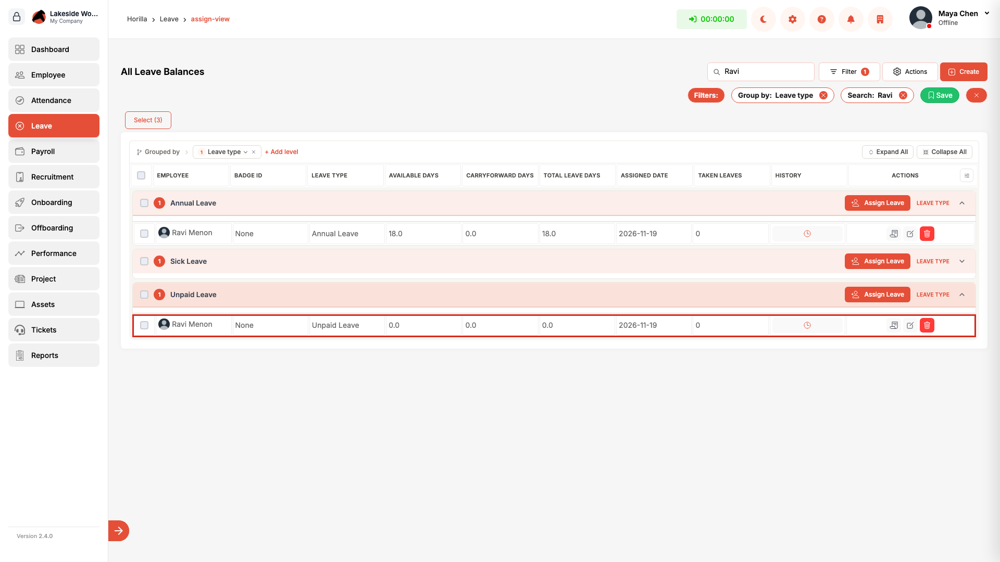
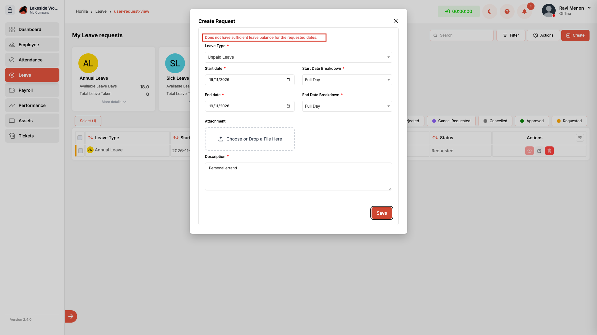

# Assign leave to employees

On Thursday 19 November 2026, Maya Chen, the HR administrator at Lakeside Works, gives **Unpaid Leave** to the 18 people who report to Sofia Rossi. Nobody holds that leave type yet, so nobody can request it. Maya assigns it to the whole team in one step and checks the balances afterwards. Verified for Maya Chen (administrator). Daniel Okafor (HR Manager) opened the same dialog, and Sofia Rossi (engineering manager) only views balances.

## Before you start

- You can open **Leave → Leave Balances** and use **Create**. Maya is an administrator, and Daniel, the HR Manager, also sees **Create**. Sofia, who has no extra permission, sees the balances but has no **Create** button. See [Leave](/hr/functional/v2.0/leave/).
- The leave type exists in [Configuration](/hr/functional/v2.0/leave/configuration). To give one type to a single person, use **Assign** in its row there. The dialog asks only for the employee.

## Steps

1. Open **Leave → Leave Balances** and click **Create**.

   
   *Create opens the Assign Leaves dialog. Sample data.*

2. In the **Assign Leaves** dialog, click the **Leave Type** field and choose **Unpaid Leave**. You can choose several types here. The field has no star, but the dialog does not save without a type.
3. In **Employee**, click **Filter**. The picker lists all 38 employees.
4. Open **People** in the filters on the left. Click **Reporting manager** and choose **Sofia Rossi**. The list drops to 18 employees, and a tag reads `Reporting manager: Sofia Rossi`.
5. Tick the box in the header of the list to select everyone. The counter reads `18 selected`. Click **Add**.

   
   *The same picker has Department, Job position, Company, Work type, Shift, Employee type and Job role filters. Sample data.*

6. Back in the dialog, check that **Employee** shows 18 names, then click **Save**.

   
   *Each employee appears as a tag; remove one with its x. Sample data.*

## Check that it worked

A green message reads `Leave types assigned successfully.` **Select** above the list goes from 76 to 94, which is 18 new balances, and the new rows have **Assigned Date** 2026-11-19.

Type `Ravi` in **Search** and press Enter. The list groups by leave type, and Ravi Menon now has an **Unpaid Leave** row next to **Annual Leave** (18.0 days) and **Sick Leave**. Its **Available Days**, **Carryforward Days** and **Total Leave Days** are all 0.0.

*Ravi holds Unpaid Leave, with no days yet. Sample data.*

## If something goes wrong

- **A request on the new type fails with `Does not have sufficient leave balance for the requested dates.`** The balance is 0.0, so the type exists but has no days. Ravi's **Unpaid Leave** card on **Leave → My Leave Requests** reads **Available Leave Days** `No Limit` and still refuses the request. Open **Leave Balances**, search for the employee, expand the group and click **Edit** (the pencil) in the row. The **Update Available Leave** dialog has **Available Days** and **Carryforward Days**. Set **Available Days** to `3` and click **Save**. The message reads `Available leaves updated successfully...`.

  
  *Edit changes one employee's balance only. Sample data.*

  Ravi's form now shows `Available Leaves : 3.0`, and a one-day request for 19/11/2026 saves with `Leave request created successfully`.

  
  *The message appears at the top of the dialog before the balance is raised. Sample data.*

- **The leave type is missing from the list in the dialog.** Create it first in [Configuration](/hr/functional/v2.0/leave/configuration). See [Set up leave types and carry forward](/hr/functional/v2.0/leave/guides/set-up-leave-types-and-carry-forward).
- **Sofia sees no Create button.** Only roles that may add balances see it; a reporting manager sees the balances only.

::: info Not tested
Assigning a type to someone who already holds it, **Import**, **Export**, **Delete** and the group header's **Assign Leave** button were not exercised. Assigning to a single person from **Leave Balances** (the **Assign** icon in **Configuration** was used for one person on another page), **Carryforward Days** on a new balance, and **Leave Ledger** and **History** were not exercised either. Daniel opened the dialog but did not save. Sofia's access to **Edit** was not checked. A type created with **Limit Leave Days** turned off in this installation gave a balance of 100000.0 days when assigned; the seeded Unpaid Leave gave 0.0, and the cause was not investigated.
:::

## Related pages

- [Leave Balances](/hr/functional/v2.0/leave/leave-balances)
- [Configuration](/hr/functional/v2.0/leave/configuration)
- [Set up leave types and carry forward](/hr/functional/v2.0/leave/guides/set-up-leave-types-and-carry-forward)
- [Create a leave request for an employee](/hr/functional/v2.0/leave/guides/create-a-leave-request-for-an-employee)
