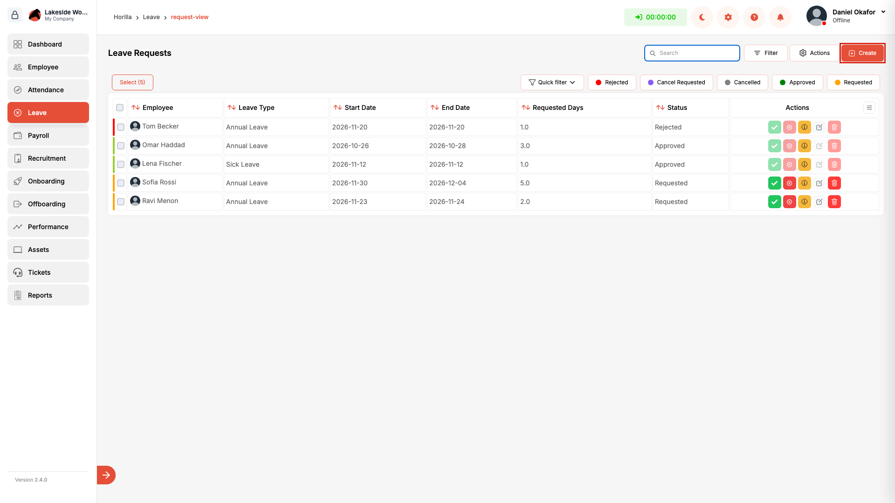
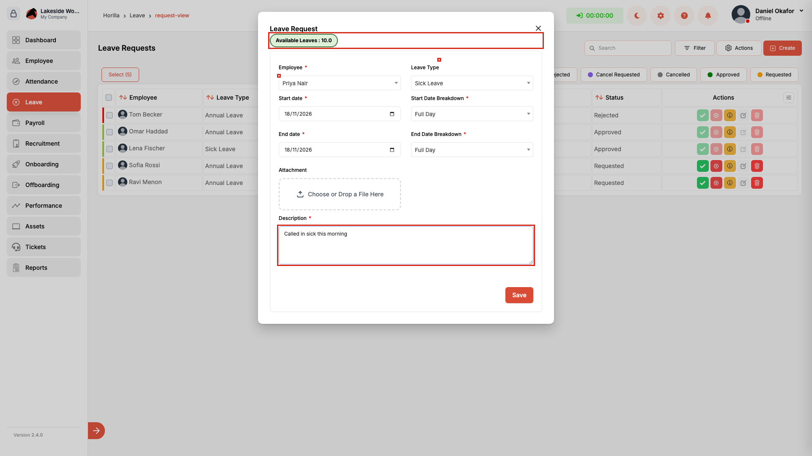
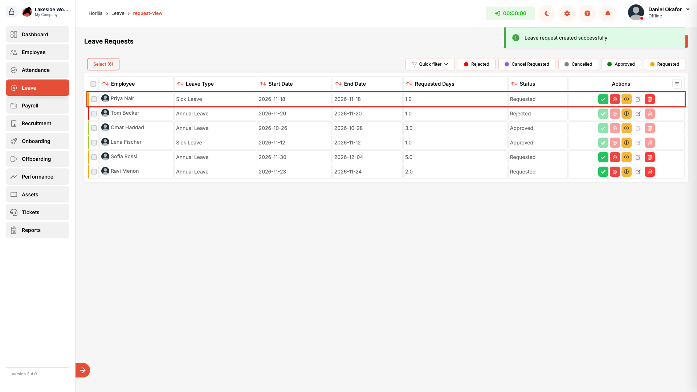
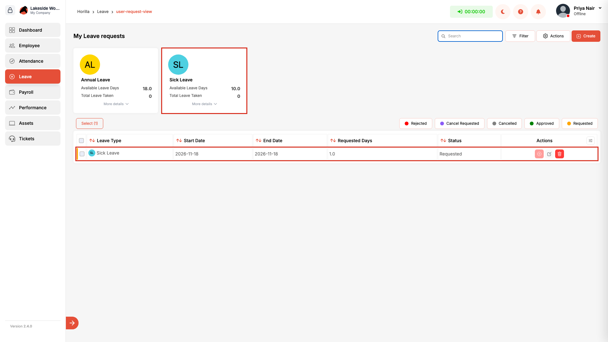

# Create a leave request for an employee

On Wednesday 18 November 2026, Priya Nair, a developer at Lakeside Works, phones in sick and has no time to open Horilla. Daniel Okafor, the HR Manager, records one day of Sick Leave for her from **Leave Requests**. Verified for Daniel (HR Manager), Maya Chen (administrator) and Sofia Rossi (engineering manager). Daniel's walk was complete; Maya and Sofia each saved one request for another employee.

## Before you start

- You can open **Leave → Leave Requests**: you have `leave.view_leaverequest`, or you are a reporting manager. See [Leave](/hr/functional/v2.0/leave/).
- The employee already holds a balance of the leave type, in [Leave Balances](/hr/functional/v2.0/leave/leave-balances). The **Leave Type** list only offers the types the chosen employee holds.

## Steps

1. Open **Leave → Leave Requests** and click **Create** at the top right.

   
   *Create is next to Actions. Sample data.*

2. In the **Leave Request** dialog, set **Employee** to **Priya Nair**. The list starts on your own name.
3. Set **Leave Type** to **Sick Leave**. A green label at the top of the dialog reads `Available Leaves : 10.0`.
4. Leave **Start date** and **End date** at 18/11/2026, which is today, and both breakdowns at **Full Day**. Use **First Half** or **Second Half** for a half day.
5. Type a **Description**, for example `Called in sick this morning`. **Employee**, **Start date**, **End date**, both breakdowns and **Description** are required. **Attachment** is optional.

   
   *The label shows Priya's own balance, not yours. Sample data.*

6. Click **Save**.

## Check that it worked

A green message reads `Leave request created successfully`, and the new row is at the top of the list:

```text
Priya Nair   Sick Leave   2026-11-18   2026-11-18   1.0   Requested
```


*The request waits for a decision like any other. Sample data.*

Sign in as Priya and open **Leave → My Leave Requests**. The row is there with the status *Requested*. The **Sick Leave** card still shows **Available Leave Days** 10.0 and **Total Leave Taken** 0, because days leave the balance only when the request is approved. See [Approve a leave request](/hr/functional/v2.0/leave/guides/approve-a-leave-request).


*Priya sees the request and an unchanged balance. Sample data.*

## If something goes wrong

- **`This field is required.` appears under Leave Type or Description.** Saving an empty form shows the message under each required field you skipped and keeps the dialog open. Fill them in and click **Save** again.
- **The leave type you want is not in the list.** The employee does not hold it. Give it to them in **Leave → Leave Balances** first. In the sample company nobody holds **Unpaid Leave**, so the list shows only **Sick Leave** and **Annual Leave**.
- **You only see some employees.** A reporting manager without `leave.view_leaverequest` can create requests only for the team and for themselves. Sofia's **Employee** list has 19 names (herself, then her team), and Maya's and Daniel's have 38.

::: info Not tested
Half-day breakdowns, **Attachment**, **Save And Add Another** (it is in the form but was not clicked), a request longer than the balance, a day inside a restricted period or a holiday, multiple-approval rules, and whether Priya is notified of a request made for her were not exercised. Approving the new request was not walked here.
:::

## Related pages

- [Leave Requests](/hr/functional/v2.0/leave/leave-requests)
- [My Leave Requests](/hr/functional/v2.0/leave/my-leave-requests)
- [Leave Balances](/hr/functional/v2.0/leave/leave-balances)
- [Approve a leave request](/hr/functional/v2.0/leave/guides/approve-a-leave-request)
