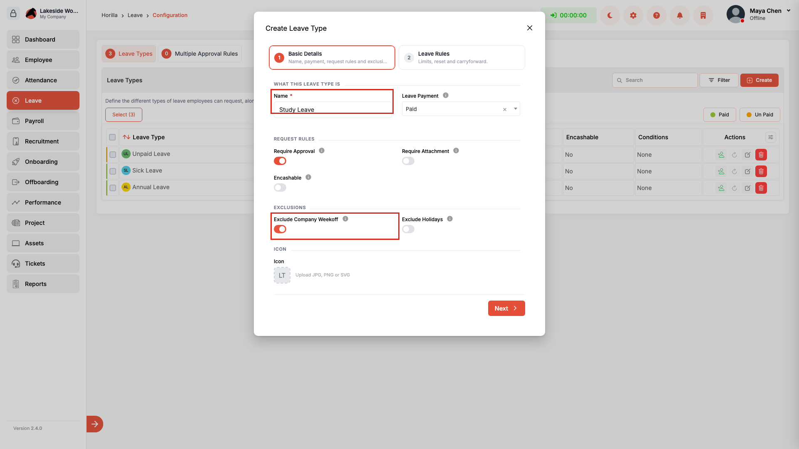
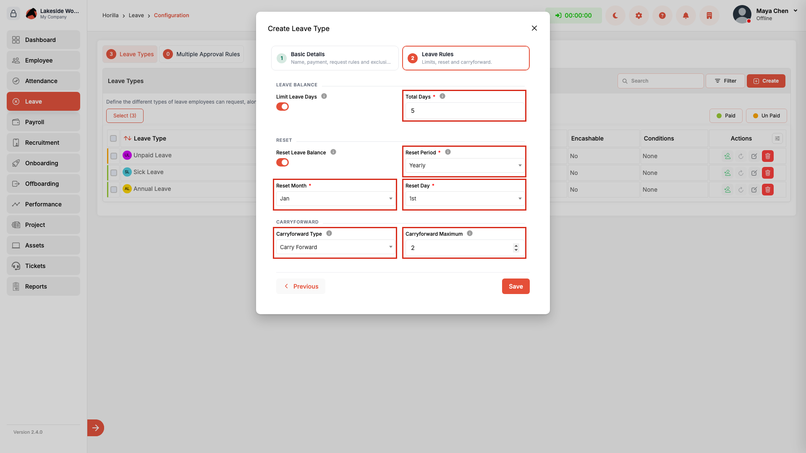
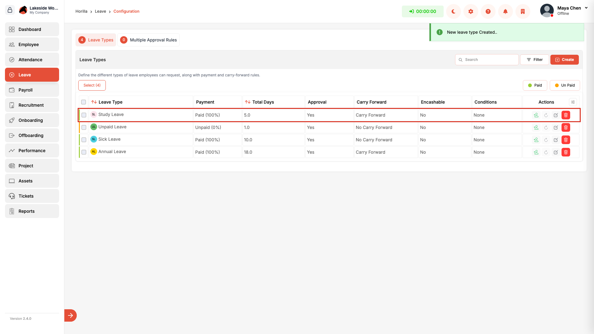
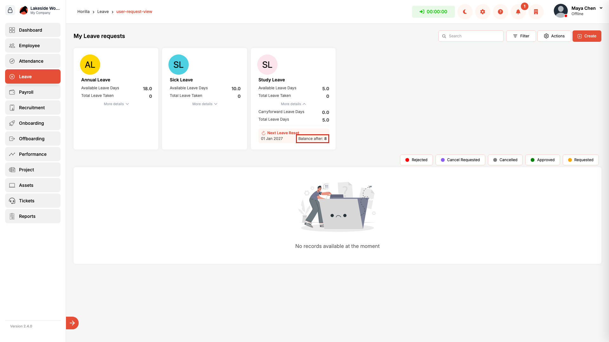

# Set up leave types and carry forward

Maya Chen, the HR administrator at Lakeside Works, adds a fourth leave type, Study Leave, next to Annual Leave, Sick Leave and Unpaid Leave. Employees get five paid days a year, the balance resets on 1 January, and up to two unused days move into the new year. A leave type decides how many days an employee can take, whether the days are paid, which days count, and what happens to unused days at the reset. Verified for Maya Chen (administrator) only.

## Before you start

- You can open **Leave → Configuration**: you have `leave.view_leavetype`, or you are an administrator, as Maya is. Which other permission creating a type needs was not tested. See [Leave](/hr/functional/v2.0/leave/).
- You know the policy: the name, the yearly days, the reset date and the carry-forward limit.

## Decide first

| Decision | Options on the screen | What it changes |
|---|---|---|
| **Leave Payment** | **Paid**, **Unpaid**, **Custom** | Whether the days are paid. The list shows a paid type created here as `Paid (100%)`. **Custom** adds a **Payment Percentage** field; it was not saved or tested here. |
| **Require Approval**, **Require Attachment**, **Encashable** | Switches. **Require Approval** is on by default | Whether a manager must decide the request, whether a file is required, whether unused days can be cashed in |
| **Exclude Company Weekoff**, **Exclude Holidays** | Two switches under the **Exclusions** heading, off by default | Whether weekly off days and public holidays inside the dates are left out of the count |
| **Limit Leave Days** and **Total Days** | A switch (on by default) and a number | The days an employee holds. Turn the switch off for a type with no limit |
| **Reset Leave Balance** | A switch, with **Reset Period**: **Yearly**, **Monthly**, **Weekly** or **Custom** | Whether the balance is restored on a schedule |
| **Carryforward Type** | **No Carry Forward**, **Carry Forward**, **Carry Forward with Expire** | What happens to unused days at the reset |

## Create the leave type

1. Open **Leave → Configuration** and click **Create**. The **Create Leave Type** dialog opens on step **1 Basic Details**.
2. Type the **Name**, `Study Leave`. It is required: clicking **Next** with it empty shows `This field is required.` and stays on the step.
3. Set **Leave Payment** to **Paid**.
4. Scroll to the **Exclusions** heading and turn on **Exclude Company Weekoff**, the switch next to **Exclude Holidays**. Its hint reads: "When on, company weekoff days that fall within the leave dates are not counted as leave days." Leave the other switches as they are.

   
   *Step 1 holds the name, payment, request rules and exclusions. Sample data.*

5. Click **Next** to open step **2 Leave Rules**. Set **Total Days** to `5`. The field starts at 1.
6. Turn on **Reset Leave Balance**. Set **Reset Period** to **Yearly**, **Reset Month** to **Jan** and **Reset Day** to **1st**.
7. Set **Carryforward Type** to **Carry Forward**, and type `2` in **Carryforward Maximum**.

   
   *Carryforward Maximum appears when a carry-forward type is chosen. Sample data.*

8. Click **Save**. A green message reads `New leave type Created..` (two periods, as the screen shows it).

Check: **Study Leave** is the first row of the list, **Paid (100%)**, **5.0** total days, **Yes** for approval, **Carry Forward**.

*The list now has four leave types. Sample data.*

## Give it to an employee

A leave type does nothing until an employee holds it. In the **Actions** column of the Study Leave row, click **Assign** (the first icon). In the **Assign Leave** dialog, type `Maya` in **Employee** and choose **Maya Chen**. A **Leave Days** table appears under the field once the employee is chosen; check that it reads 5, and click **Save**. A green message reads `Leave type assign is successfull` (sic, as the screen shows it). [Assign leave to employees](/hr/functional/v2.0/leave/guides/assign-leave-to-employees) covers this step, and giving a type to many people, in full.

## How carry forward works

At the reset date, unused days move into the new period up to **Carryforward Maximum**. For Study Leave that is 5 new days plus at most 2 carried days.

Check: sign in as Maya, open **Leave → My Leave Requests** and click **More details** on the **Study Leave** card. **Available Leave Days** is 5.0, **Carryforward Leave Days** is 0.0, **Next Leave Reset** is 01 Jan 2027, and the card shows `Balance after: 7`, which is 5 plus the 2 you allowed. Priya Nair's **Annual Leave** card reads 23 the same way (18 plus that type's limit of 5).

## Change a leave type

1. In **Leave → Configuration**, click **Update** (the pencil) in the row of the leave type. The **Update Leave Type** dialog opens on step **1 Basic Details**, which has only a **Next** button.
2. Open step **2 Leave Rules** with **Next**, where **Previous** and **Update** appear, and change **Carryforward Maximum** from 2 to 3.
3. Click **Update**. The message reads `Leave type is updated successfully..`.

*After the change the card reads Balance after: 8; Available Leave Days stays 5.0. Sample data.*

Check: Maya's **Study Leave** card now reads `Balance after: 8`, and **Available Leave Days** has not moved.

## Troubleshooting

### The leave type does not appear in a request

The employee does not hold it. Assign it as above; the **Leave Type** list of a request offers only the types the employee holds.

### The numbers on a request are not what the policy says

Weekly off days are defined in **Settings → Organization → Weekly Off Days**, and **Exclude Company Weekoff** only works once they exist. See [Why does a leave request count the weekend as leave days?](/hr/functional/v2.0/leave/help/why-does-a-leave-request-count-the-weekend-as-leave-days).

::: info Not tested
The date on the card was 01 Jan 2027 in this walk, and 02 Jan 2027 for Annual Leave when the sample company was reseeded after midnight; the reason was not investigated. The reset itself (waiting for 1 January 2027, or running a missed reset), **Carry Forward with Expire** and its fields (the dialog shows **Expiry Method**, **First Expiry Date**, **Carryforward Expires In** and **Carryforward Expiry Period**, but nothing was saved with them), the other **Reset Period** choices, **Limit Leave Days** turned off, **Require Attachment**, **Encashable**, **Icon**, **Exclude Holidays**, the effect of **Exclude Company Weekoff** on a request, **Delete**, and a request on Study Leave were not exercised. Other roles were not walked.
:::

## Related pages

- [Configuration](/hr/functional/v2.0/leave/configuration)
- [Leave Balances](/hr/functional/v2.0/leave/leave-balances)
- [Assign leave to employees](/hr/functional/v2.0/leave/guides/assign-leave-to-employees)
- [Why does a leave request count the weekend as leave days?](/hr/functional/v2.0/leave/help/why-does-a-leave-request-count-the-weekend-as-leave-days)
