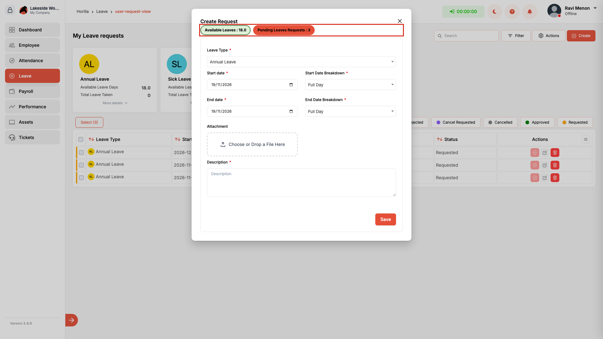
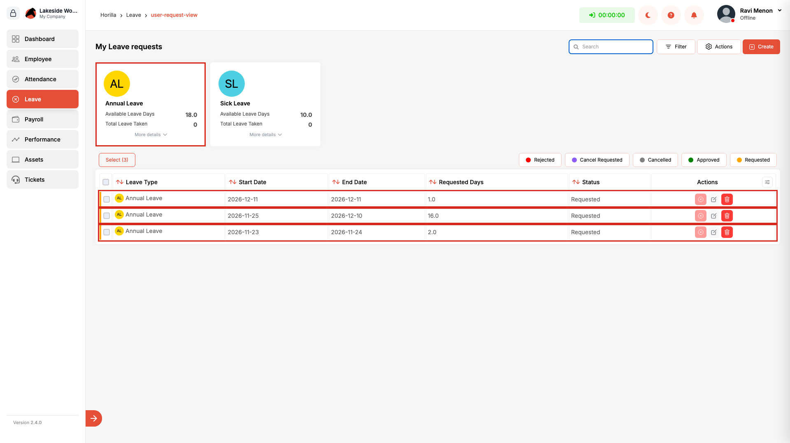
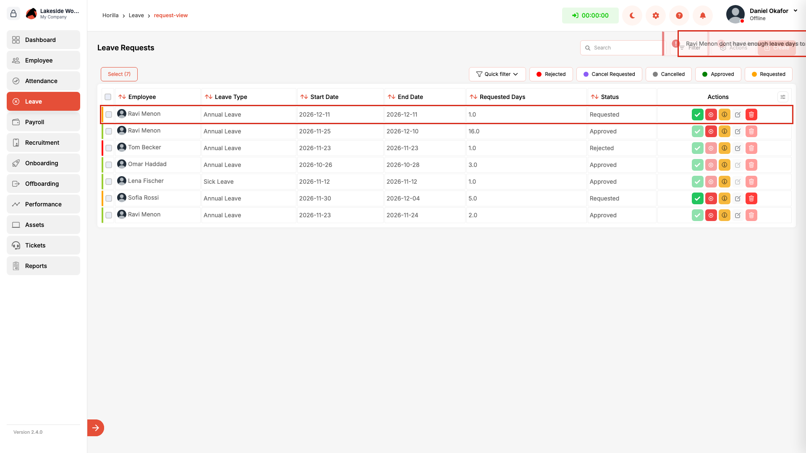

# Why can an employee request more leave days than the balance?

Ravi Menon, a developer at Lakeside Works, holds 18 days of Annual Leave and already has a request waiting for 23 and 24 November. He sends two more requests, 16 days and 1 day. That makes 19 days waiting against a balance of 18, and Horilla accepts all three:

```text
Annual Leave   2026-12-11   2026-12-11   1.0    Requested
Annual Leave   2026-11-25   2026-12-10   16.0   Requested
Annual Leave   2026-11-23   2026-11-24   2.0    Requested
```

To reproduce it, sign in as Ravi:

1. Open **Leave → My Leave Requests**. The cards can come in a different order from the screenshot below (Annual Leave first, then Sick Leave, in this walk), so look for the **Annual Leave** card. It shows **Available Leave Days** 18.0, and the list has one request, 2.0 days, with the status *Requested*.
2. Click **Create**. Set **Leave Type** to **Annual Leave**, **Start date** to 25/11/2026 and **End date** to 10/12/2026. Type a **Description**, for example `Long trip`, and click **Save**. The message reads `Leave request created successfully`.
3. Click **Create** again. Set **Leave Type** to **Annual Leave** and both dates to 11/12/2026. Type a **Description**, for example `One more day`, and click **Save**. It also reads `Leave request created successfully`.
4. Click **Create** a third time and choose **Annual Leave**. The top of the dialog shows two labels, `Available Leaves : 18.0` and `Pending Leaves Requests : 3`. The number counts requests, not days.


*The labels do not add up the pending days. Sample data.*


*Three requests, 19 days in all, against 18.0 available. Sample data.*

This is the situation described in [horilla-hr #751](https://github.com/horilla/horilla-hr/issues/751), where an employee with 2 days left can send more than one request for those days. The thread says a check was added; in this 2.4.0 installation, pending requests are not added up.

::: info Scope
Verified for Ravi Menon (employee), Lena Fischer (employee) and Daniel Okafor (HR Manager).
:::

## Why this happens

Horilla takes days off the balance when a request is approved, not when it is sent. When someone saves a request, it checks that one request against **Available Days** only. A single request longer than the balance is refused: Lena Fischer, who holds 18 days, tried 1 to 19 December 2026 (19 days) and the dialog showed:

```text
Does not have sufficient leave balance for the requested dates.
```

Two smaller requests are each checked on their own and each fits, so both are saved, even though together they exceed the balance. Pending requests are not added up when a new one is saved.

The check is repeated when a request is approved, against the balance left at that moment. Daniel Okafor approved the 16-day request and the 2-day request, which brought Ravi's balance to 0.0. When he approved the 1-day request, a red message appeared and the request stayed *Requested*:

```text
Ravi Menon dont have enough leave days to approve the request..
```


*Approval stops the request that no longer fits. Sample data.*

## How to fix it

You need to be an approver for the employee, as Daniel is. See [Approve a leave request](/hr/functional/v2.0/leave/guides/approve-a-leave-request).

1. Open **Leave → Leave Requests** and type the employee's name in **Search**. Add up the days of every row with the status *Requested* for the same leave type.
2. Compare the total with **Available Days** for that leave type in **Leave → Leave Balances**: search for the employee and expand the leave type group. Ravi's **Annual Leave** row reads 18.0 before any approval and 0.0 after the two approvals.
3. Approve the requests that fit, oldest dates first. Click the green **Approve** icon and confirm with **OK** in the dialog (**Cancel** closes it). The dialog usually reads `Do you really want to approve this request?`. For Ravi's 16-day and 1-day requests it read `This leave request is for the month of November. Approval depends on the Ravi Menon having available leave days for this month.` (December for the 1-day request); why the wording differs was not investigated.
4. For a request that no longer fits, click the red **Reject** icon. A **Rejection Reason** dialog opens; type a reason and click **Save**. A green message reads `Leave request rejected successfully..` (two periods) and the status becomes *Rejected*. Or ask the employee to change its dates.

Check: the balance on the employee's **Annual Leave** card reads 0.0 and **Total Leave Taken** reads 18.0, and no *Approved* request takes the balance below zero. In the walk this was the case: Ravi's card read 0.0 and 18.0 after the two approvals, and the 1-day request stayed *Requested* until Daniel rejected it, after which its status read *Rejected* and the balance stayed at 0.0.

## How to prevent it

Horilla has no setting that adds up pending requests when they are saved, so the check is a habit of the approver: look at the employee's other *Requested* rows before approving. Tell employees that a request does not hold days for them until it is approved.

::: info Not tested
Editing the request that did not fit, requests of another leave type, requests that start in a different reset period, a request canceled after approval, whether multiple-approval rules change the result, and approving through **Bulk Approve** were not exercised. Reporting managers were not walked for this article; Daniel approved as HR Manager. Whether the check described in #751 is in another release was not checked.
:::

## Related pages

- [Approve a leave request](/hr/functional/v2.0/leave/guides/approve-a-leave-request)
- [Leave Balances](/hr/functional/v2.0/leave/leave-balances)
- [My Leave Requests](/hr/functional/v2.0/leave/my-leave-requests)
- [Create a leave request for an employee](/hr/functional/v2.0/leave/guides/create-a-leave-request-for-an-employee)
