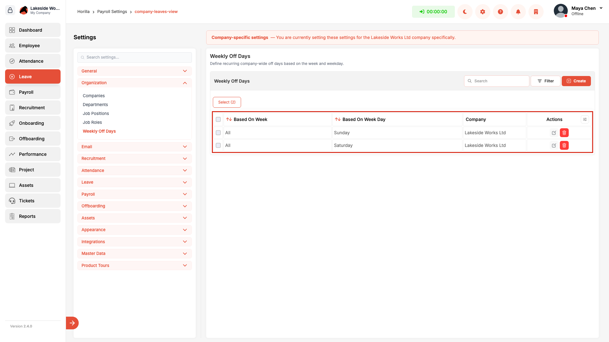
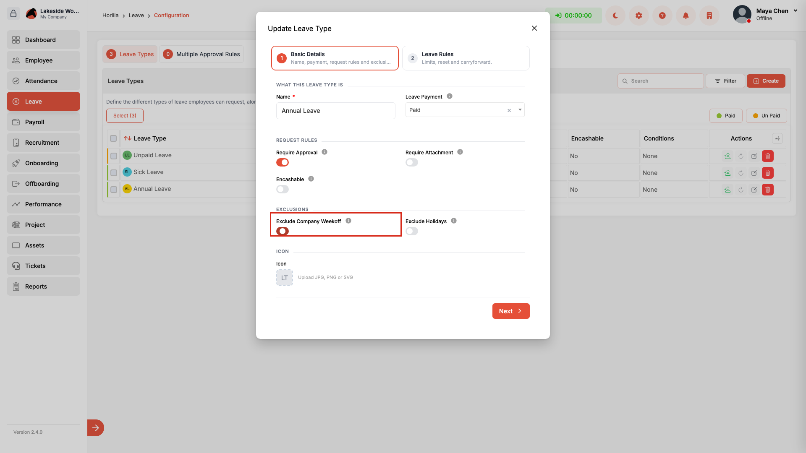
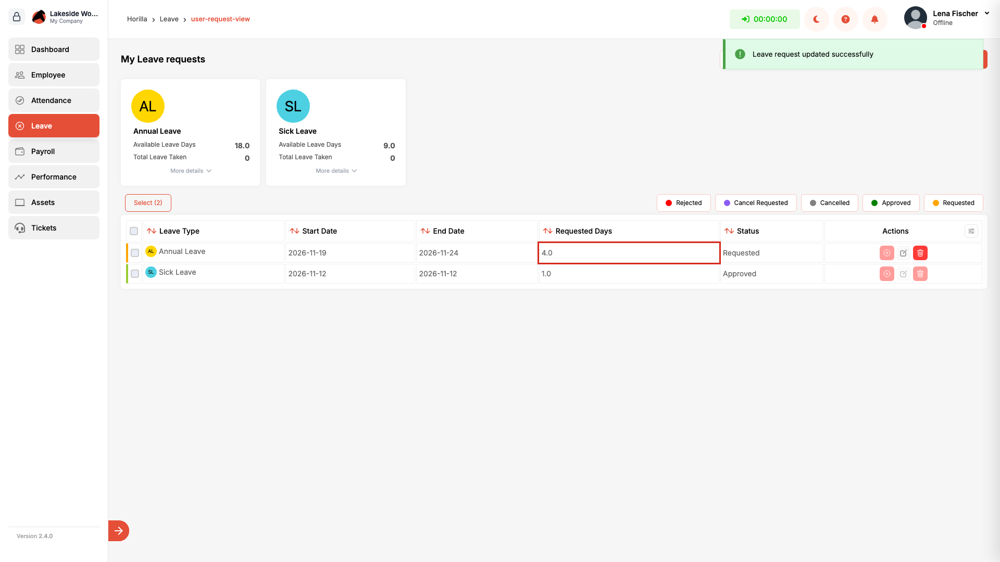

# Why does a leave request count the weekend as leave days?

Lena Fischer, a designer at Lakeside Works, asks for Annual Leave from Thursday 19 November 2026 to Tuesday 24 November 2026. The company works Monday to Friday, so she expects four leave days. **My Leave Requests** shows six:

To reproduce it, sign in as Lena:

1. Open **Leave → My Leave Requests** and click **Create**.
2. Set **Leave Type** to **Annual Leave**, **Start date** to 19/11/2026 and **End date** to 24/11/2026. Leave both breakdowns at **Full Day**.
3. Type a **Description**, for example `Family visit`. Leave Type, both dates and Description are required.
4. Click **Save**. The message reads `Leave request created successfully`, and the list shows:

```text
Annual Leave   2026-11-19   2026-11-24   6.0   Requested
```


*Saturday 21 and Sunday 22 November are counted. Sample data.*

This question was asked in [horilla-hr #414](https://github.com/horilla/horilla-hr/issues/414).

::: info Scope
Verified for Maya Chen (administrator) and Lena Fischer (employee).
:::

## Why this happens

Horilla counts every calendar day between the start date and the end date unless the leave type says otherwise. Two things must both be in place before a day is skipped:

- The company has defined its weekly off days, in **Settings → Organization → Weekly Off Days**. The sample company has none.
- The leave type has **Exclude Company Weekoff** on. Its hint reads: "When on, company weekoff days that fall within the leave dates are not counted as leave days." In the sample company it is off for Annual Leave.

Defining the weekly off days alone does not change the count. With Saturday and Sunday defined and **Exclude Company Weekoff** still off, a new request by Ravi Menon from Thursday 17 December to Tuesday 22 December 2026 was also counted as 6.0 days.

## How to fix it

You need an administrator, or a role that can open **Weekly Off Days** and update leave types.

1. Click the gear icon in the top bar, to the right of the moon icon (administrators see it; other roles do not). In **Settings**, open **Organization → Weekly Off Days**.
2. Click **Create**. Leave **Based On Week** as **All**, set **Based On Week Day** to **Saturday**, and click **Save**. The message reads `New Weekly Off Day Created Successfully`.
3. Repeat step 2 for **Sunday**.

   
   *Both rules apply to every week. Sample data.*

4. Open **Leave → Configuration**. In the row of **Annual Leave**, the **Actions** column has four icons: **Assign** (a person with a plus), a circular arrow (**No overdue resets**), **Update** (a pencil) and **Delete** (a bin). Click **Update**.
5. Turn on **Exclude Company Weekoff**.

   
   *Leave Payment already shows Paid, so leave it as it is. Sample data.*

6. Click **Next**, then **Update**. The message reads `Leave type is updated successfully..`.

::: warning
Requests that already exist keep their old count. Sign in as the employee, open **Leave → My Leave Requests**, click **Edit** in the row of the request and click **Save** without changing anything. The count is recalculated. A request that is no longer *Requested* was not tested.
:::

Check: Lena's request from 19 to 24 November now shows **4.0** in **Requested Days**, and, in a separate run with the same rules, Ravi's new request for 17 to 22 December 2026 showed 4.0.


*The weekend no longer counts. Sample data.*

## How to prevent it

When you set up a leave type, define the weekly off days first, then turn on **Exclude Company Weekoff** on every leave type that should skip them. **Exclude Holidays** does the same for public holidays; its effect was not exercised here.

::: info Not tested
Turning on **Exclude Company Weekoff** while no weekly off days exist, **Exclude Holidays**, weekly off days based on a week of the month (for example **Second Week**), half-day breakdowns next to a weekend, and editing a request that was already approved were not exercised.
:::

## Related pages

- [Leave Rules and Weekly Off Days](/hr/functional/v2.0/leave/leave-rules)
- [Configuration](/hr/functional/v2.0/leave/configuration)
- [My Leave Requests](/hr/functional/v2.0/leave/my-leave-requests)
- [Approve a leave request](/hr/functional/v2.0/leave/guides/approve-a-leave-request)
