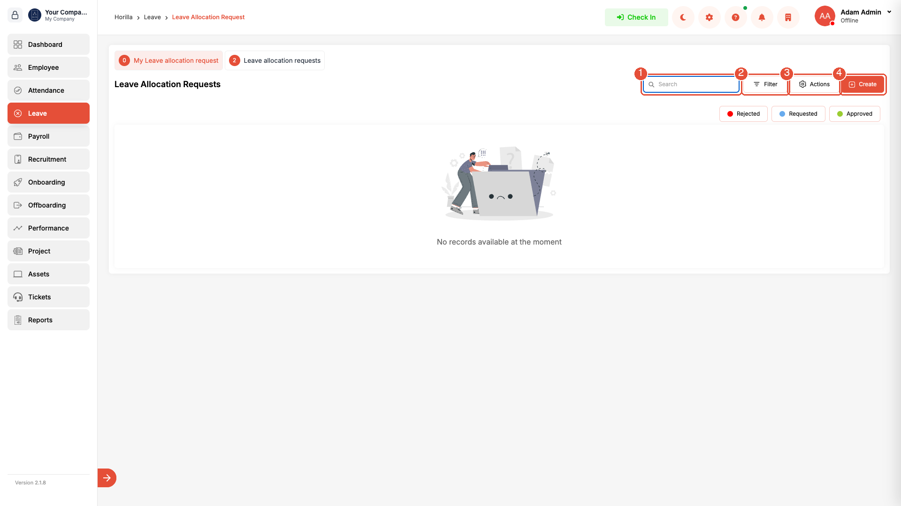
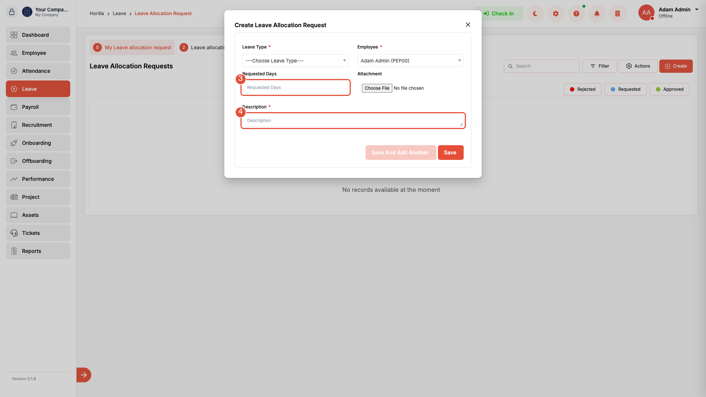

# **Leave Allocation Request**

A **leave allocation request** asks for extra days to be added to someone's balance for a leave type. It is different from a leave request, which asks to be away on certain dates. Open it from **Leave → Leave Allocation Request**.

## **The page**

The page has two tabs:

- **My Leave allocation request**: requests you raised yourself.
- **Leave allocation requests**: the requests of other people. This is the tab an administrator or manager works from.

On the second tab:

1. **Search** box.
2. **Filter** by **Name or Badge ID**, **Leave Type**, **Requested Days Up To**, **Requested Days More Than** and **Status** (*Requested, Approved, Rejected*); the **Work Info** section adds **Employee** and **Created By**.
3. **Actions** offers **Bulk Allocate Leave**.
4. **Create** opens the request form.

The coloured status dots (**Rejected**, **Requested**, **Approved**) filter by status. In the demo the list is empty and reads **No records available at the moment**.

## **Create an allocation request**

| Field | Required | Notes |
|---|---|---|
| **Leave Type** | Yes | Maternity, Sick, Casual or Compensatory Leave Type in the demo. |
| **Employee** | Yes | Who the days are for. |
| **Requested Days** | No | How many days to add. |
| **Attachment** | No | Supporting file. |
| **Description** | Yes | Why the days are needed. |

Click **Save** to submit the request.

## **Bulk allocation**

**Actions → Bulk Allocate Leave** is for giving the same leave type and number of days to several employees at once.

::: info Not tested
Approving, rejecting and bulk-allocating were not exercised, because the demo has no allocation requests to act on and these actions change balances. How a decision affects the balance is not described here.
:::
