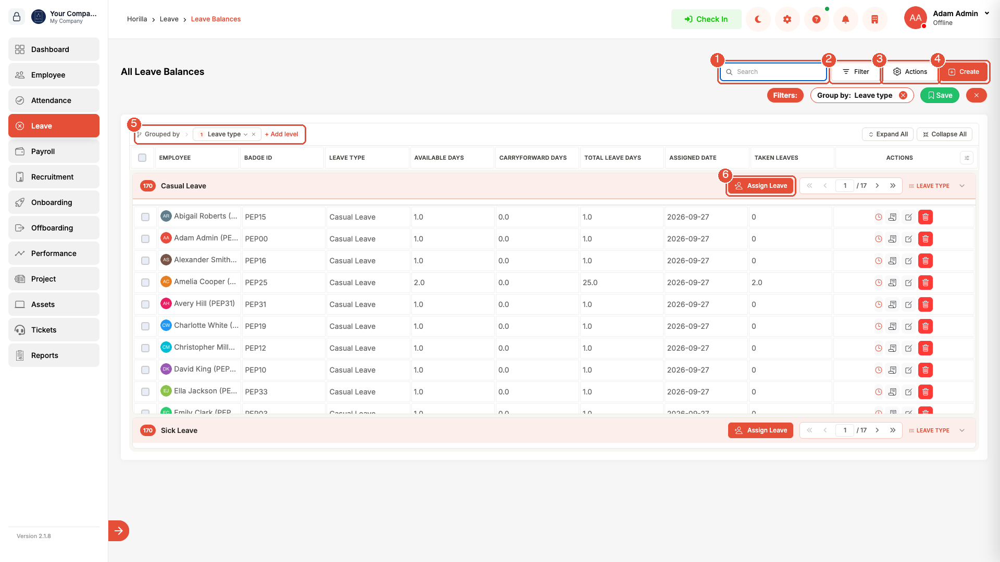

# **Leave Balances**

**Leave Balances** records which leave types each employee holds and how many days they have available, carried forward and taken. It is where an administrator gives a leave type to employees. Open it from **Leave → Leave Balances**.

## **The page**

1. **Search** box.
2. **Filter** by **Name or Badge ID**, **Employees**, **Leave Type**, **Available Days**, **Carryforward Days**, **Total Leave Days** (each with a greater-or-equal and a less-or-equal range) and **Assigned Date**.
3. **Actions** offers **Import**, **Export** and **Delete**.
4. **Create** opens the assignment form.
5. **Grouped by** shows how the list is organised. It opens grouped by **Leave type**; use **+ Add level** to group further, **Expand All** / **Collapse All** to open or close groups, or remove the grouping.
6. **Assign Leave** in a group header assigns that leave type.

Each group header shows how many balances it holds (170 per leave type in the demo) and its own page controls. The table columns are **Employee, Badge ID, Leave Type, Available Days, Carryforward Days, Total Leave Days, Assigned Date, Taken Leaves** and **Actions**.

## **Row actions**

Each balance row has icons for **History** (the record's change history), **Leave Ledger** (a ledger view for that balance), **Edit** and **Delete**.

## **Assign a leave type**

1. Click **Create**, or **Assign Leave** in a group.
2. Choose one or more **Leave Type** values. The field is required and accepts several.
3. Choose one or more employees. The employee picker has a **Filter** to narrow the list, with criteria such as company, department, shift, job position, work type and reporting manager.
4. Save.

An employee needs a balance for a leave type before they can request it.

::: info Not tested
Saving an assignment, **Import**, **Edit** and **Delete** change balances for real employees and were not exercised on the demo, so the messages and results of those actions are not shown here.
:::
