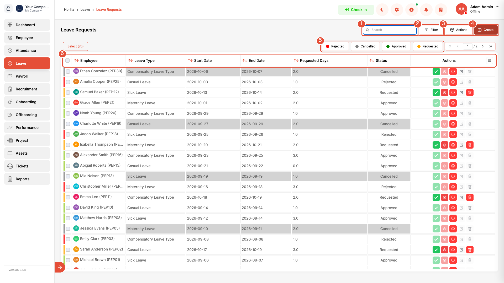
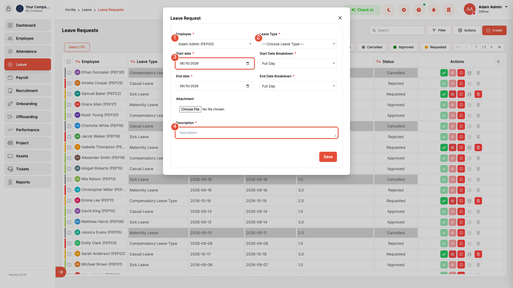

# **Leave Requests**

**Leave Requests** is the organisation-wide list of leave requests, where an administrator reviews, approves, rejects or creates requests for employees. Open it from **Leave → Leave Requests**.

## **The page**

1. **Search** box.
2. **Filter** opens a panel with: **Name or Badge ID**, **Leave Type**, **Start Date**, **End Date**, **Status**, and a **Work Info** section (**Employee, Company, Department, Job Position, Job Role, Shift, Work Type, Reporting Manager, Employee Type**). **Advanced** adds more criteria, and **Group By** groups the list.
3. **Actions** offers **Bulk Approve**, **Export** and **Delete** for the rows you tick.
4. **Create** adds a request on behalf of an employee.
5. The coloured status dots (**Rejected**, **Cancelled**, **Approved**, **Requested**) filter by status.
6. The table: **Employee** (with badge ID), **Leave Type**, **Start Date**, **End Date**, **Requested Days** and **Status**. The demo holds 70 requests across two pages, and **Select (70)** selects them all for a bulk action.

## **Row actions by status**

Each row has icons at the right. What is available depends on the request's status:

| Status | **Approve** | **Reject** | **Penalty** | **Edit** | **Delete** |
|---|---|---|---|---|---|
| *Requested* | Available | Available | Available | Available | Available |
| *Approved* | Not available | Not available | Available | Not available | Not available |
| *Rejected* | Not available | Not available | Available | Not available | Not available |
| *Cancelled* | **Approve cancellation request** | Not available | Available | Available | Not available |

This is how the buttons appeared on the demo's data; for approved requests the demo's dates have all passed.

In practice:

- **Approve** and **Reject** are for requests still in *Requested* status. **Approve** and **Delete** are also available in bulk from **Actions**.
- A *Cancelled* row offers **Approve cancellation request** in place of **Approve**.
- **Penalty** is available on every row; it is the entry point for recording a penalty against the employee's leave.

## **Create a request for an employee**

1. Click **Create**.

2. Fill in the form (same fields as [My Leave Requests](/hr/functional/v2.0/leave/my-leave-requests), plus the employee):

| Field | Required | Notes |
|---|---|---|
| **Employee** | Yes | Chosen from the employee list. It starts as you. |
| **Leave Type** | Yes | Lists the leave types the chosen employee holds. |
| **Start date**, **End date** | Yes | Default to today. |
| **Start Date Breakdown**, **End Date Breakdown** | Yes | **Full Day**, **First Half** or **Second Half**. |
| **Attachment** | No | Supporting file. |
| **Description** | Yes | Reason. |

3. Click **Save**.

## **Open a request**

Click a row to open its details: employee, department and job position, **Leave Type**, **Days**, **Start Date**, **End Date**, **Created Date**, **Created By** and the description.

## **Export**

**Export** is offered under **Actions**.
