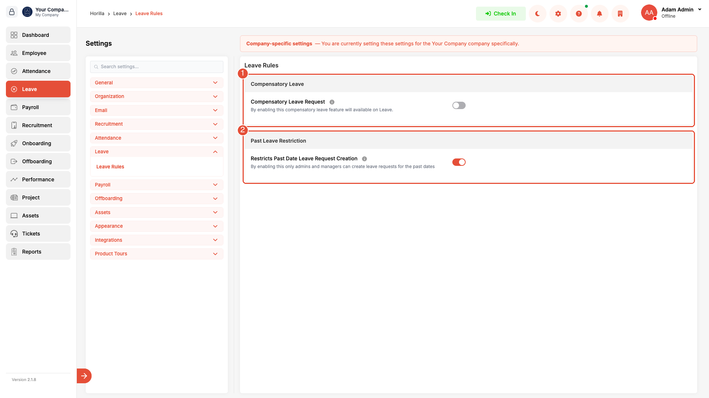
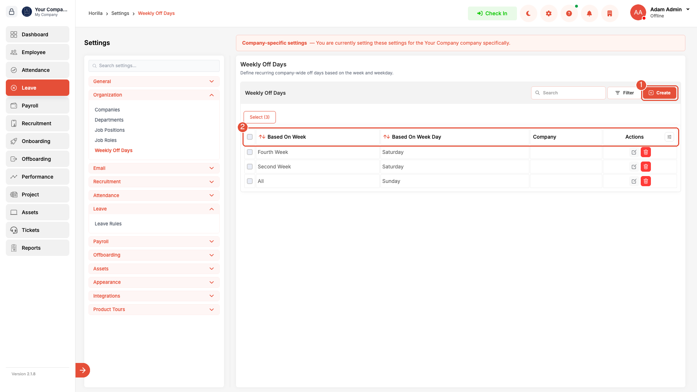

# **Leave Rules and Weekly Off Days**

Two Settings pages belong to the Leave module. Open Settings with the gear icon in the top bar.

## **Leave Rules**

**Settings → Leave → Leave Rules** has module-wide switches. The page applies to the company currently selected, and says so at the top (*You are currently setting these settings for the Your Company company specifically*).

1. **Compensatory Leave**, with the switch **Compensatory Leave Request**: *By enabling this compensatory leave feature will available on Leave.* In the demo this is **off**, which is why **Compensatory Leave Requests** does not appear in the Leave menu.
2. **Past Leave Restriction**, with the switch **Restricts Past Date Leave Request Creation**: *By enabling this only admins and managers can create leave requests for the past dates.* In the demo this is **on**.

## **Weekly Off Days**

**Settings → Organization → Weekly Off Days** defines recurring company-wide days off, based on the week of the month and the weekday. The page reads *Define recurring company-wide off days based on the week and weekday*.

1. **Create** adds a rule.
2. The table lists **Based On Week, Based On Week Day, Company** and **Actions** (**Edit** and **Delete**).

The demo has three rules: **Fourth Week / Saturday**, **Second Week / Saturday** and **All / Sunday** (every Sunday).

To add one, click **Create** and choose:

| Field | Required | Choices |
|---|---|---|
| **Based On Week** | No | **All, First Week, Second Week, Third Week, Fourth Week, Fifth Week** |
| **Based On Week Day** | Yes | **Monday** to **Sunday** |

::: info Not tested
Changing a switch or saving a weekly off day were not exercised, since they affect the whole demo. How weekly off days change attendance and leave day counts is not described here.
:::
