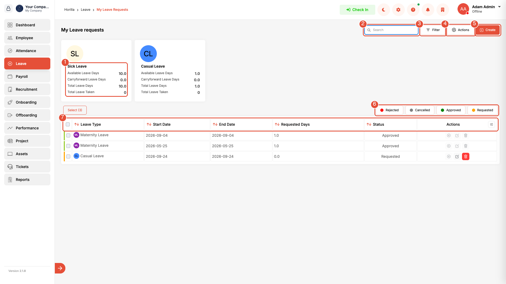
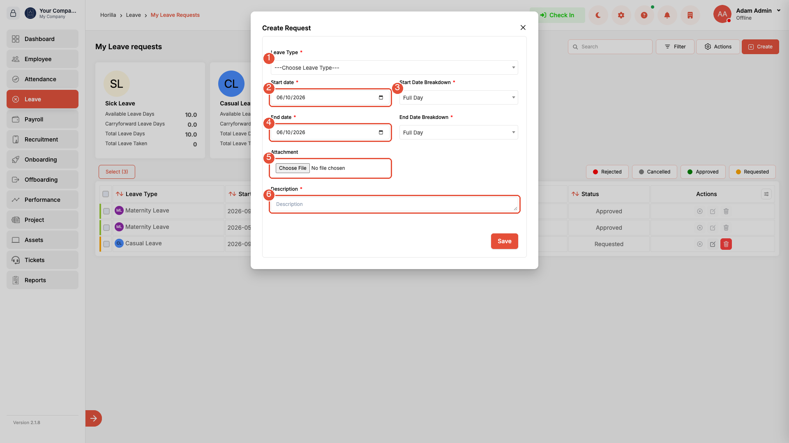

# **My Leave Requests**

**My Leave Requests** is where you see your own leave balances and apply for leave. Open it from **Leave → My Leave Requests**.

## **The page**

1. **Balance cards**: one for each leave type you hold. Each shows **Available Leave Days**, **Carryforward Leave Days**, **Total Leave Days** and **Total Leave Taken**. In the demo the administrator holds **Sick Leave** (10 days) and **Casual Leave** (1 day).
2. **Search** box.
3. **Filter** by **Leave Type** and **Status** (*Requested, Approved, Cancelled, Rejected*). **Advanced** adds a **From date** and **To date**, and you can **Group By**.
4. **Actions** offers **Delete** for the rows you tick.
5. **Create** opens the leave request form.
6. The coloured status dots (**Rejected**, **Cancelled**, **Approved**, **Requested**) filter the list to one status when clicked.
7. The table: **Leave Type**, **Start Date**, **End Date**, **Requested Days** and **Status**, with row actions on the right.

## **Apply for leave**

1. Click **Create**.

2. Fill in the form:

| Field | Required | Notes |
|---|---|---|
| **Leave Type** | Yes | Lists only the leave types you hold a balance for (here **Sick Leave** and **Casual Leave**). |
| **Start date** | Yes | Defaults to today. |
| **Start Date Breakdown** | Yes | **Full Day**, **First Half** or **Second Half**. |
| **End date** | Yes | Defaults to today. |
| **End Date Breakdown** | Yes | **Full Day**, **First Half** or **Second Half**. |
| **Attachment** | No | A supporting file, for example a medical certificate. |
| **Description** | Yes | The reason for the leave. |

3. Click **Save**.

If the leave type needs approval, the request is created with status *Requested* until it is decided. Dates that fall inside a [restricted period](/hr/functional/v2.0/leave/restricted-leave-periods) that applies to you are blocked.

## **Changing or withdrawing a request**

The row actions depend on the request's status:

| Status | **Cancel** | **Edit** | **Delete** |
|---|---|---|---|
| *Requested* | Not available | Available | Available |
| *Approved*, dates already passed | Not available | Not available | Not available |

An approved request whose dates are still ahead is the case that offers **Cancel**; the demo has no such request to show, so that behaviour is not illustrated here.

Clicking a card in the balance row opens the leave request form.
