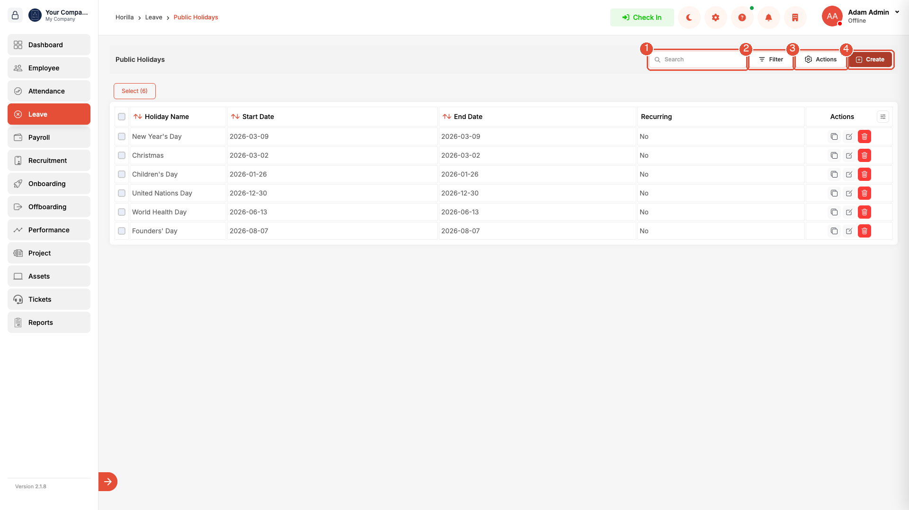
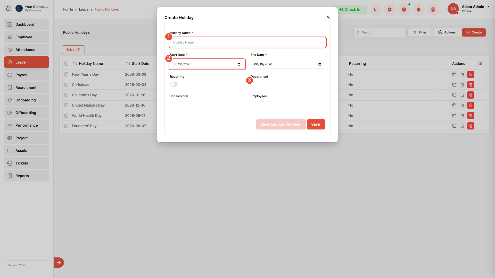

# **Public Holidays**

**Public Holidays** is the company holiday calendar. Open it from **Leave → Public Holidays**.

## **The page**

1. **Search** box.
2. **Filter** by **Holiday** (name) and **Recurring** (*Unknown, Yes, No*); **+ Add filter** adds more.
3. **Actions** offers **Import**, **Export** and **Delete**.
4. **Create** adds a holiday.

The table lists **Holiday Name, Start Date, End Date, Recurring** and **Actions**. Each row has **Duplicate**, **Edit** and **Delete**. The demo holds six holidays, such as **Christmas** and **Founders' Day**, none marked recurring.

Upcoming holidays also appear on the [main dashboard](/hr/functional/v2.0/dashboard) and the [Leave Dashboard](/hr/functional/v2.0/leave/dashboard).

## **Add a holiday**

| Field | Required | Notes |
|---|---|---|
| **Holiday Name** | Yes | For example *Christmas*. |
| **Start Date**, **End Date** | Yes | Use the same date for a one-day holiday. |
| **Recurring** | No | Switch on if the holiday repeats every year. |
| **Department** | No | Limit the holiday to chosen departments. |
| **Job Position** | No | Limit it to chosen positions. |
| **Employees** | No | Limit it to chosen employees. |

Click **Save**. **Duplicate** on a row is for creating a similar holiday from an existing one.

::: info Not tested
Saving, importing and deleting holidays were not exercised on the demo. How a holiday affects leave day counts and attendance is not described here.
:::
