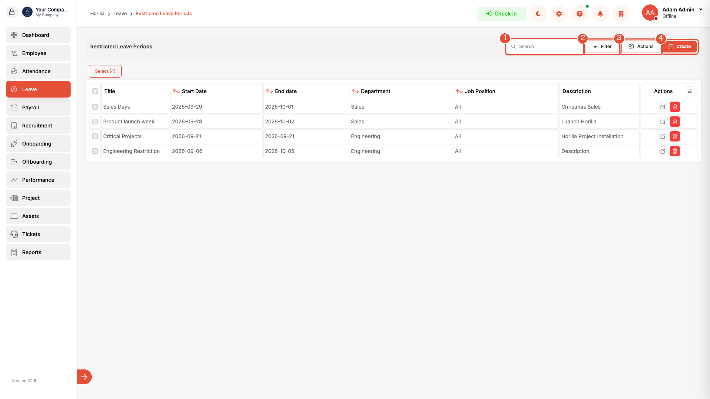
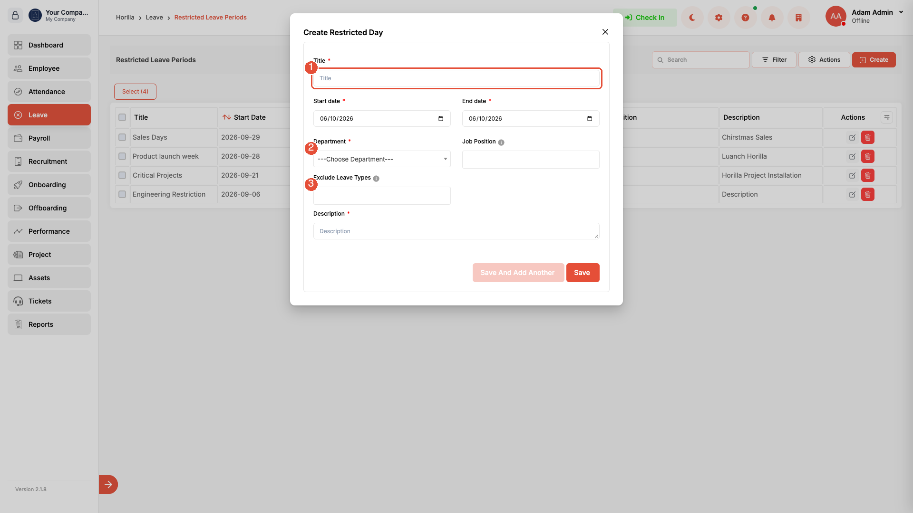

# **Restricted Leave Periods**

A restricted leave period blocks leave requests over a date range, for example during a product launch or a year-end close. Open it from **Leave → Restricted Leave Periods**.

## **The page**

1. **Search** box.
2. **Filter** by **Title**, **Include All** (*Unknown, Yes, No*), and, under **Work Information**, **Department** and **Job Position**.
3. **Actions** offers **Delete** for ticked rows.
4. **Create** adds a restricted period.

The table lists **Title, Start Date, End date, Department, Job Position** and **Description**. In the demo there are four, for example **Sales Days** (Sales, 2026-09-29 to 2026-10-01) and **Engineering Restriction** (Engineering, 2026-09-06 to 2026-10-05). **All** in the **Job Position** column means the period applies to every position in the department. Each row has **Edit** and **Delete**.

## **Create a restricted period**

| Field | Required | Notes |
|---|---|---|
| **Title** | Yes | A short name, for example *Product launch week*. |
| **Start date**, **End date** | Yes | The range being blocked. Default to today. |
| **Department** | Yes | The department the restriction applies to. |
| **Job Position** | No | Narrow it to chosen positions within the department. Leave empty for all. |
| **Exclude Leave Types** | No | Leave types that may still be requested during the period. |
| **Description** | Yes | Why the period is restricted. |

Click **Save**.

::: info Not tested
Creating, editing and deleting were not exercised on the demo, and a blocked request was not attempted, so the message an employee sees is not shown here.
:::
