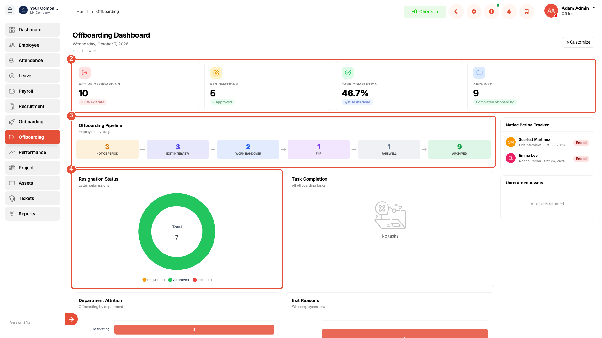
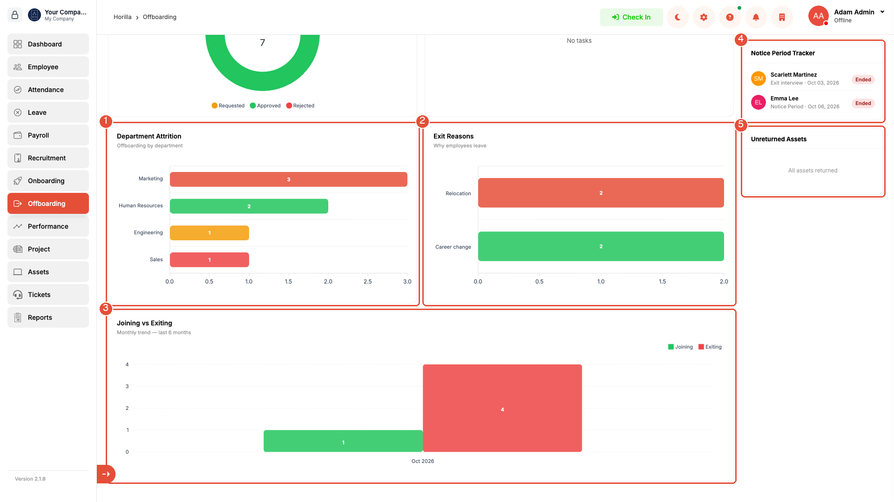

# **Offboarding Dashboard**

The Offboarding Dashboard summarises exits. Open it from **Offboarding → Dashboard**. **Customize** opens a panel to choose the widgets.

1. **Customize** opens the widget panel.
2. Four summary cards:

   | Card | Reads in the demo | Caption |
   |---|---|---|
   | **Active Offboarding** | 10 | *5.3% exit rate* |
   | **Resignations** | 5 | *7 Approved* |
   | **Task Completion** | 46.7% | *7/15 tasks done* |
   | **Archived** | 9 | *Completed offboarding* |

3. **Offboarding Pipeline** (*Employees by stage*) counts people in each stage, with arrows showing the order: **Notice Period** (3), **Exit Interview** (3), **Work Handover** (2), **FNF** (1), **Farewell** (1) and **Archived** (9).
4. **Resignation Status** (*Letter submissions*) splits resignation letters into **Requested, Approved** and **Rejected** (7 in total).

1. **Department Attrition** (*Offboarding by department*).
2. **Exit Reasons** (*Why employees leave*), for example **Relocation** and **Career change**.
3. **Joining vs Exiting** (*Monthly trend, last 6 months*) compares joiners and leavers per month.
4. **Notice Period Tracker** lists people in or near their notice period with the stage and date, for example *Exit interview, Oct 03, 2026, Ended*.
5. **Unreturned Assets**, or **All assets returned**.

The page also has a **Task Completion** widget (*All offboarding tasks*), which reads **No tasks** in the demo.

::: info Not tested
Where cards lead was not checked. The **Resignations** card reads 5 beside *7 Approved*, so the card and its caption do not obviously agree; treat the resignation counts with care.
:::
