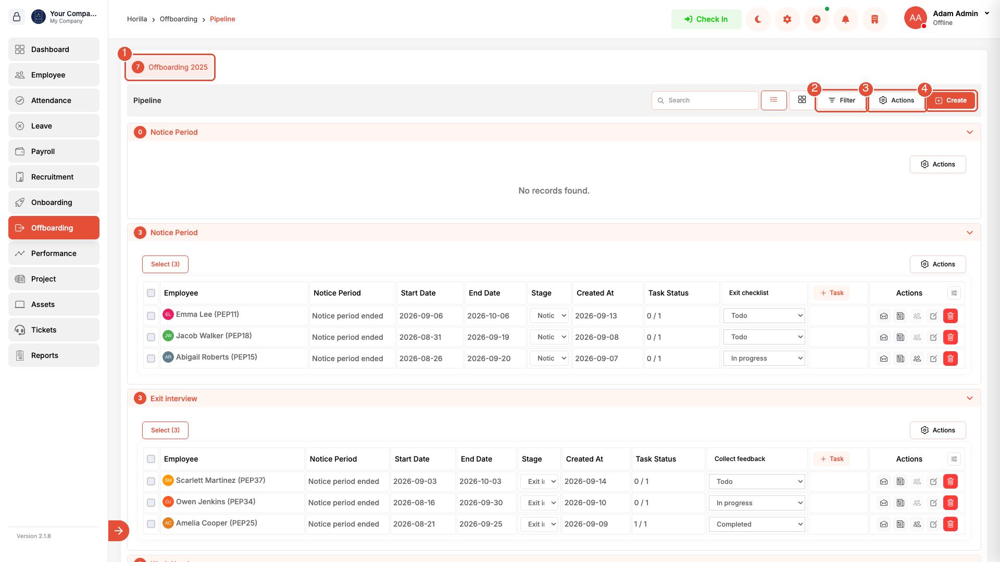
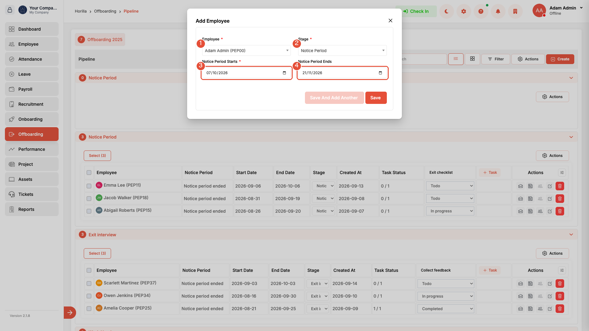

# **Exit Process**

The Exit Process is where each leaving employee is tracked through the stages of offboarding. Open it from **Offboarding → Exit Process**.

1. A tab for each offboarding process, with a count (in the demo **Offboarding 2025**, 7).
2. **Filter** opens a panel with **Employee, Department, Job Position, Job Role, Employee Type, Shift** and **Work Type**, plus **Advanced** options.
3. **Actions** offers **Add Stage, Manage Stage Order, Edit** and **Delete**.
4. **Create** adds an employee to the process.

The header also has a **Search** box and a switch between the list and card layouts. The pipeline is a set of collapsible stage sections: **Notice Period, Exit interview, Work Handover, FNF, Farewell** and **Archived**. (The demo has two stages both named **Notice Period**; the first is empty.) Each section has its own **Actions** menu and a table:

| Column | What it shows |
|---|---|
| **Employee** | The person leaving |
| **Notice Period** | The notice status, for example *Notice period ended* |
| **Start Date**, **End Date** | The notice period |
| **Stage** | The employee's current stage, shown as a drop-down in the row |
| **Created At** | When the employee entered the process |
| **Task Status** | Tasks done out of tasks, for example *0 / 1* |
| A column named for the stage's task | For example **Exit checklist** or **Collect feedback**, with a status drop-down (*Todo, In progress, Stuck, Completed*) |
| **+ Task** | Adds a task to the stage |
| **Actions** | **Send Mail, Notes, Show managing records, Edit, Delete** |

## **Add an employee**

| Field | Required | Notes |
|---|---|---|
| **Employee** | Yes | Who is leaving. |
| **Stage** | Yes | The starting stage. |
| **Notice Period Starts** | Yes | Defaults to today. |
| **Notice Period Ends** | No | Pre-filled 45 days after the start in the demo. |

::: info Not tested
Adding an employee, changing a stage or a task status, and **Send Mail** were not exercised. What moving someone to **Archived** does to their record and access is not described.
:::
