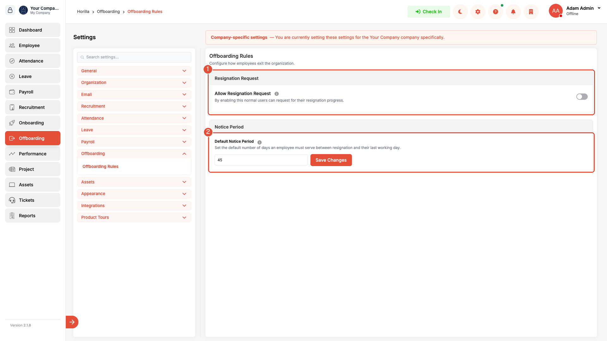

# **Offboarding Rules**

Open **Settings** with the gear icon, then **Offboarding → Offboarding Rules**. The page applies to the company currently selected and says so at the top. It is described as *Configure how employees exit the organization*.

1. **Resignation Request**, with **Allow Resignation Request**: *By enabling this normal users can request for their resignation progress.* **Off** in the demo.
2. **Notice Period**, with **Default Notice Period**: *Set the default number of days an employee must serve between resignation and their last working day.* **Save Changes** stores the value.

In the demo the **Offboarding** menu contains only **Dashboard** and **Exit Process**, and the resignation switch is off.

::: info Not tested
The switch and the notice period were not changed. How a resignation request is submitted and approved is not described, because that part of the product is not visible in the demo with the switch off.
:::
