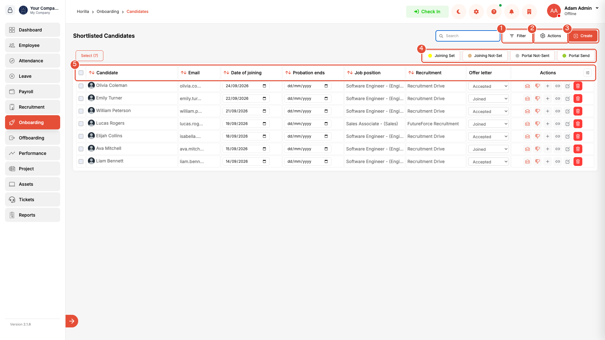

# **Onboarding Candidates**

This page lists the shortlisted candidates and records the details needed before they join. It is headed **Shortlisted Candidates**. Open it from **Onboarding → Candidates**.

1. **Filter** opens a panel with **Recruitment, Job Position, Rejection Reason, Portal Sent** (*Unknown, Yes, No*), **Joining Set** (*Unknown, Yes, No*) and **Offer Status** (*Not Sent, Sent, Accepted, Rejected, Joined*), plus **+ Add filter** and **Group By**.
2. **Actions** offers **Send Portal**.
3. **Create** adds a candidate.
4. The coloured dots (**Joining Set, Joining Not-Set, Portal Not-Sent, Portal Send**) filter by those states.
5. The table: **Candidate, Email, Date of joining, Probation ends, Job position, Recruitment, Offer letter** and **Actions**. The **Offer letter** column carries the five statuses (*Not Sent, Sent, Accepted, Rejected, Joined*) for each candidate. Each row has icons including **Send Mail**, **Add To Rejected Candidates** and **Added to Onboarding**.

The demo lists seven candidates, for example *Olivia Coleman* and *Lucas Rogers*.

## **Add a candidate**

**Create** opens a candidate form with, among others:

| Field | Required | Notes |
|---|---|---|
| **Name** | Yes | With an optional profile photo. |
| **Recruitment** | Yes | *Hiring Employees, FutureForce Recruitment, Recruitment Drive* in the demo. |
| **Job Position** | No | |
| **Source** | No | **Application Form, Inside software** or **Other**. |
| **Portfolio**, **Resume** | No | A link and a file. |
| **Email** | Yes | |
| **Mobile**, **Address**, **Country**, **State**, **Zip Code** | No | |

::: info Not tested
**Send Portal**, **Send Mail**, **Add To Rejected Candidates** and saving a candidate were not used, since they email real addresses or change records. The candidate portal that **Send Portal** refers to, and the **Candidate Portal** setting, are not described here.
:::
