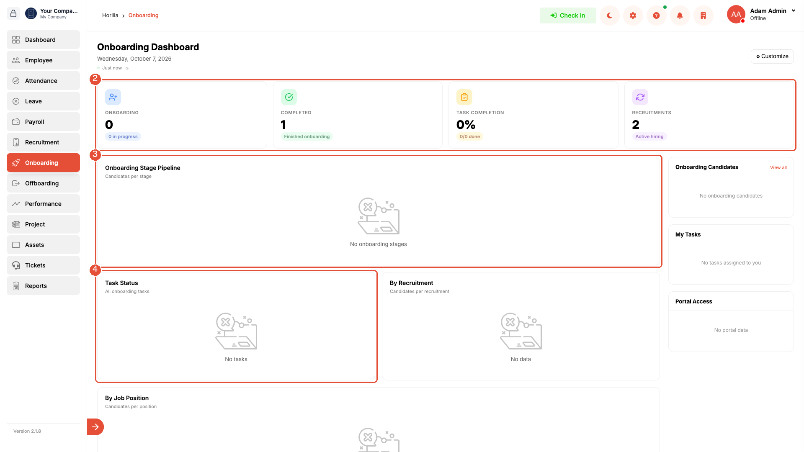
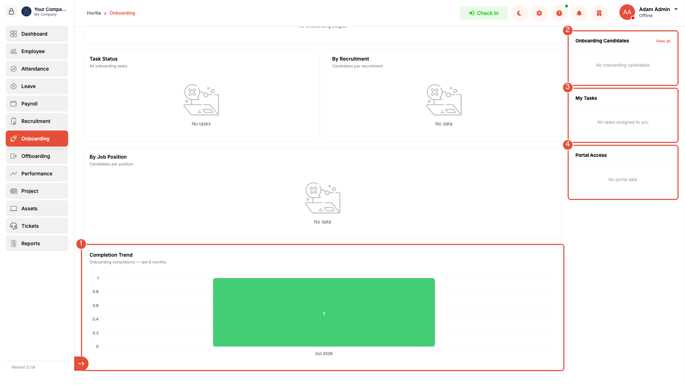

# **Onboarding Dashboard**

The Onboarding Dashboard summarises onboarding progress. Open it from **Onboarding → Dashboard**. **Customize** opens a panel to choose the widgets.

1. **Customize** opens the widget panel.
2. Four summary cards:

   | Card | Reads in the demo | Caption |
   |---|---|---|
   | **Onboarding** | 0 | *0 in progress* |
   | **Completed** | 1 | *Finished onboarding* |
   | **Task Completion** | 0% | *0/0 done* |
   | **Recruitments** | 2 | *Active hiring* |

3. **Onboarding Stage Pipeline** (*Candidates per stage*), or **No onboarding stages**.
4. **Task Status** (*All onboarding tasks*), or **No tasks**.

1. **Completion Trend** (*Onboarding completions, last 6 months*) charts completions per month.
2. **Onboarding Candidates** lists candidates being onboarded, with **View all**, or **No onboarding candidates**.
3. **My Tasks** lists onboarding tasks assigned to you, or **No tasks assigned to you**.
4. **Portal Access** (*No portal data* in the demo).

The page also has **By Recruitment** and **By Job Position** widgets (*Candidates per recruitment* and *per position*), which read **No data** in the demo.

::: info Not tested
Most widgets are empty in the demo because no candidate is currently in onboarding, so their populated appearance is not shown.
:::
