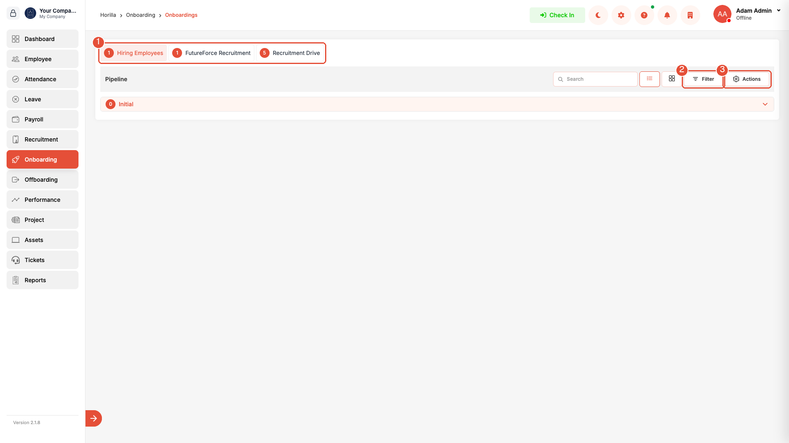

# **Onboarding Tasks**

Onboarding Tasks is the pipeline of onboarding stages and the tasks inside them. Open it from **Onboarding → Onboarding Tasks**.

1. A tab for each recruitment, with a count (in the demo **Hiring Employees**, **FutureForce Recruitment** and **Recruitment Drive**).
2. **Filter** opens a panel with **Candidate**, **Tasks**, **Task Status** (*Todo, Scheduled, Ongoing, Stuck, Done*), **Start Date** and **End Date**, **Portal Sent?**, **Joining Set?**, **Probation End** from and till, and **Interview Scheduled** from and till. The **Tasks** choices in the demo are *Complete Employment Paperwork, Attend Orientation Session, Set Up Laptop and Accounts, Complete Onboarding Training Modules* and *Submit First Assignment*.
3. **Actions** offers **Add Stage, Manage Stage Order, Edit** and **Delete**.

The header also has a **Search** box and a switch between the list and card layouts. The pipeline is a set of collapsible stage sections, each with a count (here **Initial**, with none in it).

## **Add a stage**

**Actions → Add Stage** opens a form with a **Stage Title** and the employees who manage the stage, both required. **Manage Stage Order** reorders the stages.

::: info Not tested
Adding or editing stages and tasks was not exercised, and the demo has no candidates in onboarding, so cards moving through stages and the task statuses on a card are not illustrated.
:::
