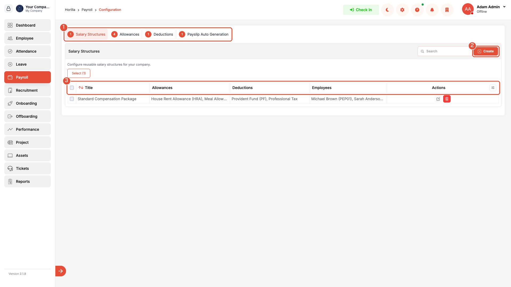
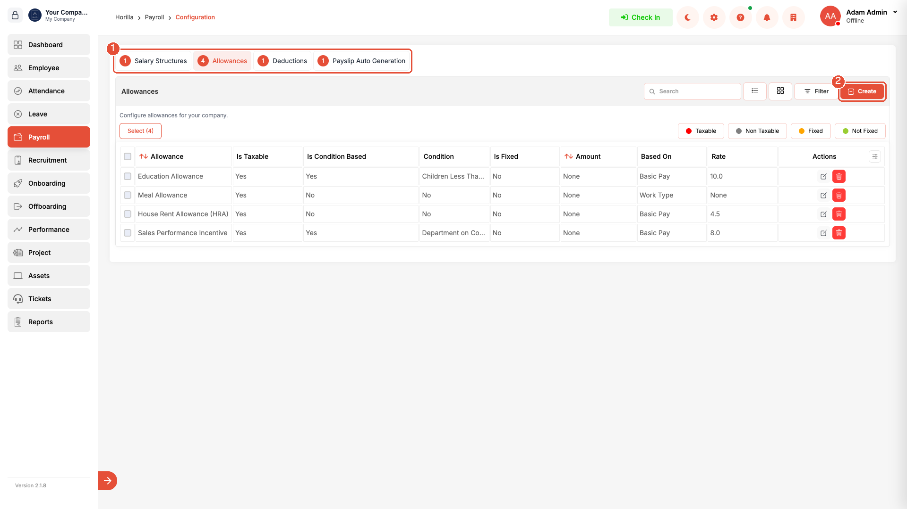
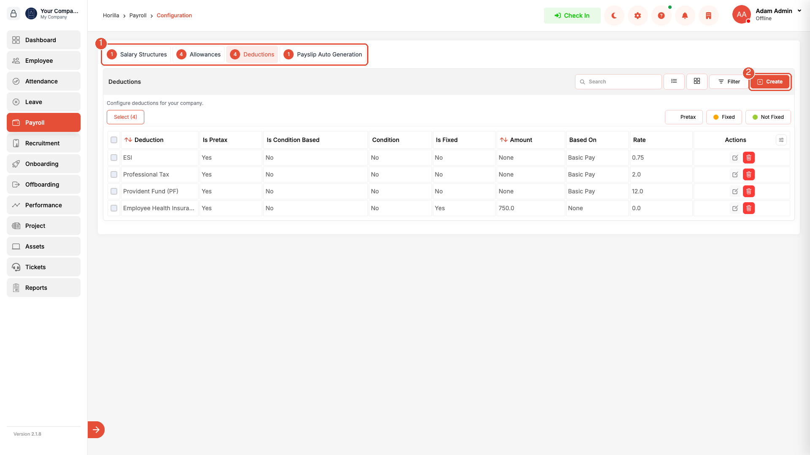
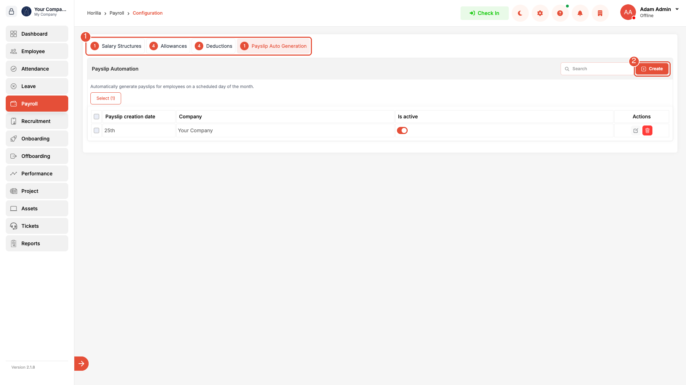
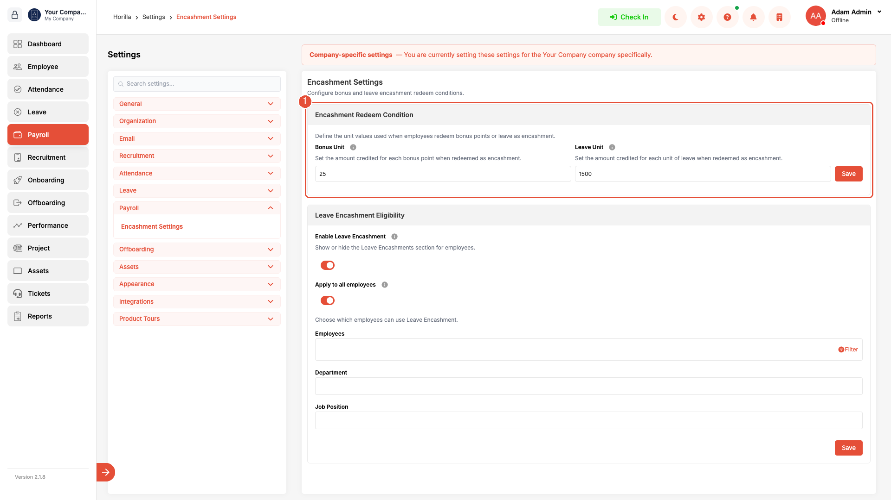

# **Payroll Configuration**

**Payroll → Configuration** holds the building blocks of pay. It has four tabs: **Salary Structures, Allowances, Deductions** and **Payslip Auto Generation**. A fifth set of rules, **Encashment Settings**, lives under **Settings → Payroll**.

## **Salary Structures**

*Configure reusable salary structures for your company.* A salary structure bundles allowances and deductions so they can be given to many employees at once.

1. The tabs.
2. **Create** adds a structure.

The table lists **Title, Allowances, Deductions, Employees** and **Actions** (**Update**, **Delete**). The demo has one, **Standard Compensation Package**. The form has **Title** (required) and multi-selects for **Allowances**, **Deductions** and **Employees**.

## **Allowances**

*Configure allowances for your company.* An allowance adds to pay. The table lists **Allowance, Is Taxable, Is Condition Based, Condition, Is Fixed, Amount, Based On, Rate** and **Actions**. The demo has **Sales Performance Incentive, House Rent Allowance (HRA), Meal Allowance** and **Education Allowance**.

The allowance form has these switches and fields:

| Field | Notes |
|---|---|
| **Title** (required) | The allowance's name. |
| **Is Taxable** | On by default. |
| **Is Fixed** | On by default. The form has an **Amount** field, and **Based On** and **Rate** fields for allowances that are not a fixed amount. |
| **One Time Date** | Pays the allowance once, on this date. |
| **Based On** | **Basic Pay, Children, Regular Overtime, Week Off Overtime, Holiday Overtime, Shift, Work Type** or **Attendance**. Some choices ask for extra amounts (per attendance, per child, per shift, per hour, per work type). |
| **Has Max Limit For Allowance** | Reveals **Maximum Amount** and **Maximum Unit** (*For working days on month*). |
| **Is Condition Based** | Reveals a condition: **Field** (*Children, Marital Status, Experience, Company Experience, Gender, Country, State, Pay Frequency, Wage Type*), **Condition** (*Equal, Not Equal, Less Than, Greater Than, and so on*), **Value**, and **If Choice**. |

## **Deductions**

*Configure deductions for your company.* A deduction subtracts from pay. The table lists **Deduction, Is Pretax, Is Condition Based, Condition, Is Fixed, Amount, Based On, Rate** and **Actions**. The demo has **Employee Health Insurance, Provident Fund (PF), Professional Tax** and **ESI**.

The deduction form mirrors the allowance form, with these differences:

| Field | Notes |
|---|---|
| **Is Tax** | Marks the deduction as a tax. Off by default. |
| **Is Pretax** | On by default. |
| **Update Compensation** | **Basic pay, Gross Pay** or **Net Pay**. |
| **Based On** | **Basic Pay, Gross Pay, Taxable Gross Pay** or **Net Pay**. |
| **Employee Rate**, **Employer Rate** | Percentages, for a rate-based deduction. |
| **If Choice**, **If Condition**, **If Amount**, **Start Range**, **End Range** | A second condition that can use a range. **If Amount** is required. |

## **Payslip Auto Generation**

*Automatically generate payslips for employees on a scheduled day of the month.* The table lists **Payslip creation date, Company, Is active** and **Actions**. The form has **Payslip Generate Day** (*Last Day, 1st, 2nd, 3rd* and so on) and an **Auto Generate** switch.

## **Encashment Settings**

Open **Settings → Payroll → Encashment Settings**.

*Configure bonus and leave encashment redeem conditions.*

- **Encashment Redeem Condition**: *Define the unit values used when employees redeem bonus points or leave as encashment.* **Bonus Unit** is the amount credited for each bonus point, and **Leave Unit** the amount credited for each unit of leave. **Save** stores them.
- **Leave Encashment Eligibility**: **Enable Leave Encashment** (*Show or hide the Leave Encashments section for employees*, on in the demo) and **Apply to all employees** (on in the demo), with a list of employees to choose from when it is switched off.

::: info Not tested
Creating or editing salary structures, allowances, deductions and auto-generation, and changing encashment settings, were not exercised. How an allowance or deduction is calculated into a payslip was not verified; the fields above are described by their labels.
:::
